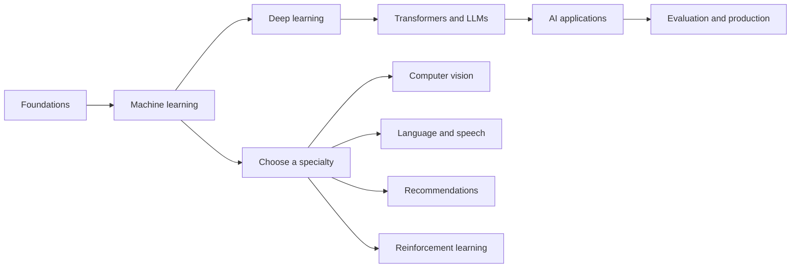

## The big idea

New to the terminology? Read [What Is Artificial Intelligence?](/learn/ai/what-is-artificial-intelligence) first, then return to this roadmap.

AI is a broad field, not one tool or one course. A useful way to learn it is to move from **data and problem framing**, to **models**, then to **reliable products**. You do not need to master every branch before building something useful.

## A sensible learning order

1. **Programming and data:** Be comfortable writing small programs, using functions, lists, dictionaries, files, APIs, and tests. Python is the most common language for model experiments; SQL and basic data visualization are useful too.
2. **Math you can use:** Learn vectors and matrices, probability, averages and variance, derivatives, and the idea of optimization. Build intuition with examples; you rarely need advanced proofs to start.
3. **Machine learning:** Understand features, labels, training, validation, test sets, loss, overfitting, and metrics. Learn how to compare a model against a simple baseline.
4. **Deep learning:** Study neural networks, gradient descent, embeddings, and why GPUs help. Then explore the model family relevant to your goal.
5. **Generative AI:** Learn tokens, transformers, context windows, prompting, structured outputs, embeddings, retrieval-augmented generation (RAG), and tool use.
6. **Reliable delivery:** Evaluate quality, protect data, address abuse and prompt injection, manage latency and cost, and monitor changes after release.

## Pick the kind of AI work you want

| Goal | Focus on |
| --- | --- |
| Add AI to a product | APIs, prompting, structured outputs, RAG, evaluation, privacy, and cost |
| Train predictive models | Python, SQL, statistics, feature engineering, scikit-learn, and experiment design |
| Build deep-learning models | Linear algebra, PyTorch, neural networks, GPU basics, and model training |
| Work with images or video | Convolutional models, vision transformers, image data, and evaluation |
| Work with language or speech | NLP, transformers, tokenization, retrieval, and speech pipelines |
| Research new methods | Strong math, paper reading, experiment reproduction, and rigorous measurement |

## What to build while learning

Follow these hands-on lessons alongside the conceptual path:

- [Python and math foundations](/learn/ai/python-and-math-lab): runnable vectors, normalization, similarity, and metrics.
- [Train your first model](/learn/ai/train-your-first-model): a complete regression experiment with a baseline and held-out evaluation.
- [AI specialties and examples](/learn/ai/ai-specialties-and-real-world-examples): vision, language, speech, recommendations, forecasting, and reinforcement learning.
- [Developer plan and capstone](/learn/ai/developer-roadmap-and-capstone): staged deliverables and a runnable local document-search project.

Make small projects that answer a real question: classify support requests, estimate delivery times, search a private set of documents, or summarize a known collection of text. Write down what a good answer means, create a baseline, keep examples that expose failures, and test on data the model did not train on.

For an LLM app, begin with a single clear task and a few representative examples. Add retrieval or tools only when the basic version cannot meet the requirement. A larger model is not automatically a better system.

## What you can postpone

You do not need to train a frontier-scale model, memorize every architecture, or learn every AI framework before getting started. First become good at framing problems, handling data, measuring outcomes, and understanding failure modes. Those skills transfer when tools change.

## Key takeaways

- AI includes multiple specialties; choose a direction after learning the shared foundations.
- Python, data handling, basic statistics, and careful evaluation pay off across the field.
- Learn classic machine learning before treating LLMs as the whole of AI.
- Building a useful AI feature includes safety, privacy, reliability, latency, and cost, not just model output.
- Follow the lessons in order for a broad path, or jump to the area that matches your project.
