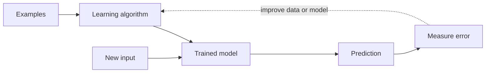

## The big idea

In traditional programming, a developer writes rules that turn inputs into outputs. In machine learning, we provide examples and an objective, and an algorithm fits a model that captures useful patterns.



## The main learning setups

| Setup | What examples contain | Example |
| --- | --- | --- |
| **Supervised** | Inputs and known target labels | Predict whether a payment is fraudulent |
| **Unsupervised** | Inputs without target labels | Group similar articles into clusters |
| **Self-supervised** | Targets derived from the data itself | Predict the next token in a text sequence |
| **Reinforcement** | Actions, rewards, and environment feedback | Learn a policy for a simulated robot |

Classification predicts a category; regression predicts a number. A spam detector is classification. Estimating a home's sale price is regression.

## Train, validate, test

The **training set** fits model parameters. The **validation set** helps select models and settings. The **test set** estimates how the final choice performs on data kept out of those decisions. Repeatedly tuning against the test set leaks information and makes its score too optimistic.

```text
all labeled examples
  ├── training: learn parameters
  ├── validation: choose settings
  └── test: final, once-in-a-while estimate
```

Always compare with a baseline: predict the majority class, use a simple rule, or predict the training average. If a complex model cannot beat a reasonable baseline on a trustworthy test set, complexity is not helping.

## Loss and metrics

Training minimizes a **loss**: a numeric penalty that says how wrong the model is according to its objective. Evaluation metrics answer whether that objective matches the actual product need.

For an imbalanced fraud dataset, accuracy can mislead: a model that calls every transaction legitimate may be 99% accurate and still catch no fraud. Precision asks, “Of the alerts, how many were truly fraud?” Recall asks, “Of the fraud, how much did we catch?” The right tradeoff depends on the cost of missed fraud versus investigating a false alert.

## Generalization and overfitting

A model should work on **unseen examples** from the population it will encounter. If training performance is excellent but validation performance is poor, it may have memorized quirks of the training set. More representative data, simpler models, regularization, or better features may help.

### A simple prediction example

```python
# Imagine a model trained on past deliveries.
features = {"distance_km": 8.2, "hour": 17, "rain_mm": 3.0}
predicted_minutes = model.predict(features)
```

The prediction is useful only if the input fields are available at prediction time, measured consistently, and representative of future deliveries.

## Key takeaways

- A model learns patterns from examples; it does not automatically understand the real-world cause behind them.
- Keep training, validation, and test data conceptually separate.
- Choose metrics based on the cost of mistakes, not on what is easiest to report.
- Establish a simple baseline and look for overfitting before reaching for a larger model.