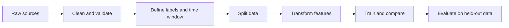

## The big idea

Model quality is limited by the data and the question you give it. A training pipeline should make the same transformations at training and prediction time, preserve the meaning of each example, and avoid exposing information that would not exist when a real prediction is made.

## Define the example first

Write down what one row represents, when its prediction is made, and what outcome it predicts. For example: “At the moment an order is placed, estimate whether it will arrive late.” This clarifies which information is available and how to create the label.

Check for missing values, duplicates, inconsistent units, stale records, skewed classes, and labels that are ambiguous or wrong. Keep a record of where data came from, what it means, and whether it may be used for this purpose.

## Prevent data leakage

**Leakage** occurs when training uses information that would not legitimately be available for a real prediction, or when information from the test set influences training. It makes offline results look better than the deployed model will perform.

Examples:

- Predicting loan default using a field populated only after the loan defaults.
- Randomly splitting records from the same person across train and test when the real goal is to generalize to new people.
- Computing a normalization average over all rows before making the train/test split.

For time-dependent questions, split by time: train on the past and test on a later period. Fit preprocessing steps on training data only, then apply those fitted steps to validation, test, and production inputs.

## Features and preprocessing

Features are the inputs used by a model. Useful feature work often means making values consistent and meaningful: normalize units, encode categories, handle missingness explicitly, or extract a date's weekday. Avoid transformations that smuggle in the answer.

Keep preprocessing reproducible and versioned alongside the model. A fitted encoder or vocabulary is part of the model artifact; independently rebuilding it in production can change the meaning of inputs.

## Run a useful experiment

Change one meaningful thing at a time, save the data version and settings, and record the metric on the same validation set. Include the baseline and the reason you expect a change to help. This makes a result understandable and repeatable instead of a lucky notebook run.

## Key takeaways

- Define the prediction moment, example, and label before preparing features.
- Split data before fitting transformations; use time-based or entity-based splits where appropriate.
- Watch for target leakage and train-serving differences.
- Track data, code, settings, and metrics so experiments can be reproduced.