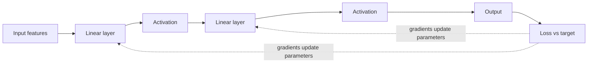

## The big idea

A neural network is a composition of parameterized functions. Each layer transforms its input; training adjusts the parameters so the network's output reduces a chosen loss on examples.

## Neurons, layers, and activations

A linear layer combines inputs with learned weights and a bias. An **activation function** adds nonlinearity, allowing stacked layers to represent more than one linear transformation. The final layer and loss depend on the task: a class probability, a continuous value, or another output shape.

The network's parameters are the weights and biases learned from data. **Hyperparameters** are choices made by the practitioner, such as learning rate, batch size, and number of layers.

## How training updates a model

1. A **forward pass** computes predictions from a batch of examples.
2. A **loss function** compares predictions with targets.
3. **Backpropagation** computes how each parameter contributed to the loss.
4. An **optimizer** updates parameters, often using a form of gradient descent.

If the learning rate is too high, updates may overshoot; if too low, training can be very slow. Training and validation curves help distinguish optimization problems from overfitting.

## Embeddings and model families

An embedding represents an item as a vector, so useful relationships can be reflected in geometric distance. Embeddings are used for words, images, users, products, and documents.

Different architecture families suit different data and tasks: convolutional networks have been useful for images, recurrent networks process sequences step by step, and transformers use attention to relate positions in a sequence. These are starting points, not guarantees that one architecture is best for every task.

## When deep learning is a good fit

Deep learning can excel with large, complex data such as images, audio, and text, especially when a pretrained model is available. For smaller structured tables, simpler tree-based or linear models can be faster, easier to explain, and just as effective. Start with the problem and a baseline, not with the most fashionable model.

## Key takeaways

- Neural networks learn parameters by repeatedly comparing predictions with a loss and updating weights.
- Activations let layers represent nonlinear relationships; embeddings turn items into useful vectors.
- Training behavior depends on data, objective, architecture, and optimization settings.
- Deep learning is a tool choice, not a default requirement.