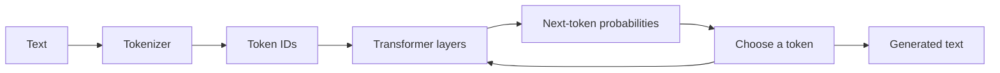

## The big idea

A large language model (LLM) is a neural network trained on text to predict tokens. Given a context, it estimates a distribution over what token might come next, then generates a sequence one step at a time. Fluent output is not proof that a statement is true.

## Tokens and context

Models process **tokens**, not words exactly. A token may be a word, part of a word, punctuation, or whitespace. The tokenizer maps text to token IDs; token limits therefore do not correspond to a fixed number of words.

The **context window** is the amount of input and generated content the model can consider in one request. Long context can help, but it increases cost and does not guarantee the model will reliably use every detail.

## What attention does

Transformer attention lets each position compute a weighted combination of information from other positions. This helps the model relate tokens across a sequence and process many positions in parallel during training. Modern models stack attention and feed-forward layers, with learned parameters shaped by training.

## Training stages

- **Pretraining:** learn broad statistical patterns from a large corpus, often through next-token prediction.
- **Instruction tuning:** train on examples of instructions and desired responses to improve task following.
- **Preference or alignment training:** use human or synthetic preferences to shape response behavior. This can improve usefulness but does not guarantee correctness or safety.
- **Inference:** use the trained model to generate output for a particular input.

Fine-tuning changes model parameters using additional examples. Retrieval instead supplies relevant external information in the prompt at inference time. These approaches solve different problems.

## Generation settings and limitations

Sampling settings such as temperature affect how output tokens are selected; lower randomness can make responses more repeatable but does not make them factually correct. Models can produce plausible errors, reflect gaps or bias in training data, and struggle with ambiguous instructions or unfamiliar facts.

Treat model output as a prediction to verify. For high-impact uses, add authoritative sources, human review, explicit validation, or a non-AI rule-based check.

## Key takeaways

- LLMs generate tokens from learned probability distributions conditioned on context.
- Token limits, context windows, and generation settings affect behavior and cost.
- Pretraining, instruction tuning, fine-tuning, and retrieval are distinct techniques.
- A confident, well-written answer can still be wrong; build verification into the application.