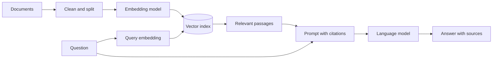

## The big idea

Retrieval-augmented generation (RAG) finds relevant material from a knowledge source and includes it in a model request. The model can then answer using supplied evidence instead of relying only on what it learned during training.

## Embeddings and similarity

An embedding model maps text to a vector. Texts with related meaning often have vectors that are close under a similarity measure such as cosine similarity. This supports semantic retrieval: a search for “change my password” may find a passage titled “account credential reset” even without shared keywords.

Embeddings are not a perfect measure of relevance. The embedding model, language, chunk size, and query all affect the results. Combine vector search with keyword search or metadata filters when they improve the task.

## A practical RAG pipeline

1. **Prepare sources:** collect allowed, current documents and preserve titles, URLs, access rules, and update times.
2. **Chunk:** split content into passages that retain enough context; keep a link to the original source.
3. **Index:** compute embeddings and store vectors plus metadata in a search index.
4. **Retrieve:** search with the user query, apply access controls, and select relevant passages.
5. **Generate:** tell the model to answer from those passages and cite the supporting sources.
6. **Evaluate:** measure retrieval relevance and answer correctness separately.

Chunking too small loses context; too large can bury the relevant sentence and consume the context budget. Overlap can preserve boundaries, but excessive overlap duplicates content and increases cost.

## Trust and access control

Retrieved text is data, not trusted instructions. Documents can contain prompt injection or stale claims. Enforce document permissions before retrieval, keep citations traceable, and avoid returning information the requester is not authorized to see. A model-generated citation must be checked against the actual retrieved source.

## Key takeaways

- RAG retrieves external material at answer time; it does not retrain the model.
- Retrieval quality and answer quality are separate things to evaluate.
- Preserve source metadata and enforce access control before content reaches the model.
- Cite evidence and treat retrieved documents as untrusted input.