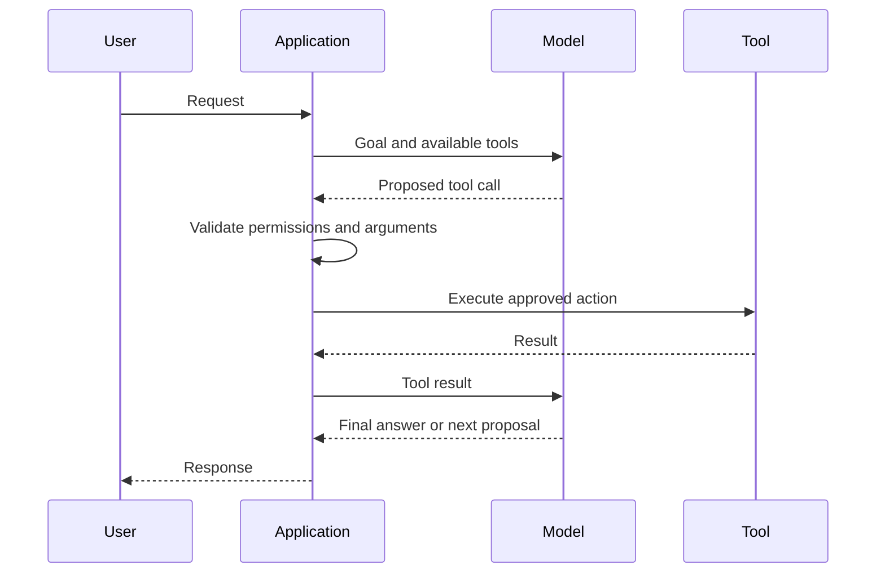

## The big idea

An AI agent is a system where a model selects actions, often by calling tools, and uses the results to continue toward a goal. The model proposes an action; application code should decide whether the action is valid and authorized.

## Tools are explicit capabilities

Give a model only the tools required for its task. Define narrow arguments, validate them, apply the user's permissions, and return only the necessary result. A “search orders” tool is safer than arbitrary database access; a “draft refund” action is safer than an unreviewed “issue any refund” action.

Treat tool calls as untrusted proposals. Check identity, authorization, schema, limits, and business rules in regular code. Require confirmation for sensitive or irreversible actions.

## Control the loop

Bound the number of model turns, tool calls, elapsed time, and token or monetary budget. Handle timeouts, duplicate calls, partial failures, and retries. Record enough trace information to understand what happened without logging secrets or unnecessary personal data.

For multi-step work, persist explicit workflow state and make side effects idempotent where possible. A long-running workflow with fixed stages is often more reliable as ordinary orchestration with an LLM at selected decision points than as a fully autonomous loop.

## When to use an agent

Use tool calling when a model needs to select from a small set of useful actions based on the request. Prefer a deterministic workflow when steps are known, outputs must be exact, or actions have high consequences. Autonomy is a risk and complexity decision, not a feature to maximize.

## Key takeaways

- The application, not the model, enforces identity, permissions, and business invariants.
- Tool definitions should be narrow; validate every proposed call and bound the loop.
- Add human approval for sensitive, costly, or irreversible actions.
- Prefer deterministic workflows when the process is known or risk is high.