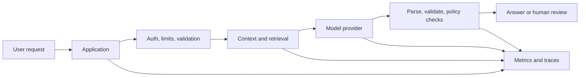

## The big idea

A production AI feature is a software system around a model: input validation, retrieval or context, provider calls, output checks, user experience, monitoring, and operational controls. The model is one dependency among several.

## Reliability and failure behavior

Model providers can time out, rate-limit requests, change behavior, or return malformed output. Set timeouts and bounded retries with backoff; retries should not repeat unsafe side effects. Provide a clear fallback: ask the user to retry, return a deterministic result, or route to a person.

Validate output at the boundary. For structured responses, parse against a schema and reject or repair invalid values within a limited policy. Do not allow a model response to bypass normal authorization or business rules.

## Latency and cost

Track requests, input and output tokens, retrieval work, model choice, latency, retries, and failures. Use the smallest model that meets measured quality needs. Trim irrelevant context, cap output length, cache only where privacy and freshness allow, and set per-user or per-workflow budgets.

## Versioning and monitoring

Version prompts, model identifiers, retrieval configuration, source data, and evaluation sets. Before release, run regression tests and compare quality, latency, and cost. Roll out changes gradually when possible and keep a rollback path.

Monitor aggregate quality signals and operational errors. User feedback can reveal problems, but it is not a substitute for a curated evaluation set. Keep traces useful for debugging while redacting secrets and minimizing personal data.

## Human review and release criteria

Decide which outputs may be shown directly, which require confirmation, and which must be reviewed by a qualified person. Make uncertainty and limitations visible in the product when they matter. Define an owner, incident path, and conditions for disabling the feature.

## Key takeaways

- Production quality depends on application design and operations, not model choice alone.
- Set timeouts, budgets, retries, validation, fallbacks, and human review deliberately.
- Version and evaluate prompts, models, retrieval, and data together.
- Monitor quality, latency, failures, and cost while respecting privacy.