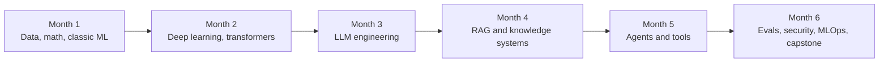
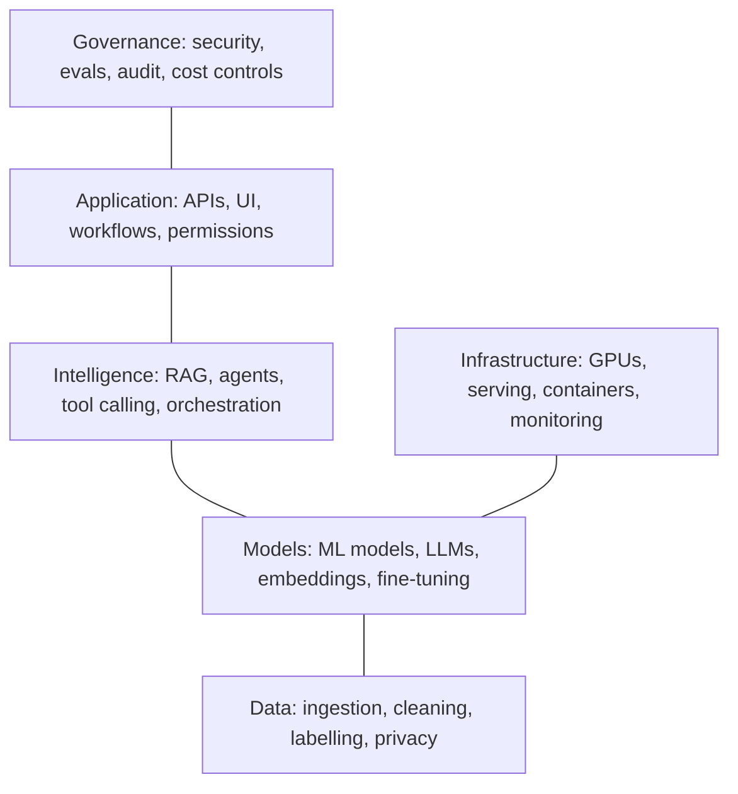

## The goal

You already know how to build large software systems. The gap to becoming an AI engineer or AI architect is not "learning to code again". It is learning how models learn, how LLMs behave, how to ground them in your data, how to let them act safely, and how to measure and run all of it in production.

The goal of this plan in one sentence:

> Become a software architect who can design, build, evaluate and deploy intelligent systems end to end: predictive ML, LLMs, RAG, agents, and the production infrastructure around them.

The plan takes **24 weeks at about 10 hours a week**. Every week has a lesson, five daily tasks, a weekend build and a checklist. The next six lessons hold one month each.



## The six months at a glance

| Month | Weeks | Focus | You can do this at the end |
| --- | --- | --- | --- |
| 1 | 1-4 | Python data stack, math intuition, classic ML | Train, evaluate and serve a seller-propensity model |
| 2 | 5-8 | Neural networks, PyTorch, embeddings, transformers | Explain attention and train a tiny GPT |
| 3 | 9-12 | LLM APIs, prompting, structured output, tools, cost | Ship a CRM copilot with tool calls and cost tracking |
| 4 | 13-16 | RAG with pgvector, hybrid search, reranking, evals | Run a tenant-safe knowledge assistant with citations |
| 5 | 17-20 | Agents, LangGraph, memory, approvals, guardrails | Ship a guarded research agent with human approval |
| 6 | 21-24 | Evaluation, security, fine-tuning, serving, MLOps | Deploy a full Lead Intelligence Platform |

## The weekly rhythm

| Day | Time | What you do |
| --- | --- | --- |
| Monday | 1.5 h | Read or watch the core lesson. Take notes in your own words. |
| Tuesday | 1.5 h | Code along with the lesson in a notebook. |
| Wednesday | 1.5 h | Do the exercise without looking at the solution. |
| Thursday | 1.5 h | Apply the idea to your own domain data (for example lead generation). |
| Friday | 1 h | Write a one-page summary and update the checklist. |
| Weekend | 3 h | Weekend build: a small working thing pushed to GitHub. |

## Rules that keep you moving

1. **Build every week.** A notebook or repository on GitHub is the proof you learned it. Watching is not learning.
2. **Learn the idea, then the tool.** Understand what vector search does before you choose Qdrant or pgvector.
3. **Use your own domain.** Property, owner and lead data make every exercise stick and become your portfolio.
4. **Go deep on one tool per area.** PyTorch, LangGraph and pgvector, deeply, beat five frameworks shallowly.
5. **Behind schedule? Cut scope, not weeks.** Skip stretch tasks, never the weekend build.
6. **Write it down.** One short blog post or internal note per month forces real understanding.

## One-time setup before Week 1

1. Install Python 3.12 and `uv`, a fast package manager:

   ```bash
   curl -LsSf https://astral.sh/uv/install.sh | sh
   ```

2. Create a learning repository:

   ```bash
   mkdir ai-journey && cd ai-journey
   uv init
   uv add numpy pandas matplotlib scikit-learn jupyterlab
   uv run jupyter lab
   ```

3. Create accounts: GitHub, Kaggle (free datasets and GPUs), Hugging Face, Google Colab (free GPU) and one LLM API provider such as Anthropic or OpenAI. Set a monthly spending limit of about $20.
4. Install Docker and PostgreSQL 16 or newer. You add pgvector in Month 4.
5. Install Ollama to run small open models on your laptop:

   ```bash
   curl -fsSL https://ollama.com/install.sh | sh
   ollama run llama3.2
   ```

## How each week is written

Every week in the month lessons has the same four parts:

- **Learn**: the concepts in plain words.
- **Daily tasks**: Monday to Friday, about 1.5 hours each.
- **Weekend build**: one small project you push to GitHub.
- **Checklist**: tick an item only when you can explain it to a colleague without notes.

## The five portfolio projects

| Project | What it is | Main skills | Built in |
| --- | --- | --- | --- |
| 1. Enterprise Knowledge AI | Chat that answers from documents with citations | RAG, embeddings, hybrid search, evals | Month 4 |
| 2. AI Agent | Researches a property, uses tools, waits for approval | Agent loop, LangGraph, state, guardrails | Month 5 |
| 3. Predictive Lead Intelligence | Predicts which owners are likely to sell | Feature engineering, XGBoost, SHAP, MLflow | Months 1 and 6 |
| 4. AI Voice Assistant | Handles calls and triggers CRM workflows | Speech-to-text, LLM tools, text-to-speech | Stretch after Month 6 |
| 5. AI Research Team | Searches, cross-checks and writes cited reports | Multi-agent orchestration, evaluation | Month 5 |

The capstone in Week 24 joins projects 1, 2 and 3 into one deployed platform.

## The seven skills that make an AI architect

1. LLM engineering
2. RAG and search systems
3. AI agents and tool orchestration
4. Machine learning and predictive AI
5. AI evaluation and reliability
6. AI infrastructure and deployment
7. AI security and governance



An AI architect can reason about every one of these layers, not only the model in the middle.

## Lessons in this plan

1. [Month 1: Data, Math Intuition and Classic ML](/learn/ai/month-1-data-math-and-classic-ml)
2. [Month 2: Deep Learning, PyTorch and Transformers](/learn/ai/month-2-deep-learning-pytorch-and-transformers)
3. [Month 3: LLM Engineering](/learn/ai/month-3-llm-engineering)
4. [Month 4: RAG and Knowledge Systems](/learn/ai/month-4-rag-and-knowledge-systems)
5. [Month 5: AI Agents and Tool Orchestration](/learn/ai/month-5-ai-agents-and-tool-orchestration)
6. [Month 6: Reliability, Security, Fine-Tuning and Production](/learn/ai/month-6-reliability-security-fine-tuning-and-production)
7. [AI Architect Reference: Decisions, Glossary, Resources and Career](/learn/ai/ai-architect-reference-and-career)

## Key takeaways

- You are not starting from zero: your architecture, backend and cloud skills cover half of AI engineering.
- Follow 24 weeks at about 10 hours a week: learn, code, apply to your domain, summarize, build.
- Every month ends with a working project; together they form your portfolio.
- An AI expert knows when not to use an LLM: rules, SQL and classic ML are often the right answer.
