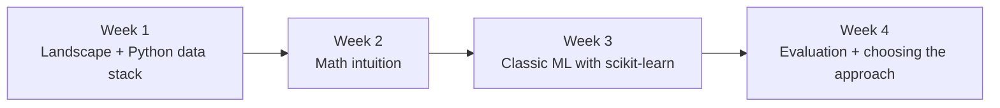
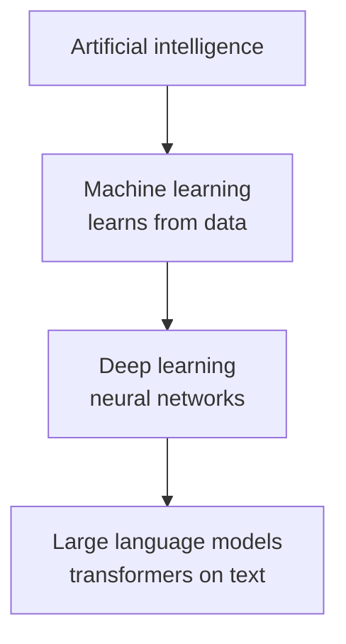
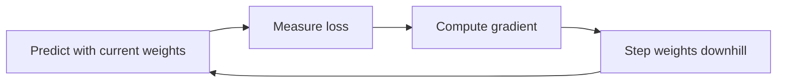

## What you finish with

By the end of Month 1 you train, evaluate and explain a model that predicts whether a property owner is likely to sell, and you serve it behind an API. This month gives you the vocabulary every later month depends on.

Part of [the 24-week plan](/learn/ai/ai-architect-24-week-plan).



## Week 1: The AI landscape and the Python data stack

### Learn

- **AI** is any system that does something we would call intelligent. **Machine learning (ML)** is AI that learns rules from data instead of you writing them. **Deep learning** is ML using neural networks with many layers. **LLMs** are huge deep-learning models trained on text.
- **Training** means the model looks at many examples and adjusts its internal numbers. **Inference** means using the trained model to make a prediction. Training is expensive and rare; inference is cheap and constant.
- **Supervised learning**: you have labelled examples (owner sold: yes or no) and the model learns to predict the label. **Unsupervised learning**: no labels; the model finds groups or patterns, such as clusters of similar properties.
- **Classification** predicts a category (sell or not sell). **Regression** predicts a number (price, days on market).
- **NumPy** gives fast arrays and math. **Pandas** gives tables (DataFrames), like SQL inside Python. **Matplotlib** draws charts.



### Daily tasks

1. **Monday:** Start Andrew Ng's Machine Learning Specialization, Course 1, Week 1. Write the definitions above in your own words.
2. **Tuesday:** NumPy basics: create arrays, reshape, slice, vector math and broadcasting. Rewrite a Python loop as a vectorized operation and time both.
3. **Wednesday:** Pandas basics: `read_csv`, `head`, `describe`, `groupby`, `merge`, filtering, and missing values with `isna` and `fillna`.
4. **Thursday:** Load a real estate dataset (Kaggle "House Prices" or your own export). Answer five business questions, such as average price by zip code.
5. **Friday:** Draw four charts: histogram, scatter, bar and box plot. Write one sentence on what each tells you.

```python
import pandas as pd

df = pd.read_csv("properties.csv")
print(df.shape)
print(df.isna().mean().sort_values(ascending=False).head())
print(df.groupby("zip_code")["price"].median().sort_values().tail(10))
```

### Weekend build

An exploratory data analysis (EDA) notebook on property data: shape of the data, missing values, distributions, and your top five insights.

### Checklist

- [ ] I can explain AI, ML, deep learning and LLMs and how they relate
- [ ] I can explain supervised vs unsupervised, and classification vs regression
- [ ] I can load, clean, group and chart a dataset in Pandas

## Week 2: Math intuition you actually need

You do not need to become a mathematician. You need enough intuition to understand why models work and fail.

### Learn

- **Vector**: a list of numbers describing something. A property might be `[beds, baths, sqft, age]`. **Matrix**: a table of vectors, such as all properties. Models are mostly matrix multiplication.
- **Dot product**: multiply matching numbers and add them up. It measures how much two vectors point the same way. It is the heart of similarity search and of attention later.
- **Mean, median, variance, standard deviation**: the centre and spread of data. A **distribution** is the shape of how values are spread: normal, skewed, long-tailed.
- **Conditional probability** P(A given B), and **Bayes' theorem**: updating a belief with new evidence. Example: P(sells given owned 10+ years).
- **Derivative**: how fast an output changes when an input changes. **Gradient**: the derivatives for every input together; it points in the direction of steepest increase.
- **Loss function**: one number saying how wrong the model is. Mean squared error for regression, cross-entropy for classification.
- **Gradient descent**: repeatedly take a small step opposite the gradient to reduce the loss. **Learning rate**: the step size. Too big overshoots; too small is slow.

The whole of model training in one line:

```text
new_weight = old_weight - learning_rate * (slope of the loss with respect to that weight)
```



### Daily tasks

1. **Monday:** Watch 3Blue1Brown "Essence of Linear Algebra" episodes 1-4. Code vectors, a dot product and matrix multiplication in NumPy.
2. **Tuesday:** Statistics with Pandas: mean, median, standard deviation and percentiles of price. Find outliers with the IQR rule.
3. **Wednesday:** Probability: compute conditional probabilities from your data with `groupby`, such as sale rate by years owned.
4. **Thursday:** Watch 3Blue1Brown "Essence of Calculus" episodes 1-2 and the "Gradient descent" neural-network video.
5. **Friday:** Code gradient descent from scratch to fit `price = w * sqft + b`. Plot the loss going down.

```python
import numpy as np

rng = np.random.default_rng(0)
sqft = rng.uniform(800, 3000, 200)
price = 150 * sqft + 40_000 + rng.normal(0, 20_000, 200)

x = (sqft - sqft.mean()) / sqft.std()   # scale the input
y = price / 1_000                        # work in thousands
w, b, lr = 0.0, 0.0, 0.1

for step in range(200):
    pred = w * x + b
    error = pred - y
    loss = (error ** 2).mean()
    w -= lr * 2 * (error * x).mean()
    b -= lr * 2 * error.mean()
    if step % 40 == 0:
        print(step, round(loss, 1))
```

### Weekend build

A notebook "Linear regression from scratch": gradient descent, a loss curve, and a comparison with scikit-learn's `LinearRegression`.

### Checklist

- [ ] I can explain a dot product and why it measures similarity
- [ ] I can explain gradient descent and learning rate with a sketch
- [ ] I wrote gradient descent myself and it converged

## Week 3: Classic ML with scikit-learn

### Learn

- **Features** are the inputs (years owned, equity percentage, absentee owner). The **label** or **target** is what you predict.
- **Train, validation and test split**: train on one part, tune on another, and report on data the model never saw. A typical split is 70 / 15 / 15.
- **Algorithms to know:**

| Algorithm | Good for | Note |
| --- | --- | --- |
| Linear / logistic regression | Simple baselines, explainable | Always start here |
| Decision tree | If-then rules people can read | Overfits easily alone |
| Random forest | Strong, robust default | Many trees voting |
| Gradient boosting (XGBoost, LightGBM) | Tabular business data | Usually the winner |
| k-means | Grouping without labels | Unsupervised segments |

- **Overfitting**: the model memorizes training data and fails on new data. **Underfitting**: the model is too simple to learn the pattern. **Bias vs variance** is the same trade-off in math words.
- **Cross-validation**: train and test on several different splits to get a reliable score.
- **Feature engineering**: turning raw data into useful signals. Ratios (loan / value), time since last sale, and flags (owner mailing address differs from property address = absentee owner).

### Daily tasks

1. **Monday:** Read the scikit-learn "Getting started" guide. Learn the `fit` / `predict` / `score` pattern and `Pipeline`.
2. **Tuesday:** Train logistic regression and a decision tree on a classification dataset. Kaggle Titanic is a fine warm-up.
3. **Wednesday:** Train random forest and XGBoost on the same data. Compare with 5-fold cross-validation.
4. **Thursday:** Engineer five new features on property data and measure whether each one improves the score.
5. **Friday:** Run k-means to cluster owners into 4-6 segments. Describe each segment in business words.

```python
from sklearn.compose import ColumnTransformer
from sklearn.model_selection import cross_val_score
from sklearn.pipeline import Pipeline
from sklearn.preprocessing import OneHotEncoder, StandardScaler
from xgboost import XGBClassifier

numeric = ["years_owned", "equity_pct", "assessed_value"]
categorical = ["property_type", "county"]

model = Pipeline([
    ("prep", ColumnTransformer([
        ("num", StandardScaler(), numeric),
        ("cat", OneHotEncoder(handle_unknown="ignore"), categorical),
    ])),
    ("clf", XGBClassifier(n_estimators=300, max_depth=4, learning_rate=0.05)),
])

scores = cross_val_score(model, df[numeric + categorical], df["sold_within_12m"], cv=5, scoring="roc_auc")
print(scores.mean())
```

### Weekend build

**Seller propensity v1**: a pipeline that loads property data, engineers features, trains XGBoost, and outputs a 0-1 likelihood-to-sell score per property.

### Checklist

- [ ] I can explain overfitting and how a validation set catches it
- [ ] I know why gradient boosting usually wins on tabular data
- [ ] I built a scikit-learn `Pipeline` with preprocessing and a model

## Week 4: Evaluating models and choosing the right approach

### Learn

- **Confusion matrix**: true positives, false positives, true negatives, false negatives.
- **Precision**: of the leads we flagged, how many really sold. **Recall**: of the owners who sold, how many we flagged. **F1**: a balance of both. **ROC-AUC**: how well the model ranks positives above negatives (0.5 is random, 1.0 is perfect).
- **Accuracy lies on imbalanced data.** If 3% of owners sell, predicting "never sells" is 97% accurate and useless.
- **Business metric**: precision in the top 1,000 leads is often what a sales team cares about. Tie model metrics to money.
- **Explainability**: feature importance and **SHAP values** show why a model scored a lead high.
- **Data leakage**: a feature that secretly contains the answer, such as "listing date" when predicting a sale. It is the most common way to fool yourself.

### Pick the right tool

An AI expert knows when not to use an LLM.

| Problem type | Best tool | Example from lead generation |
| --- | --- | --- |
| Fixed, clear logic | Rules engine or code | Exclude properties on the do-not-contact list |
| Describe the past | SQL and analytics | Leads per county last month |
| Predict from structured data | Classic ML | Likelihood an owner sells in 12 months |
| Understand or write language | LLM | Summarize call notes, draft outreach |
| Mixed | Combination | ML scores the lead, LLM explains it to an agent |

### Daily tasks

1. **Monday:** Compute the confusion matrix, precision, recall, F1 and ROC-AUC for your seller model.
2. **Tuesday:** Handle class imbalance with class weights and threshold tuning. Plot the precision-recall curve.
3. **Wednesday:** Add SHAP explanations. Show the top three reasons for five individual predictions.
4. **Thursday:** Hunt for leakage: for every feature ask "would I know this at prediction time?"
5. **Friday:** Write a one-page decision guide: ten real features from your platform and whether each is a rules, SQL, ML or LLM problem.

### Weekend build

Wrap the seller model in a FastAPI endpoint `POST /score` that returns the score and the top reasons. Package it with Docker.

```python
from fastapi import FastAPI
from pydantic import BaseModel
import joblib, pandas as pd

app = FastAPI()
model = joblib.load("seller_model.joblib")

class Property(BaseModel):
    years_owned: float
    equity_pct: float
    assessed_value: float
    property_type: str
    county: str

@app.post("/score")
def score(p: Property):
    row = pd.DataFrame([p.model_dump()])
    return {"likelihood_to_sell": float(model.predict_proba(row)[0, 1])}
```

### Checklist

- [ ] I can explain precision vs recall to a sales manager
- [ ] I can detect data leakage
- [ ] I served a model behind an API in Docker

## Month 1 milestone

A GitHub repository with an EDA notebook, gradient descent from scratch, and a served seller-propensity model with explanations.

## Key takeaways

- Training adjusts weights to reduce a loss; gradient descent is the engine behind almost every model.
- On tabular business data, gradient boosting is the usual winner; start with a simple baseline anyway.
- Pick metrics that match the business question, and watch for imbalance and leakage.
- Many "AI" problems are better solved with rules, SQL or classic ML than with an LLM.
