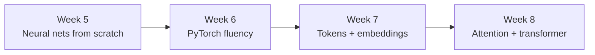
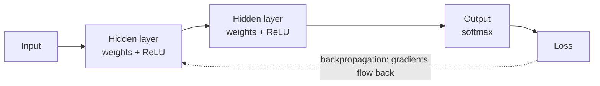
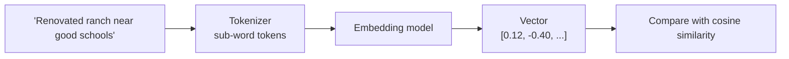
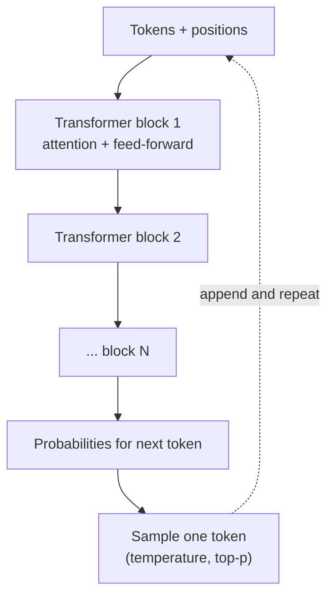

## What you finish with

By the end of Month 2 you can build and train a neural network in PyTorch, and you can explain how a transformer turns text into the next token. This is the month LLMs stop feeling like magic.

Part of [the 24-week plan](/learn/ai/ai-architect-24-week-plan). Previous: [Month 1](/learn/ai/month-1-data-math-and-classic-ml).



## Week 5: Neural networks from the ground up

### Learn

- A **neuron** takes inputs, multiplies each by a weight, adds a bias, and passes the result through an activation function. A **layer** is many neurons side by side. A **network** stacks layers.
- **Activation functions** add non-linearity so the network can learn curves, not only straight lines:

| Activation | What it does | Where it is used |
| --- | --- | --- |
| ReLU | max(0, x) | Hidden layers (default) |
| Sigmoid | Squashes to 0-1 | Yes/no output |
| Softmax | Turns scores into probabilities that sum to 1 | Multi-class output, attention |

- **Forward pass**: data flows from input to output and produces a prediction. **Loss**: how wrong it was. **Backpropagation**: use the chain rule to compute how much each weight contributed to the error. **Optimizer**: update the weights (SGD, or **Adam**, the usual default).
- **Epoch**: one pass through all training data. **Batch**: a small group of examples processed together.
- **Regularization** fights overfitting: dropout, weight decay and early stopping.



### Daily tasks

1. **Monday:** Watch 3Blue1Brown "Neural Networks" chapters 1-4. Draw a two-layer network on paper with its forward pass.
2. **Tuesday:** Follow Andrej Karpathy's "micrograd" video and build a tiny autograd engine (about 100 lines).
3. **Wednesday:** Use micrograd to train a small network on a toy dataset. Watch the loss drop.
4. **Thursday:** Change learning rate, layer size and activation. Record what happens in a table.
5. **Friday:** Write a one-page explanation of backpropagation for a backend engineer.

### Weekend build

A neural network in pure NumPy (no PyTorch) that classifies handwritten digits (MNIST) above 90% accuracy.

### Checklist

- [ ] I can explain forward pass, loss, backpropagation and optimizer step
- [ ] I know when to use ReLU, sigmoid and softmax
- [ ] I built backpropagation myself once

## Week 6: PyTorch fluency

### Learn

- A **tensor** is a NumPy-like array that can live on a GPU and track gradients.
- `nn.Module` is a class that defines layers in `__init__` and the computation in `forward`.
- **The training loop** (memorize it): zero the gradients, predict, compute loss, backpropagate, step.
- `Dataset` and `DataLoader` feed data in shuffled batches.
- **Device**: `cuda` (NVIDIA GPU), `mps` (Apple Silicon) or `cpu`. Model and data must be on the same device.
- **CNNs** (convolutional networks) learn visual patterns. **RNNs and LSTMs** process sequences step by step. Know them as history; transformers replaced them for text.
- **Transfer learning**: start from a model pretrained on huge data and fine-tune it on your small dataset.

```python
import torch
from torch import nn

device = "cuda" if torch.cuda.is_available() else "cpu"

model = nn.Sequential(
    nn.Linear(10, 64), nn.ReLU(),
    nn.Linear(64, 32), nn.ReLU(),
    nn.Linear(32, 1),
).to(device)

loss_fn = nn.BCEWithLogitsLoss()
optimizer = torch.optim.Adam(model.parameters(), lr=1e-3)

for epoch in range(20):
    for x, y in train_loader:
        x, y = x.to(device), y.to(device)
        optimizer.zero_grad()          # 1. clear old gradients
        pred = model(x).squeeze(1)     # 2. forward pass
        loss = loss_fn(pred, y)        # 3. measure error
        loss.backward()                # 4. backpropagation
        optimizer.step()               # 5. update weights
```

### Daily tasks

1. **Monday:** PyTorch "Learn the Basics" tutorial: tensors, datasets, autograd.
2. **Tuesday:** Rebuild your Week 5 MNIST network in PyTorch. Compare code size and speed.
3. **Wednesday:** Train a small CNN on MNIST or CIFAR-10 in Google Colab with a free GPU. Note CPU vs GPU time.
4. **Thursday:** Train a tabular neural network on your seller data and compare with XGBoost. XGBoost usually wins, and that is a real lesson.
5. **Friday:** Save and load models with `state_dict`. Plot train vs validation loss to see overfitting.

### Weekend build

Follow fast.ai Practical Deep Learning lessons 1-2: fine-tune a pretrained image model on your own photos, for example property exterior condition (good or needs repair). Deploy it as a Gradio demo on Hugging Face Spaces.

### Checklist

- [ ] I can write the PyTorch training loop from memory
- [ ] I trained on a GPU
- [ ] I understand transfer learning

## Week 7: Text as numbers: tokens and embeddings

### Learn

- **Tokenization** splits text into pieces called tokens, usually sub-words. "unbelievable" might become "un" + "believ" + "able". Roughly one token is three quarters of an English word. Models are priced and limited by tokens.
- **BPE** (byte-pair encoding) is the common tokenizer method: start from characters and repeatedly merge the most frequent pairs.
- An **embedding** is a vector (for example 768 or 1,536 numbers) that represents meaning. Similar meanings get nearby vectors: "house" is close to "home" and far from "invoice".
- **Cosine similarity** is the dot product of normalized vectors. 1 means the same direction, 0 means unrelated. This is how semantic search works.
- Modern **embedding models** embed whole sentences or paragraphs, not just single words.



```python
from sentence_transformers import SentenceTransformer
import numpy as np

model = SentenceTransformer("all-MiniLM-L6-v2")
docs = ["3 bed ranch, new roof, near top-rated schools",
        "Downtown condo with gym and rooftop",
        "Fixer-upper bungalow, needs kitchen remodel"]
doc_vecs = model.encode(docs, normalize_embeddings=True)

query = model.encode(["updated single-storey home for a family"], normalize_embeddings=True)
scores = doc_vecs @ query.T
for i in np.argsort(-scores[:, 0]):
    print(round(float(scores[i, 0]), 3), docs[i])
```

### Daily tasks

1. **Monday:** Use a tokenizer (Hugging Face `tokenizers` or `tiktoken`). Count tokens for English, code and another language such as Bengali; note the differences in cost.
2. **Tuesday:** Watch Karpathy "Let's build the GPT Tokenizer" and implement a tiny BPE.
3. **Wednesday:** Embed 200 property descriptions with `sentence-transformers`.
4. **Thursday:** Build semantic search in NumPy: embed a query, compute cosine similarity, return the top five.
5. **Friday:** Visualize the embeddings in 2D with UMAP or t-SNE. Do similar properties cluster?

### Weekend build

**Semantic property search v0**: type "renovated ranch near good schools" and get the closest listings, with no keyword matching and no vector database.

### Checklist

- [ ] I can explain tokens and why they matter for cost and limits
- [ ] I can explain embeddings and cosine similarity
- [ ] I built semantic search without a vector database

## Week 8: Attention and the transformer

### Learn

- **The problem**: to understand "The owner sold it because it was too old", the model must know that "it" means the house. **Attention** lets every token look at every other token and decide which ones matter.
- **Self-attention**: each token produces a **Query** (what am I looking for), a **Key** (what do I contain) and a **Value** (what I pass on). Score = Query · Key, scaled, then softmax, then a weighted sum of Values.

```text
Attention(Q, K, V) = softmax( Q × Kᵀ / √d ) × V
```

- **Multi-head attention** runs several attention operations in parallel; each head learns a different relationship (grammar, reference, topic).
- **Positional encoding** tells the model word order, because attention alone has none.
- A **transformer block** = attention + feed-forward network + residual connections + layer normalization, stacked dozens of times in large models.
- **Decoder-only (GPT-style)** models predict the next token, one at a time, using all previous tokens. That loop is all text generation is.
- **Context window**: the maximum number of tokens the model can attend to at once. Attention cost grows with the square of the length.



```python
import torch
import torch.nn.functional as F

def self_attention(x, Wq, Wk, Wv):
    q, k, v = x @ Wq, x @ Wk, x @ Wv
    scores = q @ k.transpose(-2, -1) / k.shape[-1] ** 0.5
    mask = torch.triu(torch.ones_like(scores), diagonal=1).bool()
    scores = scores.masked_fill(mask, float("-inf"))   # no peeking at future tokens
    return F.softmax(scores, dim=-1) @ v
```

### Daily tasks

1. **Monday:** Read Jay Alammar "The Illustrated Transformer", then watch 3Blue1Brown "Attention in transformers, visually explained".
2. **Tuesday:** Code a single self-attention head in PyTorch (about 30 lines).
3. **Wednesday and Thursday:** Follow Karpathy "Let's build GPT: from scratch, in code, spelled out". Train a tiny GPT on a text file.
4. **Friday:** Sample from your tiny GPT at temperatures 0.2, 0.8 and 1.5. Describe the difference.

### Weekend build

Your own nanoGPT trained on a small corpus, such as property descriptions, that generates plausible new descriptions. Write a README explaining each component.

### Checklist

- [ ] I can explain Query, Key, Value attention on a whiteboard
- [ ] I know why context windows are limited and costly
- [ ] I trained a tiny transformer myself

## Month 2 milestone

A repository with micrograd, a PyTorch CNN, semantic search, and your own tiny GPT.

## Key takeaways

- A neural network is layers of weights and activations trained by backpropagation and an optimizer.
- The PyTorch training loop has five steps; everything else is data handling and architecture.
- Embeddings turn meaning into vectors, and cosine similarity compares them.
- A transformer is attention plus feed-forward blocks; an LLM is that, trained to predict the next token.
