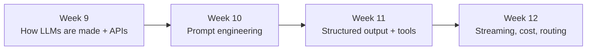
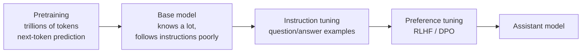
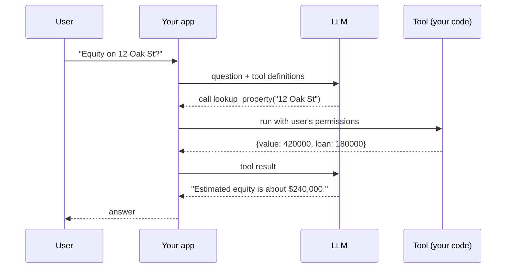
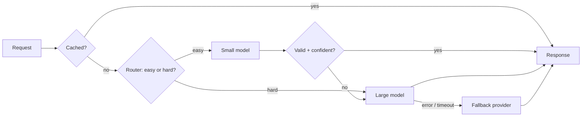

## What you finish with

By the end of Month 3 you ship production-grade LLM features: reliable prompts, guaranteed JSON, tool calls, streaming, routing between models, and cost control. This should become one of your strongest skills.

Part of [the 24-week plan](/learn/ai/ai-architect-24-week-plan). Previous: [Month 2](/learn/ai/month-2-deep-learning-pytorch-and-transformers).



## Week 9: How LLMs are made and how to call them

### Learn



- **Pretraining**: the model reads trillions of tokens and learns to predict the next one. The result is a base model that knows a lot but does not follow instructions well.
- **Instruction tuning (SFT)**: further training on question and answer examples so it behaves like an assistant.
- **Preference optimization (RLHF, DPO)**: humans or AI rank answers, and the model is nudged toward the preferred ones. This shapes helpfulness and safety.
- **Reasoning models** spend extra "thinking" tokens before answering. They are better on hard logic, and slower and more expensive.
- **Sampling settings**: **temperature** (0 = predictable, above 1 = creative), **top-p** (sample only from the most likely tokens whose probabilities add up to p), and **max tokens** (output limit).
- **Hallucination**: confident, fluent, wrong output. It happens because the model predicts likely text, not verified facts. Grounding (RAG), tools and validation reduce it.
- **API basics**: messages with roles (system, user, assistant); calls are stateless, so you send the history every time; every response returns token usage.

### Choosing a model

| Option | Examples | Strength | Watch out for |
| --- | --- | --- | --- |
| Large closed API model | Claude, GPT, Gemini | Best quality and tool use | Cost, data terms |
| Small closed API model | Fast or "mini" tiers | Cheap, low latency | Weaker on hard reasoning |
| Open-weight model, self-hosted | Llama, Qwen, DeepSeek, Mistral | Privacy, fixed cost at scale | You run the GPUs |
| Local model | Ollama on a laptop | Free experiments, offline | Small and slower |

Compare candidates on your own task: quality, latency, cost per million tokens, context window, data privacy terms and tool-use reliability.

### Daily tasks

1. **Monday:** Read your provider's API quickstart. Make a first call from Python and print the token usage.
2. **Tuesday:** Build a tiny command-line chat that keeps history. Watch input tokens grow each turn.
3. **Wednesday:** Run ten prompts at temperature 0, 0.7 and 1.2. Note consistency vs creativity.
4. **Thursday:** Run one task (summarize a property listing) on a large model, a small fast model and a local Ollama model. Compare quality, speed and cost in a table.
5. **Friday:** Make the model hallucinate on purpose (ask about an obscure fake address). Write three ways to prevent it.

```python
import anthropic

client = anthropic.Anthropic()  # reads ANTHROPIC_API_KEY
response = client.messages.create(
    model="claude-sonnet-5-5",
    max_tokens=500,
    system="You are a real estate analyst. Be concise.",
    messages=[{"role": "user", "content": "Summarize: 3 bed ranch, new roof, owner since 2004, absentee."}],
)
print(response.content[0].text)
print(response.usage.input_tokens, response.usage.output_tokens)
```

### Weekend build

A **model comparison harness**: one script runs a prompt set across three models and writes a CSV of output, latency, tokens and cost.

### Checklist

- [ ] I can explain pretraining vs instruction tuning vs preference tuning
- [ ] I know what temperature and top-p do
- [ ] I can choose a model by quality, latency, cost and privacy

## Week 10: Prompt engineering that holds up in production

### Learn

- **System prompt**: the role, rules and context for the whole conversation. Be explicit about who the model is, what the task is, and what to do when unsure.
- **Clear structure**: separate instructions from data with XML-style tags such as `<listing>...</listing>`. Put long documents first and the question last.
- **Few-shot prompting**: include two to five worked examples of input and ideal output. It is the fastest way to fix format and tone.
- **Chain of thought**: ask the model to reason step by step before answering, or use a reasoning model.
- **Give it an out**: "If the data does not say, answer `unknown`" cuts hallucinations.
- **Prompt chaining**: split a big task into steps (extract, then analyze, then write), each a separate call you can test.
- **Prompts are code**: version them in git, review changes and test them.

```text
<role>You qualify inbound real estate leads for a sales team.</role>

<rules>
- Use only the information inside <lead>.
- If a field is not stated, return "unknown". Never guess.
- Urgency is 1 (no rush) to 5 (must sell within 30 days).
</rules>

<example>
<lead>Inherited my mom's house, live out of state, want it gone before winter.</lead>
<answer>{"motivation": "inherited, absentee", "urgency": 4, "timeline": "before winter"}</answer>
</example>

<lead>{{lead_text}}</lead>
```

### Daily tasks

1. **Monday:** Read the Anthropic and OpenAI prompt engineering guides. List ten rules you will follow.
2. **Tuesday:** Write a system prompt for a "lead qualification assistant". Test it on 20 varied inputs.
3. **Wednesday:** Add few-shot examples. Count how many of the 20 outputs improve.
4. **Thursday:** Break a complex task (a property investment summary) into a three-step chain. Compare with the single-prompt version.
5. **Friday:** Move prompts into versioned template files and add a test that runs them.

### Weekend build

A **listing-to-insights** service: paste any property description and get a structured summary, red flags and a suggested outreach angle.

### Checklist

- [ ] I write system prompts with role, task, rules and a fallback
- [ ] I use few-shot examples and tags to separate data from instructions
- [ ] My prompts live in version control with tests

## Week 11: Structured outputs and tool calling

### Learn

- **Structured output**: force the model to return JSON that matches a schema. Use the provider's native structured output or JSON schema mode, and validate with **Pydantic**. Never parse free text with regular expressions in production.
- **Extraction** is the most common business use: messy text (emails, PDFs, call notes) becomes clean fields.
- **Validation and retry**: if output fails the schema, send the error back and ask for a fix, at most two times.
- **Tool calling (function calling)**: you describe functions with a name, description and JSON schema of arguments. The model decides to call one and returns arguments. **Your code** runs the function and sends back the result. The model continues.
- **Good tools** have clear names, precise descriptions, few required arguments and readable error messages.
- **MCP (Model Context Protocol)** is an open standard for exposing tools and data to any AI application, so you write a tool once and many clients can use it.



```python
from pydantic import BaseModel, Field
from typing import Literal

class PropertyLead(BaseModel):
    address: str
    owner_name: str | None
    motivation_signals: list[str]
    urgency: int = Field(ge=1, le=5)
    contact_preference: Literal["phone", "email", "sms", "unknown"]

# Ask the model for JSON matching PropertyLead.model_json_schema(),
# then validate: PropertyLead.model_validate_json(raw_text)
```

### Daily tasks

1. **Monday:** Define the `PropertyLead` model and extract it from 20 sample texts.
2. **Tuesday:** Add validation with automatic retry. Log the failure rate.
3. **Wednesday:** Implement two tools, `lookup_property(address)` (query Postgres) and `estimate_equity(property_id)`, and let the model call them.
4. **Thursday:** Handle parallel tool calls and tool errors gracefully.
5. **Friday:** Read the MCP documentation and wrap one tool as an MCP server.

### Weekend build

**CRM copilot v1**: a chat where you ask "What is the equity on 12 Oak St and who owns it?" and the model uses your real database tools to answer.

### Checklist

- [ ] I get schema-valid JSON every time, with validation and retry
- [ ] I can explain the tool-calling loop step by step
- [ ] I exposed a tool through MCP

## Week 12: Production concerns: streaming, cost, routing and reliability

### Learn

- **Streaming**: send tokens to the user as they are produced (Server-Sent Events). Slow answers feel fast.
- **Cost** = input tokens × input price + output tokens × output price. Output tokens usually cost several times more.
- **Prompt caching**: providers discount repeated prompt prefixes such as long system prompts and documents. Put stable content first.
- **Model routing**: send easy requests to a small cheap model and hard ones to a large model. A simple classifier or rules decide.
- **Fallbacks**: if a provider errors or times out, retry with backoff, then fall back to another model.
- **Rate limits**: requests and tokens per minute. Use queues, backoff and batching. Batch APIs are often about 50% cheaper for non-urgent work.
- **Context management**: summarize old turns, trim irrelevant history, keep only what the task needs.
- **Multi-modal input**: modern models accept images and PDFs directly, such as property photos and scanned deeds.
- **Observability**: log prompt version, model, tokens, latency, cost and user for every call.



### Cost estimate example

A feature runs 20,000 times a day with 2,000 input and 300 output tokens per call. At $3 per million input tokens and $15 per million output tokens:

```text
input:  20,000 × 2,000 = 40M tokens × $3  / 1M = $120 per day
output: 20,000 ×   300 =  6M tokens × $15 / 1M =  $90 per day
total ≈ $210 per day ≈ $6,300 per month
```

Routing 70% of calls to a model ten times cheaper, and caching the system prompt, can cut that by more than half. Do this math before you build.

### Daily tasks

1. **Monday:** Add streaming to your FastAPI service and a minimal web page that shows tokens arriving.
2. **Tuesday:** Build a cost tracker: tokens and dollars per request, per user, per day.
3. **Wednesday:** Add prompt caching and measure the cost and latency drop.
4. **Thursday:** Implement a router (cheap model first, escalate on low confidence) and a fallback provider.
5. **Friday:** Send a property photo and a scanned PDF to a multi-modal model and extract structured data.

### Weekend build

Production-harden the CRM copilot: streaming, retries, fallback, a cost dashboard, structured logs and environment-based configuration. Deploy it with Docker Compose.

### Checklist

- [ ] I can estimate the monthly LLM cost of a feature before building it
- [ ] I implemented routing, fallback and caching
- [ ] Every LLM call in my app is logged with tokens and cost

## Month 3 milestone

A deployed CRM copilot with structured extraction, real tool calls, streaming and cost tracking.

## Key takeaways

- LLMs are next-token predictors shaped by instruction and preference tuning; they can be fluent and wrong.
- Treat prompts as versioned, tested code with clear structure, examples and a fallback.
- Use structured outputs with schema validation; let the model propose tool calls and let your code run them.
- Production LLM work is mostly engineering: streaming, caching, routing, fallbacks, rate limits and cost tracking.
