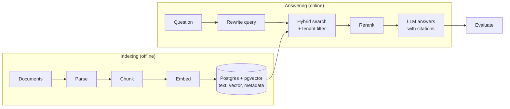
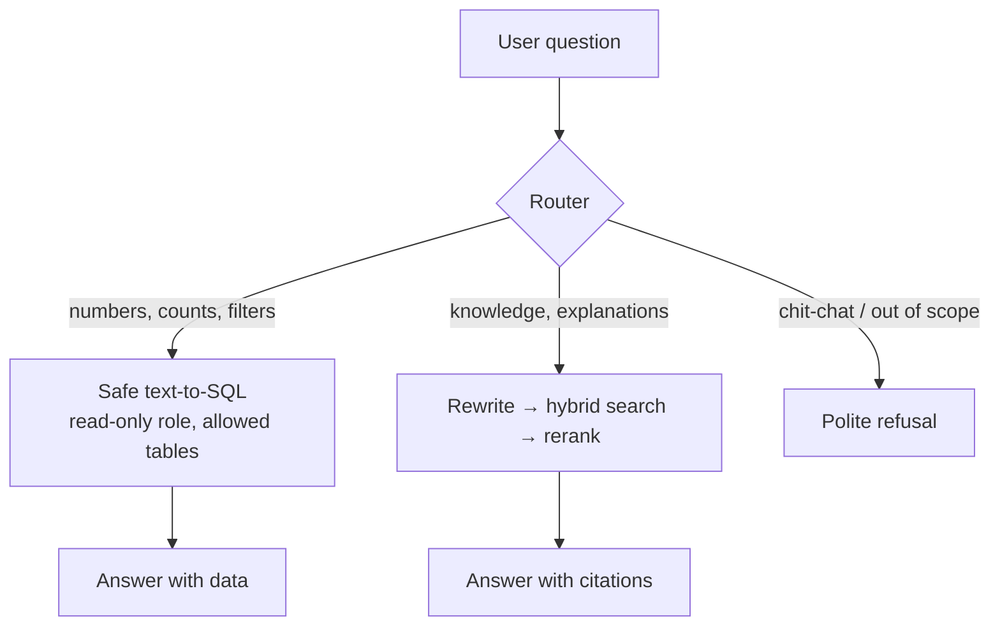

## What you finish with

By the end of Month 4 you run a tenant-safe knowledge assistant on PostgreSQL + pgvector that answers from your documents with citations, and you can prove its quality with numbers. RAG is the most common enterprise AI architecture.

Part of [the 24-week plan](/learn/ai/ai-architect-24-week-plan). Previous: [Month 3](/learn/ai/month-3-llm-engineering). For the basic idea, see [Embeddings, Semantic Search, and RAG](/learn/ai/embeddings-and-rag).



## Week 13: Basic RAG end to end

### Learn

- **Why RAG**: the model does not know your private or recent data. Retrieve the relevant pieces at question time and put them in the prompt. It is cheaper and fresher than fine-tuning.
- **Indexing (offline)**: parse documents, split them into chunks, embed each chunk, and store vector + text + metadata.
- **Answering (online)**: embed the question, find the nearest chunks, and pass them to the LLM with "answer only from these sources".
- **pgvector** adds a `vector` column type and similarity operators to PostgreSQL. Because you already know Postgres, you get joins, transactions, backups and row-level security for free.
- **Indexes**: **HNSW** (fast, accurate, uses more memory; the good default) and **IVFFlat** (less memory, needs tuning).

```sql
CREATE EXTENSION IF NOT EXISTS vector;

CREATE TABLE chunks (
  id         bigserial PRIMARY KEY,
  tenant_id  uuid NOT NULL,
  doc_id     uuid NOT NULL,
  content    text NOT NULL,
  metadata   jsonb NOT NULL DEFAULT '{}',
  embedding  vector(1536) NOT NULL
);

CREATE INDEX ON chunks USING hnsw (embedding vector_cosine_ops);
CREATE INDEX ON chunks (tenant_id);

-- nearest 5 chunks for one tenant (<=> is cosine distance)
SELECT id, content, 1 - (embedding <=> $2) AS similarity
FROM chunks
WHERE tenant_id = $1
ORDER BY embedding <=> $2
LIMIT 5;
```

A prompt that forces grounding:

```text
Answer the question using only the sources below.
Cite each claim with its source id, like [doc-3].
If the sources do not contain the answer, say "I don't know based on the available documents."

<sources>
[doc-3] ...
[doc-7] ...
</sources>

<question>{{question}}</question>
```

### Daily tasks

1. **Monday:** Run pgvector in Docker (`pgvector/pgvector:pg16`) and create the table above.
2. **Tuesday:** Write an ingestion script: read 20-50 documents (market reports, county guides, internal procedures), chunk naively by 500 tokens, embed and insert.
3. **Wednesday:** Write the retrieval function: embed the question, run the SQL, return the top five.
4. **Thursday:** Add generation with the grounding prompt above.
5. **Friday:** Ask 20 questions. Mark each answer correct, partly correct or wrong. This is your first evaluation set.

### Weekend build

**Knowledge AI v1**: FastAPI endpoints `/ingest` and `/ask`, with answers that show clickable citations.

### Checklist

- [ ] I can draw the indexing and answering pipelines
- [ ] I stored and searched vectors in pgvector with an HNSW index
- [ ] My answers cite their sources and admit when they do not know

## Week 14: Better retrieval: parsing, chunking and hybrid search

### Learn

- **Garbage in, garbage out**: most RAG failures are retrieval failures, and most retrieval failures start with bad parsing.
- **Parsing**: PDFs with tables and columns need real parsers such as Unstructured, Docling or PyMuPDF, or a vision model for scans. Keep headings, tables and page numbers.
- **Chunking strategies:**

| Strategy | How it splits | When to use |
| --- | --- | --- |
| Fixed size + overlap | Every N tokens, with 10-20% overlap | Quick baseline |
| Recursive | Paragraphs, then sentences, until small enough | Good default |
| Structure-aware | By headings and sections | Manuals, policies, contracts |
| Semantic | Where the topic changes | Long mixed documents |

- Typical chunk size is 300-800 tokens.
- **Contextual chunks**: prepend the document title and section heading to every chunk so it still makes sense on its own.
- **Metadata filtering**: filter by tenant, document type, date or county before vector search. It is fast and essential for correctness.
- **Hybrid search**: combine vector search (meaning) with keyword search (exact names, parcel numbers, addresses). In Postgres, use full-text `tsvector` plus pgvector and merge with **Reciprocal Rank Fusion (RRF)**.
- **Embedding models**: compare an API model with open ones (for example BGE, E5 or Nomic on Hugging Face) on your own questions. Public leaderboards such as MTEB are only a starting point.

```sql
WITH semantic AS (
  SELECT id, row_number() OVER (ORDER BY embedding <=> $2) AS rank
  FROM chunks WHERE tenant_id = $1
  ORDER BY embedding <=> $2 LIMIT 40
),
keyword AS (
  SELECT id, row_number() OVER (ORDER BY ts_rank(to_tsvector('english', content), q) DESC) AS rank
  FROM chunks, plainto_tsquery('english', $3) q
  WHERE tenant_id = $1 AND to_tsvector('english', content) @@ q
  LIMIT 40
)
SELECT id, SUM(1.0 / (60 + rank)) AS rrf_score
FROM (SELECT * FROM semantic UNION ALL SELECT * FROM keyword) both_lists
GROUP BY id
ORDER BY rrf_score DESC
LIMIT 10;
```

In production, store `to_tsvector(...)` in a generated column with a GIN index instead of computing it per query.

### Daily tasks

1. **Monday:** Re-parse your hardest PDFs with a proper parser and compare the extracted text.
2. **Tuesday:** Implement three chunking strategies and re-run your 20-question set for each.
3. **Wednesday:** Add metadata columns and filters (tenant, document type, date).
4. **Thursday:** Add Postgres full-text search and RRF fusion. Test questions with exact identifiers.
5. **Friday:** Compare two embedding models on your question set and record the results.

### Weekend build

**Knowledge AI v2** with structured parsing, the best chunking, hybrid search and filters. Write a short report on which change helped most.

### Checklist

- [ ] I can choose a chunking strategy and justify it
- [ ] I implemented hybrid search with RRF
- [ ] I compared embedding models on my own data

## Week 15: Advanced RAG: rewriting, reranking and compression

### Learn

- **Query rewriting**: the LLM turns a vague or conversational question ("what about the second one?") into a clear standalone search query.
- **Multi-query and decomposition**: split a complex question into sub-questions, retrieve for each, then merge.
- **HyDE**: generate a hypothetical answer, embed it, and search with that vector.
- **Reranking**: retrieve 30-50 candidates quickly, then reorder them with a **cross-encoder reranker** (for example a BGE reranker or Cohere Rerank) that reads question and chunk together. It is often the single biggest quality gain.
- **Context compression**: keep only the relevant sentences of each chunk to save tokens and reduce noise.
- **Parent-child retrieval**: search small chunks for precision, then send their larger parent section for context.
- **Grounded answers**: require a citation for each claim, and refuse when sources disagree or are missing.
- **When RAG is the wrong tool**: "How many leads in Dallas last month?" needs **text-to-SQL** or a tool, not vector search.



### Daily tasks

1. **Monday:** Add query rewriting for follow-up questions in a chat.
2. **Tuesday:** Add a reranker on top of hybrid search. Measure before and after.
3. **Wednesday:** Try parent-child retrieval and context compression.
4. **Thursday:** Add the router above. The SQL path uses a read-only database role and an allow-list of tables.
5. **Friday:** Write a "RAG design decisions" page for your repository.

### Weekend build

**Knowledge AI v3** with conversation memory, rewriting, reranking, SQL routing and a simple chat interface (Streamlit or your own React front end).

### Checklist

- [ ] I know when reranking helps and what it costs in latency
- [ ] I can route between vector search and SQL
- [ ] My assistant says "I don't know" when it should

## Week 16: Evaluating RAG and making it multi-tenant safe

### Learn

- **Golden dataset**: 50-200 real questions with expected answers and the chunks that should be found.
- **Retrieval metrics**: **recall@k** (did the right chunk appear in the top k?), **precision@k**, and **MRR** (how high was the first right chunk?).
- **Generation metrics**: **faithfulness** (is every claim supported by retrieved context?), **answer relevance** (does it answer the question?) and **context precision**.
- **LLM-as-a-judge**: a strong model scores answers against a rubric. Calibrate it against your own grading on at least 30 examples before trusting it.
- **Tools**: Ragas, DeepEval, and LangSmith or Langfuse for runs and traces.
- **Tenant isolation**: filter by `tenant_id` in the database and enforce it with **Postgres row-level security (RLS)**, never by the prompt. Use separate cache keys per tenant. Test that tenant A can never retrieve tenant B's chunks.
- **Freshness**: hash document content, re-embed only what changed, and delete chunks of removed documents.

```sql
ALTER TABLE chunks ENABLE ROW LEVEL SECURITY;

CREATE POLICY tenant_isolation ON chunks
  USING (tenant_id = current_setting('app.tenant_id')::uuid);

-- per request, inside a transaction, as a non-owner role:
SET LOCAL app.tenant_id = '8d1c...';
```

```python
def recall_at_k(results: list[list[str]], expected: list[set[str]], k: int = 5) -> float:
    hits = sum(1 for got, want in zip(results, expected) if want & set(got[:k]))
    return hits / len(expected)
```

### Daily tasks

1. **Monday:** Build a golden set of 50 questions with expected sources.
2. **Tuesday:** Compute recall@5 and MRR. Find and fix the five worst failures.
3. **Wednesday:** Run Ragas or DeepEval for faithfulness and relevance. Calibrate the judge against your own scores.
4. **Thursday:** Enable RLS on the chunks table and write an automated cross-tenant test that must fail to read.
5. **Friday:** Add incremental re-indexing with content hashes.

### Weekend build

Put the evaluation suite in CI: every change to prompts, chunking or models runs the golden set and fails the build if recall or faithfulness drops.

### Checklist

- [ ] I have a golden set and know my recall@5 and faithfulness numbers
- [ ] Tenant isolation is enforced by the database and tested
- [ ] RAG quality runs in CI

## Month 4 milestone: Project 1, Enterprise Knowledge AI

A multi-tenant RAG service with hybrid search, reranking, citations, SQL routing and an automated evaluation suite.

## Key takeaways

- Most RAG quality comes from retrieval: parsing, chunking, metadata, hybrid search and reranking.
- Start with PostgreSQL + pgvector when you already run Postgres; add a dedicated vector database only when you measure a need.
- Route structured questions to SQL tools, and knowledge questions to retrieval.
- Measure recall and faithfulness on a golden set, and enforce tenant isolation in the database, not the prompt.
