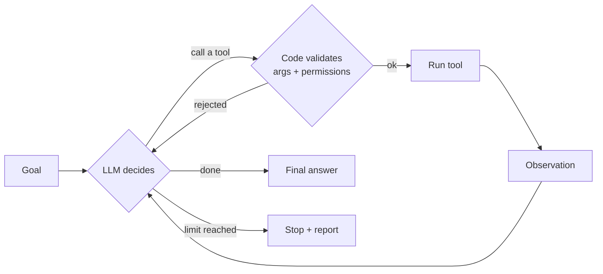
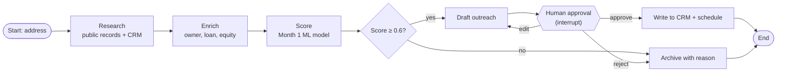
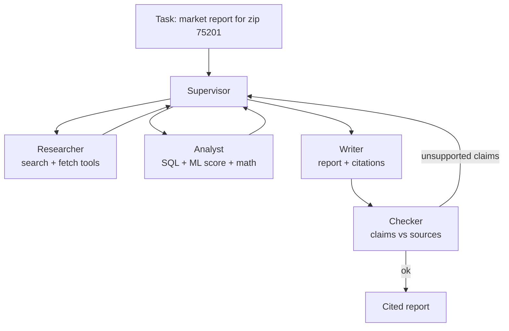

## What you finish with

By the end of Month 5 you build a controlled agent that researches a property, enriches its data, scores it, drafts outreach, and waits for human approval before acting. Your architecture background is your biggest advantage here: good agents are mostly good state machines.

Part of [the 24-week plan](/learn/ai/ai-architect-24-week-plan). Previous: [Month 4](/learn/ai/month-4-rag-and-knowledge-systems). For the basics, see [AI Agents and Tool Use](/learn/ai/ai-agents-and-tool-use).

## Core concepts

| Concept | Meaning |
| --- | --- |
| Tool calling | The LLM asks your code to run a function |
| Agent loop | Observe → decide → act → observe again |
| Planning | Breaking a goal into steps |
| Memory | Keeping relevant state and facts across steps and sessions |
| Multi-agent | Specialized agents cooperating under a supervisor |
| Human-in-the-loop | A person approves before sensitive actions |
| Guardrails | Code that blocks unsafe or invalid inputs, outputs and actions |
| State machine | Explicit states and transitions that control the workflow |

## Week 17: The agent loop from scratch

### Learn

- An **agent** is an LLM in a loop that chooses tools until the goal is met.
- **Workflow vs agent**: a **workflow** follows steps you define in code; it is predictable, cheap and testable. An **agent** decides the steps itself; it is flexible and less predictable. Start with a workflow and add autonomy only where it pays.
- **Common patterns** (from Anthropic's "Building effective agents"): prompt chaining, routing, parallel fan-out, orchestrator-workers, and evaluator-optimizer (one call writes, another critiques).
- **Stopping conditions**: maximum steps, maximum cost, goal reached, or a human stop. Never run an unbounded loop.
- **Failure modes**: loops, wrong tool, invented arguments, context overflow, giving up early, and a confident "done" when it is not.



```python
MAX_STEPS, MAX_COST = 8, 0.50

def run_agent(goal: str) -> str:
    messages = [{"role": "user", "content": goal}]
    cost = 0.0
    for step in range(MAX_STEPS):
        reply = llm(messages, tools=TOOLS)               # your provider call
        cost += reply.cost
        if cost > MAX_COST:
            return "Stopped: budget reached."
        if not reply.tool_calls:
            return reply.text                            # model says it is done
        messages.append(reply.as_message())
        for call in reply.tool_calls:
            result = safe_execute(call)                  # validate, authorize, run, catch errors
            messages.append(tool_result(call.id, result))
        log_step(step, reply, cost)
    return "Stopped: step limit reached."
```

### Daily tasks

1. **Monday:** Read "Building effective agents" (Anthropic) and a summary of the ReAct paper.
2. **Tuesday:** Write the loop above in plain Python with three tools: `search_property`, `get_owner`, `calculate_equity`.
3. **Wednesday:** Add step and cost limits plus structured logging of every step.
4. **Thursday:** Give it ten tasks. Record success rate, steps used and cost. Label each failure type.
5. **Friday:** Improve tool descriptions and error messages. Re-run the ten tasks and compare.

### Weekend build

**Property research agent v0** in plain Python: given an address, it gathers data with tools and writes a structured lead report.

### Checklist

- [ ] I can explain workflow vs agent and when to choose each
- [ ] I built an agent loop without a framework
- [ ] My agent has hard limits on steps and cost

## Week 18: LangGraph: stateful, controllable agents

### Learn

- **LangGraph** models an agent as a **graph**: **nodes** (functions or LLM calls), **edges** (what runs next) and **conditional edges** (branches based on state). It is a state machine you can see.
- **State** is a typed object passed between nodes: messages, gathered data, scores, approvals.
- **Checkpointing** saves state after every step (for example in Postgres), so runs can pause, resume, recover after a crash, and be replayed.
- **Human-in-the-loop**: an `interrupt` pauses the graph before a sensitive node (send SMS, update CRM) until a person approves, edits or rejects.
- **Streaming** of node updates lets your UI show progress live.
- **Why LangGraph first**: explicit control and durability. CrewAI (role-based agents), AutoGen (conversational multi-agent), the OpenAI Agents SDK and the Claude Agent SDK also exist. Learn their ideas, not all their APIs.



```python
from typing import TypedDict
from langgraph.graph import StateGraph, START, END
from langgraph.types import interrupt

class LeadState(TypedDict, total=False):
    address: str
    facts: dict
    score: float
    draft: str
    decision: str

def research(state):  return {"facts": lookup_all(state["address"])}
def score(state):     return {"score": seller_model(state["facts"])}
def draft(state):     return {"draft": write_outreach(state["facts"])}
def approve(state):   return {"decision": interrupt({"draft": state["draft"]})}
def save(state):      crm_save(state); return {}

graph = StateGraph(LeadState)
for name, fn in [("research", research), ("score", score), ("draft", draft),
                 ("approve", approve), ("save", save)]:
    graph.add_node(name, fn)
graph.add_edge(START, "research")
graph.add_edge("research", "score")
graph.add_conditional_edges("score", lambda s: "draft" if s["score"] >= 0.6 else END)
graph.add_edge("draft", "approve")
graph.add_conditional_edges("approve", lambda s: "save" if s["decision"] == "approve" else END)
graph.add_edge("save", END)

app = graph.compile(checkpointer=postgres_checkpointer)  # pause/resume across restarts
```

### Daily tasks

1. **Monday:** Do the LangGraph quickstart and the free "Introduction to LangGraph" course on LangChain Academy.
2. **Tuesday:** Port your plain-Python agent to LangGraph with explicit state.
3. **Wednesday:** Add a Postgres checkpointer. Kill the process mid-run and resume it.
4. **Thursday:** Add the human approval interrupt before outreach. Approve and reject from a small UI or command line.
5. **Friday:** Export the graph as a Mermaid diagram and add it to the README.

### Weekend build

**Property research agent v1** in LangGraph: research → enrich → score (your Month 1 model as a tool) → draft outreach → human approval → write to CRM.

### Checklist

- [ ] I can model an agent as nodes, edges and typed state
- [ ] My agent survives a crash and resumes from a checkpoint
- [ ] Sensitive actions require human approval

## Week 19: Memory, planning and multi-agent systems

### Learn

- **Short-term memory** is the current conversation and state. **Long-term memory** is facts saved across sessions (user preferences, past research), stored in Postgres or a vector store and retrieved when relevant.
- **Planning**: a planner node writes a step list, executor nodes do each step, and a re-planner adjusts after results. This keeps long tasks on track.
- **Reflection**: an evaluator node checks output against criteria and sends it back for revision, with a limit on rounds.
- **Multi-agent**: a **supervisor** routes work to specialist agents (researcher, analyst, writer), each with its own tools and prompt. Use it when tasks truly need different skills or contexts. It multiplies cost and debugging effort.
- **Clean context for sub-agents**: give each specialist only what it needs, and have it return a short summary, not its whole transcript.



### Daily tasks

1. **Monday:** Add long-term memory: save research findings per property and reuse them next time.
2. **Tuesday:** Add a planner and executor for multi-step research tasks.
3. **Wednesday:** Add an evaluator node that checks the lead report for missing fields and unsupported claims.
4. **Thursday:** Build a supervisor with three specialists: Researcher, Analyst and Writer.
5. **Friday:** Compare single agent vs multi-agent on ten tasks for quality, cost and latency. Decide which you would ship.

### Weekend build: Project 5 starter, AI Research Team

A system that searches sources, cross-checks each claim against at least two sources, and writes a cited market report for a zip code.

### Checklist

- [ ] I implemented long-term memory and planning
- [ ] I built a supervisor with specialist agents
- [ ] I can justify single vs multi-agent with measurements

## Week 20: Guardrails, permissions and agent evaluation

### Learn

- **Least privilege**: each tool gets the narrowest permission (read-only database role, allowed tables, per-tenant scope). The agent acts with the **user's** permissions, never an admin key.
- **Guardrails**: validate inputs (prompt-injection checks, PII detection) and outputs (schema, policy, allowed values) in code.
- **Action tiers:**

| Tier | Examples | Control |
| --- | --- | --- |
| Read | Search properties, read notes | Runs freely, logged |
| Write (reversible) | Add a tag, create a draft | Logged, idempotent, undoable |
| High risk | Send SMS or email, spend money, delete data | Always needs human approval |

- **Idempotency and rollback**: tools that change data take an idempotency key and can be undone. You know this from distributed systems; it matters even more here because the model may retry.
- **Agent evaluation**: task success rate, steps per task, cost per task, tool-call accuracy and trajectory review (did it take a sensible path?). Use traces in LangSmith or Langfuse.
- **Voice agents (Project 4 preview)**: speech-to-text → LLM with tools → text-to-speech, under about 800 ms per turn. The same agent ideas plus real-time streaming. Look at OpenAI Realtime, Deepgram, ElevenLabs, LiveKit or Pipecat when you build it.

### Daily tasks

1. **Monday:** Create per-tool permission rules and a read-only database role for the agent.
2. **Tuesday:** Add input and output guardrails. Try ten prompt-injection attacks hidden in fake property notes.
3. **Wednesday:** Add idempotency keys and an audit log table (who, what, when, approved by).
4. **Thursday:** Build an agent eval set of 30 tasks with expected outcomes. Track success rate and cost per task.
5. **Friday:** Review ten traces by hand. List the top three failure patterns and fix one.

```sql
CREATE TABLE agent_audit_log (
  id            bigserial PRIMARY KEY,
  tenant_id     uuid NOT NULL,
  run_id        uuid NOT NULL,
  actor_user_id uuid NOT NULL,
  tool_name     text NOT NULL,
  arguments     jsonb NOT NULL,
  result_status text NOT NULL,
  approved_by   uuid,
  created_at    timestamptz NOT NULL DEFAULT now()
);
```

### Weekend build: ship Project 2, AI Agent

The guarded property research agent with approvals, audit log, eval results in the README, and a three-minute demo video.

### Checklist

- [ ] Every tool runs with least privilege and the user's identity
- [ ] High-risk actions need approval and are audited
- [ ] I measure agent success rate and cost per task

## Month 5 milestone

A LangGraph agent with checkpoints, human approval, memory, guardrails, an audit log and an evaluation suite, plus a multi-agent research prototype.

## Key takeaways

- Start with a deterministic workflow; add agent autonomy only where it measurably helps.
- Model agents as explicit state machines with checkpoints, limits and human approval for risky actions.
- Multi-agent systems cost more and are harder to debug; use them when measurements justify it.
- Security lives in code and permissions: least privilege, validation, idempotency and audit logs.
