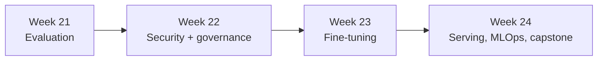
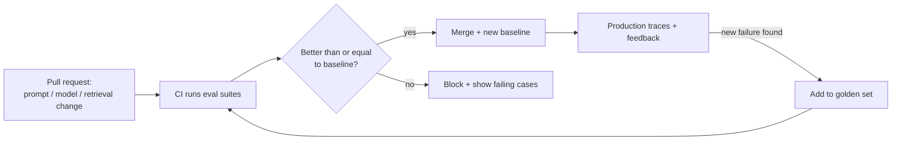
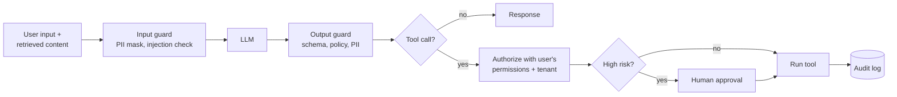
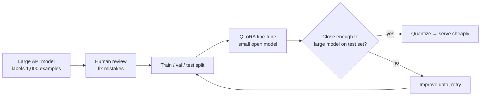
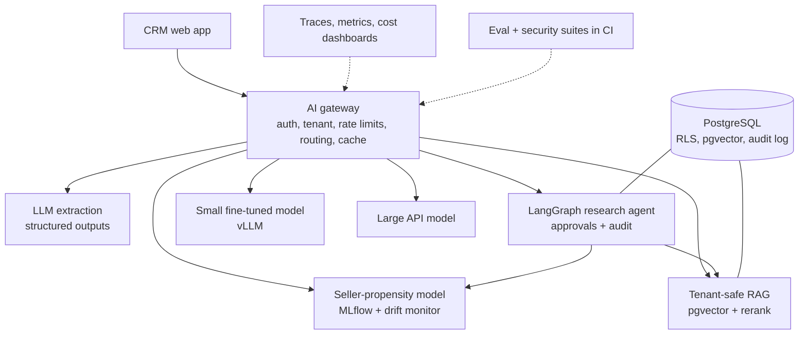

## What you finish with

By the end of Month 6 you deploy one integrated AI platform for your lead-generation product, with evaluations, security controls, a self-hosted model, monitoring and cost limits. This month turns a builder into an architect.

Part of [the 24-week plan](/learn/ai/ai-architect-24-week-plan). Previous: [Month 5](/learn/ai/month-5-ai-agents-and-tool-orchestration).



## Week 21: Evaluation as an engineering discipline

### Learn

- **Evals are your unit tests for AI.** Without them, every prompt or model change is a guess.
- **Types of evaluation:**

| Type | Example | Speed and cost |
| --- | --- | --- |
| Code-based checks | Valid schema, has a citation, under 200 words | Fast, free, exact |
| LLM-as-a-judge | Rubric: "is every claim supported by the sources?" | Medium; must be calibrated |
| Human review | Expert grades 50 answers | Slow, expensive, the ground truth |
| Online metrics | Thumbs up/down, edit rate, conversion | Real users, delayed signal |

- **Golden sets**: real examples, including hard and adversarial cases. Add a new case every time production finds a bug.
- **Regression testing**: run the full suite on every prompt, model or retrieval change and compare with the last baseline.
- **Pairwise comparison**: ask a judge "which is better, A or B?" It is more reliable than absolute 1-10 scores. Randomize the order to avoid position bias.
- **Hallucination rate**: the share of claims not supported by sources, measured on a fixed set.
- **Statistics matter**: 20 examples cannot detect a 3% change. Report sample size and confidence.
- **Tools**: LangSmith, Langfuse (open source), Ragas, DeepEval, promptfoo.



### Daily tasks

1. **Monday:** Combine all your eval sets (extraction, RAG, agent) into one runner with one report.
2. **Tuesday:** Write three LLM-judge rubrics and calibrate each on 30 human-graded examples (aim for at least 80% agreement).
3. **Wednesday:** Add pairwise model comparison. Compare your current model with a cheaper one.
4. **Thursday:** Capture online feedback (thumbs, edits) and store it with the trace ID.
5. **Friday:** Write an "AI quality dashboard" spec: metrics, thresholds and alerts.

### Weekend build

An eval CI pipeline in GitHub Actions that runs all suites, posts a comparison table on every pull request, and blocks merges on regressions.

### Checklist

- [ ] Every AI feature I own has an eval set and a baseline
- [ ] My LLM judge is calibrated against human grading
- [ ] Evals block bad changes in CI

## Week 22: AI security and governance

### Learn

- **Prompt injection**: instructions hidden in user input or in retrieved content (a web page, a PDF, a CRM note) try to hijack the model. **Indirect injection** through documents and tool results is the dangerous one for agents.
- **Defences in layers**, because no single defence is enough:
  1. Treat all retrieved and tool content as untrusted data, wrapped in clear tags.
  2. Least-privilege tools that act with the user's identity.
  3. Human approval for risky actions.
  4. Output validation before anything is executed or shown.
  5. An injection classifier as an extra layer, never the only one.
- **Data leakage**: system prompts, other tenants' data or secrets appearing in answers. Never put secrets in prompts.
- **Tenant isolation**: enforced in the database (row-level security), vector filters, caches, logs and fine-tuning data. A prompt that says "only use tenant X data" is not a control.
- **PII handling**: detect and mask personal data (for example with Microsoft Presidio) before sending it to external models where required. Know your provider's retention and training terms.
- **Output validation**: never run model output directly (SQL, shell commands, HTML) without validation and sandboxing.
- **Abuse and cost controls**: rate limits per user and tenant, token budgets and spending alerts.
- **Audit logging**: who asked what, which model answered, which data was retrieved, which actions ran and who approved them.
- **Frameworks to read**: OWASP Top 10 for LLM Applications, the NIST AI Risk Management Framework, and the EU AI Act basics if you serve EU users.



### Daily tasks

1. **Monday:** Read the OWASP Top 10 for LLM Applications. Map each risk to your system as mitigated, partly mitigated or open.
2. **Tuesday:** Red-team your agent with 20 direct and indirect injection attempts, such as instructions hidden in a property note. Log the results.
3. **Wednesday:** Add PII detection and masking, per-tenant rate limits and token budgets.
4. **Thursday:** Verify isolation end to end (RLS, vector filters, cache keys, logs) with automated tests.
5. **Friday:** Write a one-page "AI security architecture": threats, controls and owners.

### Weekend build

A security test suite (injection, cross-tenant access, PII leak, unsafe action) that runs in CI next to your evals.

### Checklist

- [ ] I can explain direct vs indirect prompt injection and layered defences
- [ ] Tenant isolation is enforced outside the model and tested
- [ ] Every AI action is audited

## Week 23: Fine-tuning and custom models

### Learn

- **Try in this order**: better prompt → few-shot examples → RAG → tools → fine-tuning. Fine-tune only when evals show the cheaper options are not enough.

| Requirement | Usually the best starting approach |
| --- | --- |
| Answer from company documents | RAG |
| Return exact JSON | Structured outputs |
| Use APIs and systems | Tool calling |
| Consistent style or tone | Prompting, possibly fine-tuning |
| Classify 1 million records cheaply | Classic ML or a small fine-tuned model |
| Domain-specific knowledge | RAG first, then evaluate fine-tuning |
| Custom model behaviour | Fine-tuning, if justified by evals |

- **Fine-tuning is good for**: consistent style or format, narrow high-volume classification or extraction, making a small cheap model match a large one (**distillation**), and lower latency. **It is not good for** teaching facts that change; use RAG for that.
- **Dataset preparation**: 500-5,000 high-quality examples usually beat 50,000 messy ones. Clean, remove duplicates, balance classes, and split into train, validation and test.
- **LoRA** trains small add-on matrices instead of all weights. **QLoRA** does the same on a 4-bit quantized model so it fits on one GPU. Both belong to **PEFT** (parameter-efficient fine-tuning).
- **Quantization** stores weights with fewer bits (16 → 8 → 4) to cut memory and speed up inference with a small quality loss. Common formats: GGUF (llama.cpp and Ollama), AWQ and GPTQ.
- **Tools**: Hugging Face Transformers, PEFT and TRL; Unsloth for fast single-GPU fine-tuning.
- **Evaluate before and after** on the same held-out test set, and check the model did not get worse at general tasks.



### Daily tasks

1. **Monday:** Complete the fine-tuning chapter of the Hugging Face LLM Course.
2. **Tuesday:** Build a 1,000-example dataset for one narrow task (for example, classify lead notes into eight motivation categories) from large-model outputs plus human review.
3. **Wednesday:** QLoRA fine-tune a small open model (1-8B parameters, such as Llama or Qwen) in Colab or Kaggle with Unsloth.
4. **Thursday:** Compare base small model, fine-tuned small model and large API model on accuracy, cost per 1,000 calls and latency.
5. **Friday:** Quantize to GGUF and run it locally with Ollama.

### Weekend build

A **distilled lead classifier**: a fine-tuned small model within a few points of the large model's accuracy at a fraction of the cost, with the comparison table in the README.

### Checklist

- [ ] I can say when fine-tuning is and is not justified
- [ ] I fine-tuned with QLoRA and evaluated before and after
- [ ] I know what quantization trades away

## Week 24: AI infrastructure, MLOps and the capstone

### Learn

- **GPU memory (VRAM)**: a model must fit. A rough rule: 16-bit weights need about 2 GB per billion parameters (an 8B model ≈ 16 GB). 4-bit needs about 0.5-0.6 GB per billion. Add memory for the KV cache, which grows with context length and concurrent users.

| Model size | 16-bit weights | 4-bit weights | Typical GPU |
| --- | --- | --- | --- |
| 3B | ≈ 6 GB | ≈ 2 GB | Laptop or small GPU |
| 8B | ≈ 16 GB | ≈ 5 GB | 24 GB GPU (L4, A10G, RTX 4090) |
| 70B | ≈ 140 GB | ≈ 40 GB | 2-4 × 80 GB GPUs, or one at 4-bit |

- **Model serving**: **vLLM** (high throughput with continuous batching and PagedAttention, OpenAI-compatible API), TGI, Ollama (local and development), and Triton or KServe at Kubernetes scale.
- **Latency vs throughput**: time to first token and tokens per second per user vs total tokens per second. Batching raises throughput and can raise latency.
- **Caching**: exact-match response cache, semantic cache for similar questions, and prompt-prefix caching.
- **Self-host or API?** Use an API for low volume, best quality and speed to market. Self-host for strict privacy, very high steady volume, or a fine-tuned small model. Do the cost math per million tokens, including GPU idle time.
- **MLOps for classic ML**: experiment tracking and model registry with **MLflow**, data and model versioning, scheduled retraining, and **data drift** and **model drift** monitoring (for example Evidently).
- **LLMOps**: prompt versioning, eval gates, traces, cost dashboards and canary releases of new models or prompts.
- **Observability**: Prometheus and Grafana for latency, errors, GPU use, tokens and cost; OpenTelemetry traces through the whole request.

```bash
docker run --gpus all -p 8000:8000 \
  -v ~/.cache/huggingface:/root/.cache/huggingface \
  vllm/vllm-openai:latest \
  --model Qwen/Qwen2.5-7B-Instruct \
  --max-model-len 8192

# OpenAI-compatible endpoint:
curl http://localhost:8000/v1/chat/completions \
  -H "Content-Type: application/json" \
  -d '{"model":"Qwen/Qwen2.5-7B-Instruct","messages":[{"role":"user","content":"Hello"}]}'
```

### Daily tasks

1. **Monday:** Serve an open or fine-tuned model with vLLM on a cloud GPU (RunPod, Modal, or AWS g5/g6). Load-test with 10, 50 and 100 concurrent users.
2. **Tuesday:** Track your seller-propensity experiments in MLflow and register the best model.
3. **Wednesday:** Add drift monitoring on input features and schedule a monthly retraining job.
4. **Thursday:** Add Prometheus metrics and a Grafana dashboard: latency, error rate, tokens, cost and GPU use.
5. **Friday:** Write the capstone architecture document: diagram, data flow, security, cost estimate and eval plan.

### Capstone: Lead Intelligence Platform



Integrate everything into one deployed system:

1. A seller-propensity ML model (Month 1), tracked in MLflow with drift monitoring.
2. LLM extraction of insights from property, owner and market data (Month 3).
3. Tenant-safe RAG over property records and documents, with citations (Month 4).
4. A LangGraph research agent that enriches a property, scores it, drafts outreach and waits for approval (Month 5).
5. Model routing (small fine-tuned model for classification, large API model for reasoning), caching and per-tenant cost budgets.
6. Eval and security suites in CI, and traces and dashboards in production (Month 6).
7. Deployment on Kubernetes or Docker Compose, with an architecture document and a five-minute demo video.

### Checklist

- [ ] I can estimate GPU memory for a given model
- [ ] I served a model with vLLM and load-tested it
- [ ] I can make a self-host vs API decision with cost math
- [ ] The capstone is deployed, documented and demoed

## Month 6 milestone

A production-grade Lead Intelligence Platform that combines predictive ML, LLMs, RAG and agents, with evals, security and monitoring. It is the centrepiece of your portfolio.

## Key takeaways

- Treat AI quality like software quality: golden sets, regression tests and CI gates.
- AI security is enforced by your backend, database and tool permissions, not by a prompt.
- Fine-tune only after prompting, RAG and tools fall short, and always evaluate before and after.
- Running AI in production is familiar engineering: capacity planning, serving, caching, monitoring and cost control.
