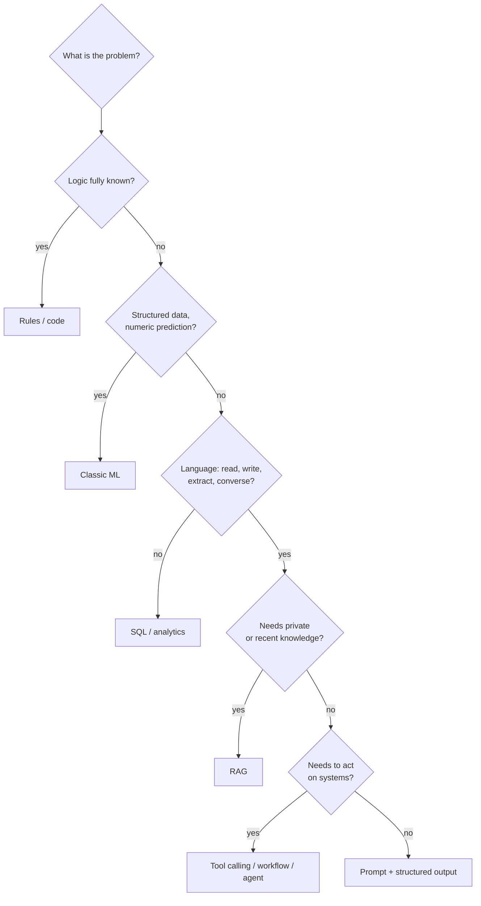

## How to use this page

Keep this page open while you work through [the 24-week plan](/learn/ai/ai-architect-24-week-plan). It answers four questions: which approach should I use, what does this word mean, where do I learn it, and am I ready for the role?

## Which approach should I use?

| Requirement | Start with | Move to when needed |
| --- | --- | --- |
| Fixed, clear business logic | Rules engine or code | ML when the rules become too many |
| Describe what happened | SQL and analytics | Dashboards |
| Predict from structured data (sell, convert, churn) | Classic ML (XGBoost) | Neural network only with very large data |
| Answer from company documents | RAG | Fine-tuning for style, rarely for facts |
| Return exact JSON | Structured outputs + validation | Small fine-tuned model at high volume |
| Act on systems (CRM, SMS, APIs) | Tool calling with approvals | LangGraph workflow or agent |
| Consistent tone or format | Prompt + few-shot examples | Fine-tuning |
| Classify 1 million records cheaply | Classic ML or a small fine-tuned model | Batch API with a small LLM |
| Strict data privacy | Open model, self-hosted | vLLM on your own GPUs |
| Multi-step research | Workflow with fixed steps | Agent, then multi-agent if measured better |

## Glossary in plain words

| Term | Meaning |
| --- | --- |
| Parameter / weight | A number inside a model that training adjusts |
| Feature | An input column used for prediction |
| Label / target | The answer a supervised model learns to predict |
| Training vs inference | Learning the weights vs using them to predict |
| Epoch | One full pass over the training data |
| Loss | One number for how wrong the model is |
| Gradient | The direction to change weights to reduce loss |
| Overfitting | Memorizing training data and failing on new data |
| Precision / recall | Correctness of flagged items / coverage of the true items |
| ROC-AUC | How well the model ranks positives above negatives |
| Data leakage | A feature that secretly contains the answer |
| Token | A piece of text, about three quarters of a word |
| Embedding | A vector of numbers that represents meaning |
| Cosine similarity | How closely two vectors point the same way |
| Transformer | The attention-based architecture behind modern LLMs |
| Attention | Each token weighing which other tokens matter |
| Context window | The maximum tokens a model can see at once |
| Temperature / top-p | Settings that control randomness in generation |
| Hallucination | Fluent output that is false or unsupported |
| RAG | Retrieve relevant data, then generate an answer from it |
| Chunk | A piece of a document stored for retrieval |
| Hybrid search | Vector (meaning) + keyword (exact) search combined |
| Reranker | A model that reorders retrieved results by relevance |
| Tool calling | The model asks your code to run a function |
| MCP | Model Context Protocol, a standard for exposing tools and data to AI apps |
| Agent | An LLM in a loop choosing actions until a goal is met |
| Human-in-the-loop | A person approves before an action runs |
| LLM-as-a-judge | Using a model to grade outputs against a rubric |
| Faithfulness | Whether every claim in an answer is supported by sources |
| LoRA / QLoRA | Cheap fine-tuning by training small add-on weights |
| Quantization | Storing weights with fewer bits to save memory |
| KV cache | Memory a model keeps per request to avoid recomputing past tokens |
| vLLM | A high-throughput server for open models |
| Drift | Real-world data changing so a model gets worse over time |
| Prompt injection | Hidden instructions that try to hijack the model |

## Learning resources

Most are free. You do not need to buy many courses.

| Resource | Use it for | Month |
| --- | --- | --- |
| [Machine Learning Specialization, Andrew Ng](https://www.coursera.org/specializations/machine-learning-introduction) | ML foundations | 1 |
| [3Blue1Brown](https://www.3blue1brown.com/) | Linear algebra, calculus and neural-network intuition | 1-2 |
| [scikit-learn user guide](https://scikit-learn.org/stable/user_guide.html) | Classic ML | 1 |
| [Neural Networks: Zero to Hero, Andrej Karpathy](https://karpathy.ai/zero-to-hero.html) | Backprop, tokenizer, GPT from scratch | 2 |
| [fast.ai Practical Deep Learning](https://course.fast.ai/) | Hands-on deep learning | 2 |
| [PyTorch tutorials](https://pytorch.org/tutorials/) | PyTorch fluency | 2 |
| [The Illustrated Transformer, Jay Alammar](https://jalammar.github.io/illustrated-transformer/) | Transformers visually | 2 |
| [Hugging Face LLM Course](https://huggingface.co/learn/llm-course) | Transformers, tokenizers, fine-tuning | 2, 6 |
| [Anthropic documentation](https://docs.anthropic.com/) | Prompting, tool use, structured output | 3 |
| [OpenAI platform documentation](https://platform.openai.com/docs) | Structured outputs, function calling | 3 |
| [DeepLearning.AI short courses](https://www.deeplearning.ai/short-courses/) | RAG, agents, evaluation | 3-6 |
| [pgvector](https://github.com/pgvector/pgvector) | Vector search in PostgreSQL | 4 |
| [Ragas](https://docs.ragas.io/) and [DeepEval](https://docs.confident-ai.com/) | RAG and LLM evaluation | 4, 6 |
| [Building effective agents, Anthropic](https://www.anthropic.com/engineering/building-effective-agents) | Agent patterns | 5 |
| [LangChain Academy](https://academy.langchain.com/) | LangGraph | 5 |
| [OWASP GenAI Security Project](https://genai.owasp.org/) | Top 10 risks for LLM applications | 6 |
| [vLLM documentation](https://docs.vllm.ai/) | Model serving | 6 |
| [MLflow documentation](https://mlflow.org/docs/latest/) | Experiment tracking and model registry | 6 |
| Book: *AI Engineering*, Chip Huyen | End-to-end AI system design | Throughout |
| Book: *Designing Machine Learning Systems*, Chip Huyen | Production ML architecture | 6 |

## Portfolio checklist

By Week 24 your public proof should include:

- [ ] Project 1: Enterprise Knowledge AI (RAG, citations, evals, tenant isolation)
- [ ] Project 2: Guarded AI Agent (LangGraph, tools, approvals, audit log)
- [ ] Project 3: Predictive Lead Intelligence (ML model, SHAP, MLflow, drift)
- [ ] Project 4: AI Voice Assistant (stretch goal after Month 6)
- [ ] Project 5: AI Research Team (multi-agent, cross-checked, cited reports)
- [ ] Capstone: Lead Intelligence Platform, deployed, with an architecture document and a demo video
- [ ] Six blog posts or LinkedIn articles, one per month, explaining what you built and measured
- [ ] A resume rewritten around outcomes, such as "cut cost per lead report 70% with model routing" or "raised recall@5 from 0.62 to 0.89"
- [ ] An AI system design story: draw the capstone architecture in ten minutes and defend each trade-off

## Target roles

| Role | Emphasis | Your strongest proof |
| --- | --- | --- |
| AI Engineer / Applied AI Engineer | LLM features, RAG and agents in production | Projects 1 and 2 |
| Senior / Staff AI Engineer | Reliability, evals, scale, mentoring | Eval CI, capstone |
| AI Solutions Architect | Choosing approaches, cost, integration, client design | Decision guide, architecture document |
| AI Platform Architect | Serving, routing, observability, multi-tenant governance | vLLM, routing, security suite |
| Forward Deployed AI Engineer | Building quickly with customers on real data | Lead-generation projects |

## After Week 24: pick a specialization

1. **AI platform and infrastructure**: GPU serving, Kubernetes, cost optimization at scale.
2. **Agents and automation**: complex multi-agent systems, voice agents, computer use.
3. **Search and knowledge**: advanced retrieval, knowledge graphs (GraphRAG), enterprise search.
4. **Applied ML**: forecasting, recommendation and causal inference for business decisions.
5. **AI governance and security**: red-teaming, compliance and responsible AI programs.

## Key takeaways

- Choose the simplest approach that meets the requirement: rules, SQL and classic ML often beat an LLM.
- Learn one tool deeply per area, and use the glossary until the terms feel natural.
- Your portfolio of measured, deployed projects matters more than certificates.
- Aim to be the person who can design, build, evaluate and run the whole AI system, not only the prompts.
