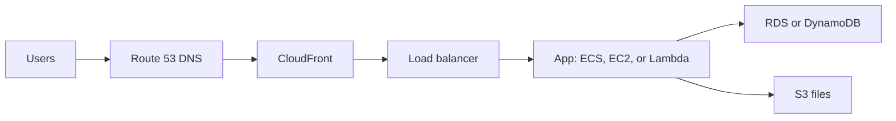

## The short version

AWS lets you rent computing building blocks instead of buying and operating your own servers. You pay for the services you use.

Think of it as a huge online hardware shop: you can rent a server, database, file storage, network, or message queue in minutes.

## Where AWS runs your app

| Word | Simple meaning |
| --- | --- |
| **Region** | A geographic area, such as `ap-southeast-1` (Singapore) |
| **Availability Zone (AZ)** | A separate data centre area inside one Region |
| **Account** | Your security and billing boundary |

For a reliable app, run copies in more than one AZ. Choose a Region near your users and one that supports the services you need.

## A beginner service map



| Need | AWS service to learn first |
| --- | --- |
| Store files | S3 |
| Run a server | EC2 |
| Run a container | ECS with Fargate |
| Run small event code | Lambda |
| SQL database | RDS |
| Login | Cognito |
| Logs and alarms | CloudWatch |

## Security and cost, from day one

Never use the root account for normal work. Turn on MFA, create separate development and production accounts when possible, and use IAM Identity Center or roles for temporary access.

Costs depend on use: running time, storage, data transfer, and requests. Add a budget alert before experimenting. Stop or delete test resources when finished.

## First commands

```bash
aws configure sso
aws sts get-caller-identity
aws configure list
```

The identity command tells you which account and role your terminal will affect. Run it before a change.

## A familiar example: move a small shop online

Imagine you sell books. Your website shows book covers, accepts orders, and emails customers. On your own computer, you might run everything together. On AWS, choose a service for each job:

| Part of the shop | Example AWS choice | Why it exists |
| --- | --- | --- |
| Website files | S3 and CloudFront | Store and deliver HTML, CSS, and images |
| Order API | Lambda or ECS | Execute your business logic |
| Orders and customers | RDS PostgreSQL | Store structured data with transactions |
| Uploaded covers | Private S3 bucket | Store file bytes separately from database records |
| Confirmation jobs | SQS | Let email work wait without blocking checkout |
| Application logs | CloudWatch | Find errors and follow requests |

You do not need to create all these services today. Start by learning storage and identity, then add compute when you understand what the application needs.

### Follow one order

1. A visitor opens the website; CloudFront delivers the frontend files.
2. The frontend sends `POST /orders` to an API.
3. The API validates the request and saves the order in a database.
4. The API places an email job on a queue after the order is accepted.
5. A worker processes the job independently.

Saving an order and publishing its event reliably requires extra design; the messaging lessons explain why a simple pair of API calls can fail between steps. For now, identify each component's responsibility.

## Understand the shared responsibility model

AWS manages physical buildings, hardware, and the underlying cloud platform. Your responsibilities depend on the service you choose.

With EC2, you patch the guest operating system and application. With a managed database, AWS handles more infrastructure work, but you still choose network access, credentials, backup settings, and database permissions. With S3, AWS operates storage, but you decide who can read your objects.

“Managed” removes some operational work. It does not automatically make an insecure application secure.

## Region, AZ, and account through the shop example

Choose a Region based on latency, data residency requirements, service availability, and cost. If you choose Singapore, keep a related application and database there unless you have a reason to distribute them.

An AZ consists of one or more discrete data centers with independent infrastructure. Running app copies in two AZs helps during an AZ failure, but a single database without an availability strategy can still stop the entire shop.

Use an account boundary to separate who can control resources. A learning account prevents experiments from altering production infrastructure. Changing the Region selector does not change the account.

## First guided exercise: identify your environment

You need an AWS account with permitted access. For organizational sign-in, an administrator first configures IAM Identity Center and assigns you a permission set. Install AWS CLI v2, then configure a named profile:

```bash
aws configure sso --profile academy
aws sso login --profile academy
aws sts get-caller-identity --profile academy
aws configure list --profile academy
```

The first command asks for your organization's SSO information and a default Region. The identity command returns an account ID and an ARN identifying your session. Compare the account ID with the account intended for your lab.

A CLI **profile** is a local named configuration, not an AWS permission role itself. Its login or credential settings determine which role you receive. If your organization does not use Identity Center, follow its approved temporary-credential workflow instead.

**Expected result:** you can name the account, role, and default Region before creating anything. If the session expires, sign in again rather than creating permanent access keys as a shortcut.

## Plan cost before creating services

A budget notification is an alert, not an automatic spending cap. Billing information and alerts can be delayed. An example learning budget might send messages at 50%, 80%, and 100% of your chosen monthly amount; choose an amount you are prepared to spend.

Think about what continues running: an idle virtual machine, load balancer, database, or NAT gateway can still cost money. Storage can continue to cost money after a server stops. Free-tier eligibility depends on your account and current service terms; do not assume every tutorial is free.

**Practice:** sketch the book shop using only a static frontend, API, and database. For each component, write its purpose, who can access it, and what you would delete after a lab.

Further reading: [AWS shared responsibility](https://aws.amazon.com/compliance/shared-responsibility-model/), [budget notification behavior](https://docs.aws.amazon.com/cost-management/latest/userguide/budgets-managing-costs.html).

## Developer learning path with concrete deliverables

Learn the request path before memorizing service names. Begin with identity and storage, then networking, compute, data, messaging, and operations. The following deliverables let you demonstrate understanding rather than simply recognizing acronyms.

| Stage | Deliverable | Explain before continuing |
| --- | --- | --- |
| Identity | Named CLI profile and a narrow read policy | Which account and role receive a request? |
| Storage | Private object upload and download | Why does an unsigned browser request fail? |
| Networking | Diagram of a two-AZ application | Which routes and rules permit each hop? |
| Compute | One repeatable deployment | Where are configuration, credentials, and persistent files? |
| Data | An order transaction and restore plan | What happens if the app crashes after saving? |
| Operations | Dashboard and incident runbook | How do you detect, diagnose, and recover? |

### Capstone: a small book shop

Write three endpoints: `GET /books`, `POST /orders`, and `GET /orders/{id}`. Store covers in private S3, order records in a database, and background notification work in a queue. Start with one compute platform rather than deploying EC2, ECS, and Lambda together.

Record every resource in a table with owner, purpose, environment, permissions, and cleanup action. Define success as a complete order flow, a denied unauthorized request, a handled duplicate submission, and a demonstrated recovery. Learn infrastructure as code once you can explain the manually built architecture.

**Self-check:** If the API is healthy but every database connection times out, buying a larger server is not a diagnosis. Trace name resolution, routing, firewall rules, database readiness, and application credentials in that order.

## Remember this

- AWS is rented infrastructure, not one product.
- An account is a security and billing boundary.
- A Region contains multiple AZs.
- Start with managed services when they fit; they remove operational work.
