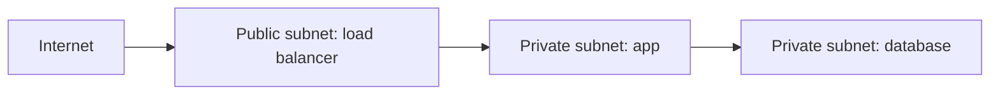
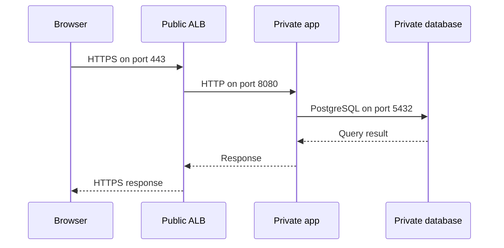

## The picture

A **VPC** is your private network in AWS. A **subnet** is a smaller section of that network, placed in one Availability Zone.



“Public” does not mean a subnet is unsafe. It means its route table can reach an internet gateway. Whether traffic is allowed still depends on security groups.

## The four pieces to understand

| Piece | Job |
| --- | --- |
| **CIDR** | The IP address range for a network, e.g. `10.0.0.0/16` |
| **Subnet** | A smaller IP range in one AZ |
| **Route table** | Tells traffic where to go next |
| **Security group** | Stateful firewall rules attached to AWS resources |

## A safe default layout

- Put the load balancer in public subnets.
- Put app containers or servers in private subnets.
- Put databases in private subnets with no public address.
- Allow the app security group to reach the database port; do not open the database to the internet.

For private apps to download updates, a NAT gateway can provide outbound internet access. It does not let unsolicited internet traffic enter.

## Security groups: allow only needed paths

```text
Internet → ALB: allow HTTPS 443
ALB → App: allow app port, source = ALB security group
App → Database: allow 5432, source = App security group
```

Using a security group as the source is safer than allowing a broad IP range.

## The VPC as a neighborhood

Imagine a neighborhood with its own address range. Subnets are streets, route tables are road signs, and security groups are access rules for each building. A road to a destination and permission to enter the building are both needed.

For the book shop, only the load balancer needs to accept public web traffic. App servers and the database can communicate inside the VPC.

## A concrete two-AZ layout

The following numbers are examples, not mandatory AWS conventions:

| Subnet | CIDR | AZ | Purpose |
| --- | --- | --- | --- |
| Public A | `10.42.0.0/24` | A | Load balancer and optional NAT gateway |
| Public B | `10.42.1.0/24` | B | Second load balancer attachment |
| App A | `10.42.10.0/24` | A | Private app tasks |
| App B | `10.42.11.0/24` | B | Private app tasks |
| Database A | `10.42.20.0/24` | A | Private database placement |
| Database B | `10.42.21.0/24` | B | Additional database AZ placement |

Use the enclosing VPC range `10.42.0.0/16`. CIDR suffixes describe the network portion of an address: `/24` contains 256 total IPv4 addresses. AWS reserves five addresses in a typical IPv4 subnet, so not every address is available to your workloads.

A subnet belongs to exactly one AZ. Deploying into two subnets in the same AZ does not provide AZ-level redundancy.

## Read a route table

```text
Public subnet route table:
10.42.0.0/16  → local
0.0.0.0/0    → internet gateway

Private app subnet route table, if using NAT:
10.42.0.0/16  → local
0.0.0.0/0    → NAT gateway

Isolated database subnet route table:
10.42.0.0/16  → local
```

`local` connects VPC addresses. `0.0.0.0/0` is the default IPv4 destination for traffic without a more specific match.

For an EC2 instance to communicate directly through an internet gateway over IPv4, it needs a public IPv4 address or Elastic IP, suitable routes, and allowing network rules. Merely placing it in a public subnet does not satisfy all these conditions.

A NAT gateway gives private IPv4 workloads a route for outbound connections. It adds ongoing and data-processing costs. An S3 gateway endpoint can instead provide access to S3 through VPC routing without requiring a NAT path for that traffic.

## Follow one HTTPS request



Create separate security groups. The app allows port 8080 from the ALB group. The database allows 5432 from the app group. This expresses a service relationship instead of relying on changeable instance IP addresses.

Security groups are **stateful**: response traffic for an allowed connection is tracked. Network ACLs operate at subnet boundaries, are stateless, and can allow or deny traffic. A restrictive ACL can break a path even when security groups permit it.

## Guided exercise without paid infrastructure

Draw the six subnets on paper, assign each a route table, and write the three inbound security-group rules. Trace traffic from the browser to the database. Then trace the app's outbound call to a third-party payment API.

**Expected result:** the browser reaches the ALB but has no direct database path. The app reaches the database over private addresses. The external payment call needs an appropriate outbound path, such as NAT for private IPv4 workloads.

## If the request times out

Check the destination name, the resolved address, route table associations, security groups, ACLs, and whether the process actually listens on the expected port. “Private subnet” does not explain every timeout. A web process bound only to `127.0.0.1` cannot accept load-balancer connections to its network interface.

**Practice:** the app listens on 8080, but its security group allows only 80. Which configuration do you change? Allow the actual app port from the ALB group and verify the target group's port too.

Further reading: [VPC subnets](https://docs.aws.amazon.com/vpc/latest/userguide/configure-subnets.html), [security groups](https://docs.aws.amazon.com/vpc/latest/userguide/vpc-security-groups.html).

## Work through two network failures

### Failure A: the app cannot reach PostgreSQL

Assume an app in `10.42.10.0/24` connects to a database on port 5432. Both resources have private addresses in the same VPC. You do not need a NAT gateway for this internal connection.

1. Resolve the database endpoint from the app environment.
2. Confirm both route tables retain the VPC local route.
3. Permit inbound 5432 on the database group from the app group.
4. Check app outbound rules and restrictive ACLs, including return traffic.
5. Verify database availability and that the client uses the correct endpoint.

A TCP timeout suggests investigating the network path. A PostgreSQL authentication error shows that the client reached a database process; investigate credentials and database privileges next.

### Failure B: the app cannot call an external API

A private IPv4 workload without an outbound route cannot reach a payment service on the public internet. Check its default route, NAT gateway placement, internet-gateway route from the NAT's public subnet, and outbound rules. Adding a public inbound rule does not create an outbound path.

**Exercise:** Draw both paths and mark their differences. State why an S3 endpoint can solve private S3 access but cannot provide access to an arbitrary payment-provider hostname.

## Remember this

- VPC = private network; subnet = a piece of it in one AZ.
- Route tables decide direction; security groups decide permission.
- Keep app and database private; expose only the load balancer.
- Debug network problems hop by hop: DNS → route → security group → app port.
