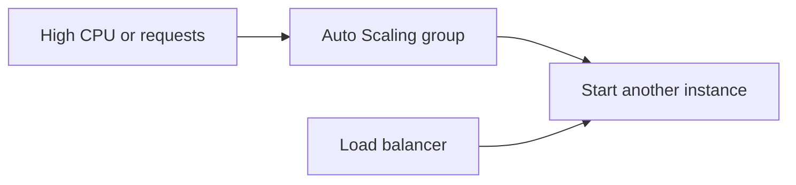

## EC2 in one sentence

An **EC2 instance** is a virtual server you manage: operating system, updates, application, and capacity are your responsibility.

Use EC2 when you need server control. For a simple container app, ECS Fargate often needs less maintenance.

## Important EC2 words

| Word | Meaning |
| --- | --- |
| **Instance type** | CPU, memory, network, and price shape of a server |
| **AMI** | Starting machine image for a server |
| **User data** | Startup script that runs when the server launches |
| **Instance role** | Temporary AWS permissions for the server |
| **EBS** | Durable block disk attached to a server |

An instance filesystem may use EBS or temporary instance-store storage. Inspect the backing storage and deletion settings; keep valuable data in deliberately managed durable storage with a backup strategy.

## Pricing choice

| Option | Best simple use |
| --- | --- |
| On-Demand | Short-term, unknown usage |
| Savings Plans | Predictable long-running usage |
| Spot | Interruptible batch or flexible workers |

## Auto Scaling

An Auto Scaling group keeps a chosen number of server copies running. It can replace unhealthy servers and add copies when a metric rises.



Create a launch template first: AMI, instance type, security group, role, and startup instructions. Then let the Auto Scaling group create matching instances in multiple AZs.

## One virtual server, explained through the shop

Suppose the book shop has a small Python API. An EC2 instance runs an operating system, your Python process, and any supporting software. AWS supplies the virtual hardware, but you must update the OS, supervise the process, and monitor health.

An AMI is the starting image. An instance type chooses CPU and memory capacity. A security group controls allowed connections. An instance profile connects an IAM role to the instance so software can obtain temporary credentials.

Start with capacity based on measured CPU and memory needs, not the largest server you can select. Check the application's processor architecture: an ARM machine image requires compatible software and dependencies.

## A guided single-server web lab

This lab creates billable resources. Use a learning account and delete the instance and remaining storage afterward. In the EC2 launch flow:

1. Select a current Amazon Linux 2023 AMI and a compatible small instance type.
2. Use a public subnet with an internet-gateway route and assign a public IPv4 address for this temporary web lab.
3. Allow inbound HTTP port 80 only from your current public IPv4 address as a `/32` rule. Do not open SSH to the world.
4. Choose a small EBS root volume and inspect its delete-on-termination setting.
5. Paste the following script in the user-data field.

```bash
#!/bin/bash
set -euxo pipefail
dnf install -y httpd
cat > /var/www/html/index.html <<'HTML'
<h1>Welcome to the book shop</h1>
<p>This page is running on one EC2 instance.</p>
HTML
systemctl enable --now httpd
```

This script assumes Amazon Linux 2023 and outbound package-repository access. It installs Apache, writes a page, and starts a service. User data commonly runs on first boot; editing it later is not a dependable deployment mechanism for an existing server.

Once startup completes, browse to `http://INSTANCE_PUBLIC_IP`. This is a temporary HTTP learning example. For a real app, use the HTTPS load-balancer pattern in the next lesson.

**Expected result:** the heading appears. A running EC2 status alone does not prove Apache started successfully. If it fails, inspect instance status checks and `/var/log/cloud-init-output.log` through an authorized access method. Systems Manager Session Manager requires its agent, an appropriate role, and network access to the required service endpoints.

## Understand storage before trusting it

| Storage | Useful for | Important behavior |
| --- | --- | --- |
| EBS | OS and block-disk data | Normally tied to one AZ; deletion settings matter |
| Instance store | Temporary scratch space | Data can be lost when the instance stops or terminates |
| S3 | Durable file objects | Accessed through object APIs, not a normal block disk |
| RDS | Relational application records | Separate managed database lifecycle |

Many EC2 filesystems are on EBS, so “on the instance” does not always mean instance-store storage. Inspect the volume type and deletion behavior. An EBS volume is durable, but durability alone is not a backup: accidental file deletion still needs a restore source.

Stopping an EBS-backed instance preserves attached EBS data but storage can continue to incur charges. Termination may delete the root volume depending on configuration. Inspect snapshots, retained volumes, and IP resources when cleaning up. See [EC2 termination behavior](https://docs.aws.amazon.com/AWSEC2/latest/UserGuide/how-ec2-instance-termination-works.html).

## Grow from one instance to a group

A launch template records how to create instances. An Auto Scaling group maintains minimum, desired, and maximum capacity. For example, minimum 2, desired 2, maximum 4 means two normal copies, with permission to grow to four.

Spread copies across AZs and place them behind an ALB. Use a metric such as CPU or requests per target for target tracking. Scaling takes time: startup, downloads, and health checks delay when a new instance can serve requests.

Keep user uploads in S3 and shared session data in an appropriate external store. Otherwise a user's next request may land on a new instance missing the first instance's local files.

**Practice:** one of two healthy app instances is terminated. What should restore capacity? The Auto Scaling group. What keeps accepting traffic while replacement starts? The remaining healthy target through the load balancer.

Further reading: [EC2 user data](https://docs.aws.amazon.com/AWSEC2/latest/UserGuide/user-data.html), [Auto Scaling groups](https://docs.aws.amazon.com/autoscaling/ec2/userguide/AutoScalingGroup.html).

## Build a replacement-friendly server

Treat an EC2 instance as replaceable compute. Store order data in a database and uploaded files in S3; local disk is unsuitable as the only copy of business data in an Auto Scaling group.

A launch template describes an AMI, instance type, security groups, IAM instance profile, and startup configuration. Prefer a known version over silently choosing whichever configuration is newest. Startup scripts should report failures and avoid embedding credentials.

### Example: two instances become four

Suppose each healthy instance handles 50 requests per second at your latency target. Two instances serve 80 requests per second with limited spare capacity. Load rises to 160. Scaling to four might provide capacity, but it will not help if the database is already the bottleneck.

Measure request latency, CPU, memory, dependency latency, and database connections. Account for startup time before choosing an aggressive scale-out policy. An instance being in the running state does not mean the application is ready.

### Operational exercise

In a dedicated lab, replace one instance using the group's ordinary replacement workflow. Confirm that the new instance starts without manual SSH configuration and that no uploaded files disappear. Record remaining EBS volumes, snapshots, public addresses, and other lab resources when cleaning up.

**Expected learning:** reliability comes from reproducible replacement and externalized state, not from keeping one carefully configured server alive forever.

## Remember this

- EC2 is a server you operate.
- EBS is a durable disk; instance-local data can disappear.
- Use an instance role instead of access keys.
- Auto Scaling groups keep the requested server capacity healthy.
