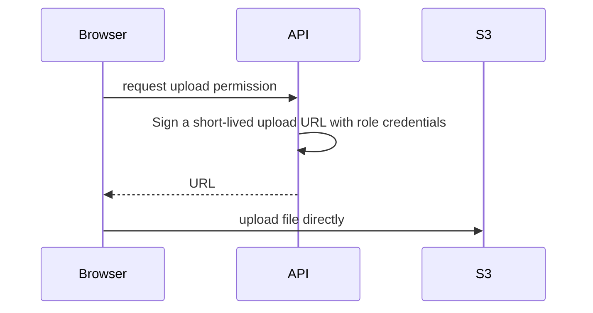

## What S3 is

S3 stores **objects**: files plus a key (their name/path). A bucket is the top-level container.

```text
bucket: shop-uploads
key: users/42/avatar.png
object: the image bytes and metadata
```

S3 is excellent for uploads, backups, images, exports, and static website assets. It is not a normal mounted server filesystem or a database.

## Keep buckets private by default

Leave Block Public Access on. Let your app access the bucket using its IAM role. Give only the paths and actions it needs.

```json
{
  "Effect": "Allow",
  "Action": ["s3:GetObject", "s3:PutObject"],
  "Resource": "arn:aws:s3:::shop-uploads/users/*"
}
```

Enable encryption and versioning for important data. Versioning makes accidental overwrites and deletes easier to recover from.

## Browser uploads: presigned URLs

Do not send a large file through your API server just to upload it. Your backend can create a short-lived **presigned URL**; the browser uploads directly to S3. Authorize the requested key before signing, and validate actual file size and contents as part of the upload workflow. A client-provided content type alone does not prove the file is safe.



## Cost control

Use lifecycle rules: move old files to a cheaper storage class or delete temporary files after a known period. Do not delete valuable data until you understand the rule and recovery policy.

## Object storage through book covers

For the shop, store a cover image in S3 and store its bucket/key reference in the database. The database answers which book owns the cover; S3 stores the bytes.

A key such as `books/42/cover.png` looks like a folder path, but S3 organizes objects by keys and prefixes. You do not create a traditional directory first. Uploading a new object under the same key replaces the current object; versioning can retain earlier versions.

## A small CLI lab

Create a private general-purpose bucket in a chosen Region through the S3 console. Choose a unique name, keep Block Public Access enabled, and use non-sensitive sample data. The following commands assume a bucket you own named `REPLACE_WITH_YOUR_BUCKET`, AWS CLI v2, a valid `academy` profile, and permission to list/read/write/delete lab objects.

```bash
printf 'Hello from the book shop\n' > sample.txt
aws s3 cp sample.txt s3://REPLACE_WITH_YOUR_BUCKET/lab/sample.txt \
  --profile academy
aws s3 ls s3://REPLACE_WITH_YOUR_BUCKET/lab/ --profile academy
aws s3 cp s3://REPLACE_WITH_YOUR_BUCKET/lab/sample.txt downloaded.txt \
  --profile academy
cat downloaded.txt
```

**Expected result:** the listing shows `sample.txt`, and the downloaded content matches the original. Opening the unsigned public object URL should be denied for a private bucket. A denied public request and a successful role-authenticated request are compatible outcomes.

For a temporary authenticated download:

```bash
aws s3 presign s3://REPLACE_WITH_YOUR_BUCKET/lab/sample.txt \
  --expires-in 300 --profile academy
```

The returned URL can be used to download that object. Anyone possessing it can use its authorized operation until it expires; treat it like a temporary credential and avoid logging it. Temporary credentials can expire before the requested URL lifetime.

## Direct upload from a browser

Your backend checks the customer's identity and chooses a key belonging to that customer. Then it signs an upload request. The signer creates the URL locally through its SDK using credentials; creating a URL does not require a separate call asking S3 to generate one.

This Python example assumes `boto3` is installed and the backend has role credentials permitting uploads to the bucket:

```python
import boto3

s3 = boto3.client("s3", region_name="ap-southeast-1")
url = s3.generate_presigned_url(
    "put_object",
    Params={
        "Bucket": "REPLACE_WITH_YOUR_BUCKET",
        "Key": "lab/browser-cover.png",
        "ContentType": "image/png",
    },
    ExpiresIn=300,
)
# Return url to an authenticated caller; do not print it into application logs.
```

A browser uploads with the matching method and signed header:

```javascript
// uploadUrl is returned by your API; file is a browser File from an input.
const response = await fetch(uploadUrl, {
  method: "PUT",
  headers: { "Content-Type": "image/png" },
  body: file,
});
if (!response.ok) throw new Error("Upload failed");
```

Configure S3 CORS to permit the intended website origin, method, and headers. CORS does not grant S3 authorization; the signed request supplies that.

A claimed file type or size from the browser is not proof of actual content. Validate uploaded objects before using them. If you need an upload size condition at the storage boundary, consider presigned POST policies with a content-length range instead of assuming a presigned PUT enforces a maximum file size.

## Versions, cleanup, and lifecycle

Enable versioning before trusting it to recover earlier data. Overwrite the sample, inspect versions in the console, and retrieve an earlier version. Ordinary deletion in a versioned bucket creates a delete marker; previous bytes can remain stored and billed.

```bash
aws s3 rm s3://REPLACE_WITH_YOUR_BUCKET/lab/sample.txt --profile academy
```

For complete lab cleanup, remove all versions and delete markers of lab objects, then delete the empty lab bucket if it is dedicated to this exercise. Lifecycle rules can expire temporary objects and old versions, but review their scope carefully.

**Practice:** explain why the database should store a stable object key rather than a presigned URL. **Answer:** the URL expires, while the key identifies the object so the app can generate new authorized URLs when needed.

Further reading: [S3 presigned URLs](https://docs.aws.amazon.com/AmazonS3/latest/userguide/using-presigned-url.html), [versioning](https://docs.aws.amazon.com/AmazonS3/latest/userguide/Versioning.html).

## Design an upload as a workflow, not just a URL

For a customer's book cover, create a database record with status `pending` and a server-selected key. Authorize the customer, issue a short-lived upload request, then verify the stored object before marking the record `ready`.

Check actual bytes, file size, allowed format, and any scanning required by the product. Keep unverified content separate from files the site serves. Do not trust a user-supplied path to choose another customer's key.

### Handle abandoned and repeated uploads

A customer may request a URL and never upload. An upload may succeed while the browser loses the response. Make finalization retryable: check the intended object's state and update the same pending record rather than creating multiple records. Clean up abandoned lab objects or pending production uploads through a scoped retention policy.

| Symptom | Check |
| --- | --- |
| Signature mismatch | Method, signed headers, expiration, and exact URL |
| Browser CORS failure | Origin and preflight configuration |
| Role gets AccessDenied | Object policy, bucket policy, encryption permissions |
| Unexpected old image | Key/version selection and CDN cache |

**Exercise:** Explain why permission to create a presigned URL must follow an ownership check, and why an expiring URL should not become the permanent database identity of an image.

## Remember this

- Bucket holds objects; object key is its name/path.
- Keep buckets private and use IAM roles.
- Use presigned URLs for direct, temporary browser uploads.
- Use versioning and lifecycle rules deliberately.
