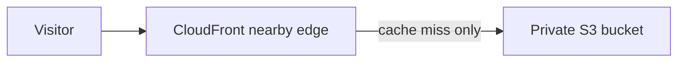

## The simple idea

CloudFront is a CDN. It keeps cached copies of files near visitors, so a visitor in another country does not always fetch images, JavaScript, or CSS from your original S3 bucket.



## Three words

| Word | Meaning |
| --- | --- |
| **Distribution** | Your CloudFront setup |
| **Origin** | The real source, such as S3 or an ALB |
| **Cache behavior** | Rules for paths, cache settings, and allowed methods |

## Safe static site setup

1. Store site files in S3.
2. Create a CloudFront distribution with that bucket as origin.
3. Use Origin Access Control so CloudFront can read the bucket but the public internet cannot.
4. Add an ACM certificate and Route 53 DNS record for your domain.

When you deploy changed filenames such as `app.abc123.js`, visitors naturally receive the new file. Avoid frequently invalidating every path; invalidations cost time and can cost money.

## Protection

AWS WAF can block common unwanted requests or rate-limit abusive clients. It is a helpful layer, not a substitute for secure application code and authentication.

## Follow a cache hit and a cache miss

Suppose the shop's logo is stored in Singapore while a reader visits from Europe. CloudFront can serve a cached copy from a nearby edge location. On a cache miss, it fetches the object from the origin, returns it, and can cache it for future requests.

Caching is a performance decision and a correctness decision. The important question is not just “can we cache this?” but “which visitors are allowed to share this response, and for how long?”

| Content | Example caching choice |
| --- | --- |
| `app.a1b2c3.js` | Long-lived public cache; filename changes with content |
| `index.html` | Short lifetime so new releases become visible |
| Public book cover | Cacheable with a deliberate freshness policy |
| `/api/me` personal profile | Disable shared caching unless a carefully designed policy isolates users |

Do not cache authenticated customer pages as if they were public files.

## Guided static-site lab

Use an existing private lab bucket with Block Public Access enabled. Create an `index.html` file:

```html
<!doctype html>
<html lang="en">
  <head><meta charset="utf-8"><title>Book shop</title></head>
  <body><h1>Our book shop</h1><p>Delivered through CloudFront.</p></body>
</html>
```

Upload it to the bucket root. Then configure CloudFront:

1. Choose the bucket's regular S3 origin, rather than its website endpoint.
2. Create and attach an Origin Access Control (OAC), with signing enabled.
3. Apply the generated bucket-policy permission for the particular distribution.
4. Set the default root object to `index.html`.
5. Redirect HTTP viewers to HTTPS and allow only needed methods.
6. Wait for deployment and open the distribution's HTTPS hostname.

**Expected result:** the page loads through CloudFront, while direct unsigned S3 access remains denied. You can use the distribution hostname without purchasing a custom domain for this lab.

OAC works with a regular S3 bucket origin, not an S3 website endpoint. Website endpoints have different behavior and are configured as custom origins. For the private-origin pattern here, keep the regular S3 origin.

## Understand the permission

An illustrative bucket-policy statement is:

```json
{
  "Effect": "Allow",
  "Principal": { "Service": "cloudfront.amazonaws.com" },
  "Action": "s3:GetObject",
  "Resource": "arn:aws:s3:::REPLACE_WITH_YOUR_BUCKET/*",
  "Condition": {
    "StringEquals": {
      "AWS:SourceArn": "arn:aws:cloudfront::123456789012:distribution/REPLACE_ID"
    }
  }
}
```

Replace the account, bucket, and distribution identifiers. Use the full generated policy or place this statement into a valid policy document. Merge it deliberately with existing statements rather than overwriting unrelated policy.

This authorizes a particular CloudFront distribution to read objects. It does not by itself authenticate visitors to that distribution. Private customer downloads need a viewer-access design, such as CloudFront signed URLs/cookies or an authenticated delivery path.

## See caching in a request

```bash
curl -I https://REPLACE_DISTRIBUTION_HOSTNAME/index.html
```

Inspect headers such as `x-cache`, `age`, and cache-control. A later request may report a cache hit; edge choice, timing, and configuration can affect the result. Do not treat one hit as proof that all paths are cached correctly.

If you overwrite the same file, CloudFront may continue serving cached bytes until expiration or invalidation. For one changed entry page, you can invalidate `/index.html` rather than every object. Versioned asset names let old and new releases coexist more predictably.

For a single-page app, consider what happens on a direct visit to `/books/42`. A regular S3 origin looks for that object key; client-side routes need a deliberate rewrite or fallback strategy. Do not blindly turn all origin errors into HTTP 200, especially on API paths.

**Cleanup:** disable and delete a dedicated lab distribution according to the console workflow, then remove its dedicated origin objects/bucket. Distribution deployment and deletion are not instantaneous.

**Practice:** a customer's profile appears in another customer's response. Why might caching be involved? A shared cache key or policy allowed personalized responses to be reused across viewers.

Further reading: [Private S3 origins and OAC](https://docs.aws.amazon.com/AmazonCloudFront/latest/DeveloperGuide/private-content-restricting-access-to-s3.html), [cache expiration](https://docs.aws.amazon.com/AmazonCloudFront/latest/DeveloperGuide/Expiration.html).

## Cache behavior through a deployment example

Publish `app.7c91.js` alongside an HTML page that references it. Give versioned assets a long cache lifetime because a new release uses a new filename. Give the HTML an intentionally shorter lifetime so users discover the new asset references.

If you overwrite `app.js` while its old response remains cached, some users can run an old bundle against a new API. Versioned filenames reduce that ambiguity. Keep old assets long enough for browsers with older HTML to load them.

### Private origin and public delivery

A private S3 origin can be accessed by CloudFront through Origin Access Control and a scoped bucket policy. This does not require making the bucket publicly readable. Conversely, content intended only for signed-in customers needs viewer authorization as well as private origin access.

Do not cache personalized responses under a key shared by all users. Decide which paths are cacheable, what varies their cache key, and whether cookies or authorization information must affect behavior. Inspect actual response headers and test with two identities.

**Exercise:** Update a lab's versioned JavaScript asset, then the HTML reference. Verify both old and new asset URLs still work. Compare that release with overwriting an unversioned filename and explain when invalidation would be required.

## Remember this

- CloudFront caches content close to users.
- Keep the S3 origin private; let CloudFront access it.
- Use versioned asset names for safe caching.
- WAF filters web traffic before it reaches your app.
