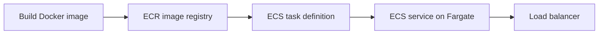

## The simple path



**ECR** stores container images. **ECS** runs them. **Fargate** is the ECS mode where AWS manages the servers underneath.

## Four ECS words

| Word | Meaning |
| --- | --- |
| **Cluster** | A logical home for ECS work |
| **Task definition** | The recipe: image, CPU, memory, ports, settings |
| **Task** | One running copy of that recipe |
| **Service** | Keeps the requested number of tasks running |

## Two roles that confuse beginners

- **Execution role:** lets ECS pull the image and send logs while starting the task.
- **Task role:** permissions used by your running application, for example reading one S3 bucket.

Your app needs the task role. Do not put AWS keys inside the image.

## A safe first deployment

1. Push an image with a real version tag, such as `1.2.0`, not only `latest`.
2. Create a task definition with CPU, memory, log configuration, and a task role.
3. Create an ECS service in private subnets.
4. Put an ALB in front of it and configure a health check.
5. Update the task definition image tag; ECS gradually replaces old tasks.

## A container recipe and a running copy

Think of a container image as a packaged application recipe. ECR is the shelf holding recipes. A task definition says which recipe and resources to use. A task is one running copy. An ECS service replaces copies when they stop.

Fargate removes the need to manage the underlying EC2 fleet. You still select task CPU/memory, networking, permissions, image versions, health checks, and scaling.

## Build an easy website image locally

Create this layout:

```text
bookshop-container/
  Dockerfile
  index.html
```

`index.html`:

```html
<h1>Book shop container</h1>
<p>This is release 1.</p>
```

`Dockerfile`:

```dockerfile
FROM nginx:stable-alpine
COPY index.html /usr/share/nginx/html/index.html
```

```bash
docker build -t bookshop-web:1 .
docker run --rm -p 8080:80 bookshop-web:1
```

Open `http://localhost:8080` from another terminal or browser. **Expected result:** the page shows release 1. Stop the local container with Ctrl+C. The base tag is convenient for a lab; pin a reviewed digest for reproducible production builds and plan updates deliberately.

## Push the image to ECR

Create an ECR repository called `bookshop-web`. The commands below assume AWS CLI v2, Docker, an authorized `academy` profile, Region `ap-southeast-1`, and that repository. Replace the account ID in every command.

```bash
aws ecr get-login-password --region ap-southeast-1 --profile academy \
  | docker login --username AWS --password-stdin \
    123456789012.dkr.ecr.ap-southeast-1.amazonaws.com

docker tag bookshop-web:1 \
  123456789012.dkr.ecr.ap-southeast-1.amazonaws.com/bookshop-web:1

docker push \
  123456789012.dkr.ecr.ap-southeast-1.amazonaws.com/bookshop-web:1
```

The ECR login authenticates Docker's registry operations. It does not grant the eventual application S3 or database permissions.

Build for the architecture configured in the task definition. An image built only for ARM may not start on an x86 task. Specify an appropriate platform during build or publish a suitable multi-architecture image.

## Map the image into an ECS service

In a learning environment, configure:

| Setting | Lab value or requirement |
| --- | --- |
| Launch type/capacity | Fargate |
| Operating system/architecture | Linux matching the built image |
| Task CPU and memory | A supported small pair, such as 0.25 vCPU / 0.5 GiB |
| Image | The pushed image URI and tag, or a pinned digest |
| Container port | 80 |
| Logs | CloudWatch log group with limited retention |
| Execution role | Permission to pull ECR image and publish logs |
| Task role | Only application permissions; this static app needs no S3 access |

Create a service with one task for a lab, or multiple tasks across AZs for an availability design. Private task subnets need outbound access to ECR and related dependencies, through NAT or appropriate VPC endpoints. An ALB can send traffic to the task's IP target on port 80.

The ALB security group accepts the intended viewer traffic. The task security group accepts port 80 from the ALB group. Private tasks do not need a public IP when these paths are configured.

This setup can create ongoing costs for Fargate, the ALB, networking, and logs. You can study the local container first without deploying AWS resources.

## Update and troubleshoot

Publish release 2, register a new task-definition revision, and update the service to use it. Watch task events and target health during rollout. Use distinct tags or digests; changing the bytes behind the same tag can make a release harder to identify.

If tasks stop immediately, inspect the stopped-task reason and logs. Common causes include the wrong architecture, a process that exits, invalid CPU/memory settings, and image-pull access problems. If tasks run but the ALB fails, inspect the container port, network rules, and health-check path.

**Cleanup:** delete the dedicated service, verify tasks have stopped, then remove dedicated ALB resources, images/repository, and log groups if no longer needed. Do not delete shared roles or networking.

**Practice:** the app cannot read an S3 object, but the image pulls correctly. Which role should you inspect? The task role, because that supplies the application's AWS permissions.

Further reading: [ECS roles](https://docs.aws.amazon.com/AmazonECS/latest/developerguide/ecs-iam-role-overview.html), [Fargate task definitions](https://docs.aws.amazon.com/AmazonECS/latest/developerguide/fargate-task-defs.html).

## Read a failed ECS deployment in layers

A task can fail before the application ever starts. Check service events and the stopped task's reason first, then application logs if the process actually ran.

| Stage | Example failure | Investigate |
| --- | --- | --- |
| Image fetch | Cannot pull image | Digest, repository, execution role, network path |
| Configuration | Cannot fetch secret | Secret ARN, execution permissions, endpoint access |
| Process start | Container exits | Entry command, architecture, required configuration |
| Health | Target stays unhealthy | Listening interface, port mapping, health path |
| Runtime API | S3 request denied | Application task role and resource policy |

The execution role supports infrastructure work such as retrieving images and configured secrets. The task role is used by your application's SDK calls. The distinction matters when an image pulls successfully but the app cannot write an object. See [AWS's ECS role overview](https://docs.aws.amazon.com/AmazonECS/latest/developerguide/ecs-iam-role-overview.html).

### Release exercise

Record the deployed image digest and task-definition revision. Deploy a new image with a different visible version response. Verify target health and application behavior, then roll back to the recorded revision. Reusing a mutable tag makes this evidence harder to interpret.

**Explain:** A service desired count of two does not prove two healthy copies are serving traffic. Compare desired, running, pending, and healthy target counts.

## Remember this

- ECR stores images; ECS runs them; Fargate removes server management.
- A service keeps task copies alive.
- Execution role starts the task; task role is for your app’s AWS access.
- Use explicit image versions and health checks.
