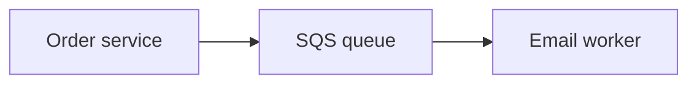

## Why messages help

If checkout sends an email directly and the email system is slow, checkout becomes slow too. A message lets checkout save the order quickly and hand the email work to another worker.



## Pick the tool by the job

| Service | Best simple description |
| --- | --- |
| **SQS** | A work queue: consumers share processing, with retry and duplicate handling |
| **SNS** | A topic: one message can notify many subscribers |
| **EventBridge** | An event router: rules send events to services by type/content |
| **Kinesis** | Ordered, high-volume stream processing |

## SQS basics that prevent lost work

When a worker receives a message, SQS hides it temporarily (visibility timeout). The worker deletes it only after success. If it fails repeatedly, send it to a dead-letter queue for investigation.

SQS is at-least-once delivery: design workers so a duplicate message is safe. Use a message or business ID to record work already completed.

## SNS fan-out example

For `order.placed`, SNS can send one copy to the email queue, analytics queue, and audit system. Each subscriber works independently.

## Queue, broadcast, and event routing through checkout

The shop creates an order and later generates a PDF receipt. Creating the PDF can take seconds. A queue lets checkout finish after the order is safely accepted, while a worker handles the slow task.

With one queue, several workers compete for work. With an SNS topic connected to separate queues, email and analytics each receive their own copy. With EventBridge, rules select which event types and contents go to which destinations.

These patterns solve different needs. Broadcasting to two consumers is not the same as adding two workers to one queue.

## A practical SQS lab

Create a **standard** queue named `academy-receipts` in your learning Region. Use AWS CLI v2 and an authorized profile. Retrieve the queue URL through the console or `get-queue-url` and replace the placeholder below.

```bash
aws sqs send-message \
  --queue-url REPLACE_QUEUE_URL \
  --message-body '{"job_id":"receipt-1001","order_id":"1001"}' \
  --profile academy

aws sqs receive-message \
  --queue-url REPLACE_QUEUE_URL \
  --max-number-of-messages 1 \
  --wait-time-seconds 10 \
  --visibility-timeout 30 \
  --profile academy
```

**Expected result:** receive returns a message body and `ReceiptHandle`. Receiving does not permanently remove the message. A receive can also return no messages, so production code must handle an empty result.

For this lab, pretend you generated the receipt successfully, then delete using the current receipt handle:

```bash
aws sqs delete-message \
  --queue-url REPLACE_QUEUE_URL \
  --receipt-handle REPLACE_WITH_CURRENT_RECEIPT_HANDLE \
  --profile academy
```

The receipt handle identifies this receive attempt. It is not the same as the stable message ID.

Now send another sample and receive it without deleting it. After the visibility timeout expires, try receiving again. It can become visible for another processing attempt. This demonstrates recovery from a worker that crashes after receiving work.

## Visibility timeout and dead letters

A 30-second visibility timeout is unsuitable for a job that normally takes two minutes. Choose a timeout allowing normal completion, or extend it while working. It is not a guarantee against every duplicate delivery.

Configure a dead-letter queue (DLQ) and a redrive policy with a reasonable maximum receive count. For example, after five failed receives, move the problematic message aside so workers can continue with other jobs. Investigate the cause before replaying it; otherwise replay simply repeats the failure.

Messages also have a retention period. A queue is durable within its service behavior, but it is not infinite historical storage.

## Duplicate-safe receipt generation

A simple processing contract is:

```text
receive message
validate job_id and order_id
claim or look up job_id in durable storage
if already complete: acknowledge without repeating the effect
otherwise: perform the operation through a retry-safe mechanism
record completion
delete the SQS message
```

The tricky case is a crash after an external effect but before recording completion. Use deterministic output keys or a provider-supported idempotency key so a retry does not repeat the side effect. A check-then-write without a conditional operation can also race between workers.

FIFO queues add ordering within message groups and deduplication support, but they do not make arbitrary external side effects magically exactly once. Still design safe retries.

## An EventBridge event

```json
{
  "source": "academy.shop",
  "detail-type": "OrderPlaced",
  "detail": {
    "order_id": "1001",
    "total_cents": 2500
  }
}
```

A rule matching source `academy.shop` and detail type `OrderPlaced` could route to a fulfillment queue. This example shows the event envelope concept; publishing through the API uses its required request format.

Saving the order and sending the event are separate operations unless you deliberately coordinate them. An outbox pattern stores an event alongside the order in the database transaction, then publishes it reliably later. Learn that pattern before trusting a naive production checkout flow.

**Cleanup:** delete only the dedicated lab queue and DLQ after checking no useful work remains.

**Practice:** email and analytics must both see every order. Should they read from one competing-consumer queue? No. Give them independent deliveries, such as SNS fan-out to separate queues.

Further reading: [SQS visibility timeout](https://docs.aws.amazon.com/AWSSimpleQueueService/latest/SQSDeveloperGuide/sqs-visibility-timeout.html), [SQS dead-letter queues](https://docs.aws.amazon.com/AWSSimpleQueueService/latest/SQSDeveloperGuide/sqs-dead-letter-queues.html).

## The missing event problem and the outbox pattern

Saving an order and sending an SQS message are two separate operations. If the order commits and the process dies before sending, the order exists but no notification job does. Sending first has the opposite risk: a consumer can observe work for an order that never committed.

In a relational system, write the order and an outbox row in the same database transaction. A publisher reads pending outbox rows, sends events, and marks publication progress. A crash after sending but before marking can create a duplicate; consumers still need idempotency.

```text
Transaction: order row + outbox event commit together
Publisher: pending event → queue → record sent progress
Consumer: validate event → process idempotently → acknowledge
```

An event should include a stable event ID, event type, schema version, relevant business identifier, and occurrence time. Avoid placing secrets or unnecessary customer data into messages.

### Poison-message exercise

Add a deliberately invalid sample message in a learning queue. Observe retry attempts, visibility behavior, and movement to the configured DLQ. Diagnose it before redriving: replaying the same incompatible event into an unchanged consumer repeats the incident.

**Explain:** Queue depth measures pending work, while age of the oldest message helps reveal delayed work. A rapidly growing backlog may need consumer capacity, a dependency fix, or reduced intake; scaling blindly can overwhelm a database.

## Remember this

- A queue separates the producer’s speed from the worker’s speed.
- Delete SQS messages only after successful processing.
- Expect duplicates and use a dead-letter queue.
- SNS broadcasts; EventBridge routes events by rules.
