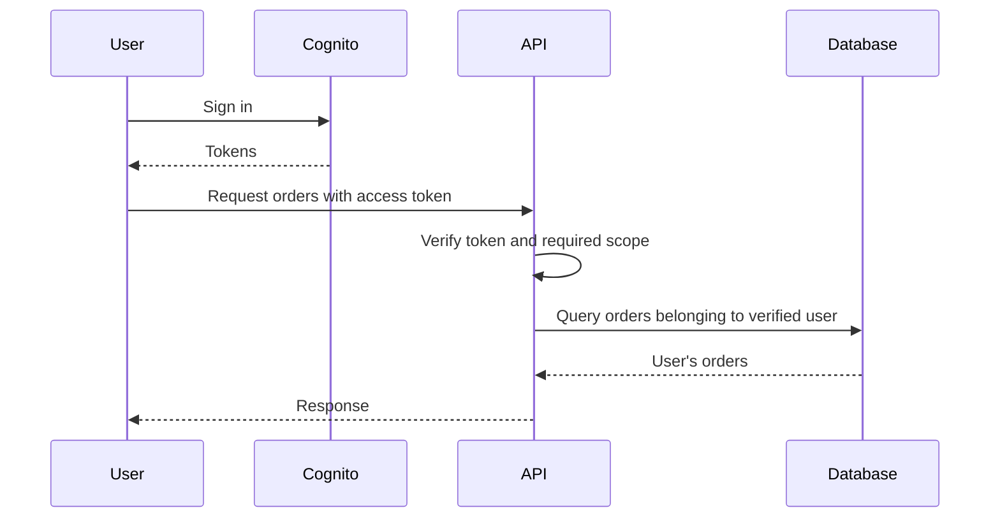

## Three separate jobs

| Need | AWS service |
| --- | --- |
| User sign-up and sign-in | Cognito User Pools |
| Passwords, API tokens, connection strings | Secrets Manager or Parameter Store |
| Encryption key management | KMS |

## Cognito

A Cognito User Pool manages application users. After sign-in, the app receives tokens. Your API must verify the token signature, issuer, audience/client, and expiry before trusting the user identity.

Do not treat a JWT as trustworthy just because it looks like one; validation is required.

## Secrets

Secrets Manager is a good fit for important credentials and supports rotation workflows. Parameter Store suits simpler configuration and can also hold secure strings. Neither means you should print secrets in logs or commit them to Git.

Give the running workload role permission to read only its required secret.

## KMS

KMS manages encryption keys used by many AWS services. Usually you ask a service such as S3, RDS, or Secrets Manager to encrypt with a KMS key; you do not encrypt every byte manually in app code.

## Separate customer identity from AWS identity

A shop customer signs in to view their orders. An employee signs in to administer the AWS account. These are different identities and permissions.

Cognito User Pools support application sign-in and tokens. IAM roles authorize workloads to call AWS APIs. A customer JWT should not become an administrator credential, and an ECS task role should not decide which customer's orders a request may read.

An **identity pool** is a different Cognito feature that can exchange identities for scoped temporary AWS credentials. You do not need it merely to authenticate users to your own API.

## A customer request, step by step



Authentication says who signed in. Authorization decides what they may read. After verifying a token, use the verified user identity to enforce ownership. Do not trust a browser's `customer_id=42` parameter as proof that it owns customer 42's orders.

## ID tokens and access tokens

An ID token describes the signed-in user for the client. An access token is used for authorized API access. A refresh token can obtain new tokens according to the client configuration.

Validate the signature against the pool's published keys, expected issuer, expiration, and expected token type. Also verify the appropriate client/resource audience rules and API scopes. In the common Cognito client checks, an ID token has `aud`, while an access token has `client_id`; resource-bound access tokens may additionally have an audience.

Use a maintained JWT verification library or a properly configured API Gateway authorizer. Base64-decoding the payload only reads it; it does not verify anything. Do not implement cryptographic verification by hand.

For a browser login flow, use authorization code with PKCE and a suitable public app client. A browser cannot keep a client secret confidential. Choose token/session storage with your application framework's security model and avoid exposing tokens in logs or URLs.

## Fetch a secret with the workload role

Assume you already created a Secrets Manager secret called `academy/shop/database`, containing:

```json
{"username":"shop_app","password":"replace-with-real-secret"}
```

Install `boto3` in a Python app and grant its workload role `secretsmanager:GetSecretValue` on that secret's ARN. If a customer-managed key is involved, grant the necessary KMS access too.

```python
import json
import boto3

client = boto3.client("secretsmanager", region_name="ap-southeast-1")
response = client.get_secret_value(SecretId="academy/shop/database")
credentials = json.loads(response["SecretString"])
username = credentials["username"]
password = credentials["password"]
# Pass these to your database client; never print credentials.
```

**Expected result:** authorized code obtains the JSON secret. Use an application-appropriate cache to avoid fetching on every request, and design how that cache refreshes after rotation. Merely changing a stored password is not a complete database rotation workflow: the database and application must coordinate the new credential.

This example retrieves the secret at runtime. ECS can alternatively inject configured secret values during task startup, using its execution-role permissions; injected values do not automatically refresh inside already running containers.

## Understand what KMS controls

Envelope encryption uses a data key for content and a KMS key to protect that data key. Managed services perform this flow for you. The KMS key policy and IAM permissions govern who may use the key.

Encryption at rest protects stored bytes. If an attacker has authorized API access to decrypt and read a secret, encryption alone does not stop that read. Limit both secret access and key access.

## Guided exercise

Draw three principals: customer, API workload, and developer. Give the customer access only to its own orders, the workload access to its one secret, and the developer the limited tools needed for diagnostics. Explain which permission belongs in application authorization and which belongs in IAM.

**Cleanup:** remove only dedicated lab users, clients, and secrets when finished. Do not disable or schedule deletion of a shared encryption key just to clean up a tutorial.

Further reading: [Cognito JWT verification](https://docs.aws.amazon.com/cognito/latest/developerguide/amazon-cognito-user-pools-using-tokens-verifying-a-jwt.html), [Secrets Manager retrieval](https://docs.aws.amazon.com/secretsmanager/latest/userguide/retrieving-secrets-python-sdk.html).

## Tenant authorization after token validation

A valid token proves particular claims were issued by the expected identity provider. It does not prove that the caller owns `order-9001`. After verifying signature, issuer, expected audience or client binding, expiration, and token purpose, apply domain authorization to the requested resource.

For example, load an order using both its identifier and the authorized tenant identifier. Do not accept a tenant ID from the request body as proof of ownership. Keep customer identity distinct from the IAM role your application uses to access AWS.

### Secret rotation without surprise downtime

A secret's value can change while a running process retains an old connection or cached credential. Decide how frequently your app refreshes secrets, how it handles authentication failures, and how rotation is tested. Do not log secret values to confirm refresh.

### Encryption recovery exercise

Document which KMS key protects each important store and backup. Restore permission requires both access to the backup and the needed decryption permissions. A copied backup that cannot be decrypted by the recovery role does not meet your recovery plan.

**Self-check:** Explain the different roles of HTTPS in transit, storage encryption at rest, IAM access to a secret, and authorization to view a customer's order. Each addresses a different boundary; none replaces the others.

## Remember this

- Cognito authenticates users; your API validates the token.
- Secrets belong in a secret service, not code, images, or Git.
- KMS controls encryption keys and access to use them.
- Give each workload only the secret and key access it needs.
