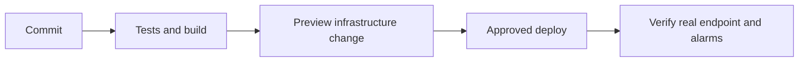

## Two habits that prevent surprises

1. Define infrastructure in code (Terraform, CloudFormation, or CDK), not only by clicking in the console.
2. Deploy through a reviewed pipeline, not from one person’s laptop.



## Infrastructure as code

| Tool | Simple description |
| --- | --- |
| Terraform | Works across many cloud providers; stores state remotely |
| CloudFormation | AWS-native templates and stacks |
| CDK | Write AWS infrastructure using programming languages |

Use separate environments and protect remote state. Treat the preview (`terraform plan` or CloudFormation change set) as something to review, not an automatic approval.

## CI/CD credentials

GitHub Actions can use OpenID Connect (OIDC) to assume an AWS role for a short time. This is safer than saving long-lived AWS keys as GitHub secrets. Restrict the role to the repository, branch/environment, and exact deployment permissions.

## Deployment safety

- Build an immutable artifact/image with a version.
- Test before production.
- Roll out gradually where possible.
- Keep a rollback path to the prior version.
- Verify the external route after deployment, not only “pipeline passed.”

## Two kinds of changes in the shop

Changing an S3 policy is an infrastructure change. Publishing a new API image is an application release. They may share a repository or pipeline, but their risks and rollback behavior differ.

Infrastructure as code records desired resource settings. Continuous integration checks and builds proposed changes. Continuous delivery produces reviewed deployable releases; whether production deploys automatically depends on your team's approval policy.

## A small CloudFormation template

Save this as `storage.yaml` to learn what a reviewed infrastructure definition looks like:

```yaml
AWSTemplateFormatVersion: '2010-09-09'
Description: Private storage for an AWS learning exercise
Resources:
  UploadsBucket:
    Type: AWS::S3::Bucket
    Properties:
      PublicAccessBlockConfiguration:
        BlockPublicAcls: true
        BlockPublicPolicy: true
        IgnorePublicAcls: true
        RestrictPublicBuckets: true
      VersioningConfiguration:
        Status: Enabled
      BucketEncryption:
        ServerSideEncryptionConfiguration:
          - ServerSideEncryptionByDefault:
              SSEAlgorithm: AES256
      Tags:
        - Key: Purpose
          Value: academy-lab
Outputs:
  BucketName:
    Value: !Ref UploadsBucket
```

CloudFormation generates a bucket name, avoiding a hard-coded naming collision. This template creates a private, versioned bucket; it does not grant an application permission to use it.

Validate syntax and create a preview without executing it:

```bash
aws cloudformation validate-template \
  --template-body file://storage.yaml --profile academy

aws cloudformation create-change-set \
  --stack-name academy-storage \
  --change-set-name initial-storage \
  --change-set-type CREATE \
  --template-body file://storage.yaml --profile academy
```

Wait for the change set to finish and inspect it in the console, or use:

```bash
aws cloudformation describe-change-set \
  --stack-name academy-storage --change-set-name initial-storage \
  --profile academy
```

**Expected result:** the preview shows an S3 bucket addition. Only execute it after verifying the target account, Region, and changes:

```bash
aws cloudformation execute-change-set \
  --stack-name academy-storage --change-set-name initial-storage \
  --profile academy
```

Validation is not a guarantee that deployment will succeed; permissions, quotas, and current resources also matter. This example is for a dedicated lab. Production data may need explicit retention policies and protection from stack deletion.

## An easy application pipeline

For the container from the ECS lesson:

1. Test the application and build the image once.
2. Tag it with the source revision and publish it to ECR.
3. Deploy that image digest to dev and test the public route.
4. Review production changes and required approvals.
5. Deploy the same artifact to prod through a controlled role.
6. Monitor target health, error rate, and latency during rollout.

Building a different image for production weakens the claim that you tested exactly what you deployed. Keep environment-specific configuration outside the immutable image where appropriate.

## OIDC credentials, simply explained

The CI platform presents a signed identity token. AWS checks a role's trust policy and issues short-lived role credentials if the repository, branch/environment, and audience match the allowed identity.

The trust policy controls who can obtain the role. Its permission policies control the deploy operations. Restrict both. Protect production environments and serialize deployment jobs so two releases cannot overwrite each other's decisions.

Do not give untrusted pull-request code production credentials. A workflow that runs arbitrary code with a powerful role can expose both secrets and infrastructure, even if the role credentials are short-lived.

## Rollback is a planned operation

For a broken image, redeploy the known previous digest and verify it. For a database schema change, the old application may no longer work with the new schema. Use backward-compatible expand/migrate/contract changes when appropriate.

Infrastructure rollback can fail or delete valuable resources; review resource replacement and data-retention behavior. A green pipeline means commands succeeded, not necessarily that customers can check out.

**Cleanup:** delete the dedicated lab stack after emptying all bucket versions and delete markers if objects were uploaded. Remove unused lab change sets. Do not delete production stacks as a rollback shortcut.

**Practice:** a release passes unit tests but every ALB target becomes unhealthy. Should you announce success? No. Check task startup and health routing, use the approved rollback, and verify the public route.

Continue with the [Terraform learning path](/learn/terraform) for a detailed plan/apply workflow.

Further reading: [CloudFormation change sets](https://docs.aws.amazon.com/AWSCloudFormation/latest/UserGuide/using-cfn-updating-stacks-changesets.html), [IAM OIDC federation](https://docs.aws.amazon.com/IAM/latest/UserGuide/id_roles_providers_create_oidc.html).

## Database changes need a different rollback plan

An application image can be rolled back while a schema change may already have transformed persistent data. Use an expand-and-contract migration when versions must overlap.

1. Add a new nullable field or compatible table without removing the old one.
2. Release code that can operate during the transition.
3. Backfill data in bounded batches and measure failures.
4. Switch reads only after validating the new representation.
5. Remove the old representation in a later release after the rollback window.

### Deployment artifact checklist

Build an image once, record its digest, and promote that artifact across environments. Environment-specific settings should be separate from image contents. Record source revision, tests, infrastructure plan, schema version, and rollback target.

An OIDC trust relationship should limit which repository and workflow context can assume the deployment role. A role permission policy should limit what that deployment can change. Short-lived credentials do not compensate for an overly broad trust policy.

**Exercise:** Your new release renames `customer_name`, but the previous release still reads it. Explain why rolling back only the image fails. Design a compatible migration and state when it becomes safe to delete the old field.

## Remember this

- IaC makes infrastructure reviewable and repeatable.
- Preview changes before applying them.
- Use temporary OIDC roles for CI/CD.
- A successful deployment is not complete until the real service works.
