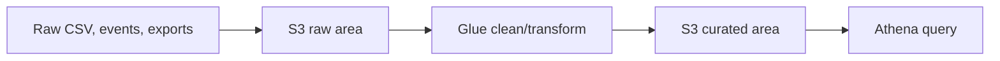

## The simple data journey



This is a **data lake**: files in S3 organized so analytics tools can read them.

## Keep the areas separate

| Area | What belongs there |
| --- | --- |
| **Raw** | Original data; do not silently change it |
| **Clean** | Validated, normalized data |
| **Curated** | Business-ready tables for reports |

Keeping raw data lets you fix a transformation later without asking the source system to resend everything.

## The tools

| Tool | Job |
| --- | --- |
| S3 | Stores the files |
| Glue Data Catalog | Keeps table definitions for files |
| Glue job | Transforms data |
| Athena | Runs SQL directly over S3 data |
| Firehose | Delivers streaming data into S3 |

Use Parquet for analytical data when possible: it is compressed and column-oriented, so Athena scans less data and costs less. Partition files by a field you filter often, such as date.

## A report that does not burden checkout

The shop needs a daily sales report. Running large reporting queries on the live checkout database during a sale can compete with customer traffic. A data pipeline exports or delivers records into analytical storage so reporting can operate separately.

The important first step is defining the business meaning of a row. Does it represent an order created, a payment captured, or an item shipped? Those are different events, and mixing them produces misleading revenue reports.

## A tiny raw dataset

Save this as `orders.csv`:

```csv
order_id,order_date,total_cents,status
1001,2026-10-01,2500,paid
1002,2026-10-01,1800,paid
1003,2026-10-02,900,cancelled
```

For this exercise, paid orders count as sales and cancelled orders do not. The first day's sales should be 4300 cents, or 43.00 in the example currency.

Upload the file to a dedicated S3 prefix such as `s3://REPLACE_DATA_BUCKET/raw/orders/`. Keep unrelated files outside that prefix because Athena's table location refers to a collection of objects, not just one named file.

## Understand ETL with ordinary Python

**Extract** obtains records, **transform** validates and normalizes them, and **load** writes the result. This example runs locally before you introduce Glue:

```python
import csv

with open("orders.csv", newline="") as source, \
     open("paid-orders.csv", "w", newline="") as destination:
    reader = csv.DictReader(source)
    writer = csv.DictWriter(destination, fieldnames=reader.fieldnames)
    writer.writeheader()
    for row in reader:
        cents = int(row["total_cents"])
        if cents < 0:
            raise ValueError("Order total cannot be negative")
        if row["status"] == "paid":
            writer.writerow(row)
```

**Expected result:** `paid-orders.csv` contains orders 1001 and 1002 plus the header. The raw input remains unchanged so you can reproduce the transform. A production pipeline would also address malformed records, currency, duplicate IDs, changing schemas, and reconciliation with the source.

## Query the raw CSV with Athena

Configure an Athena workgroup with a private S3 query-result location and appropriate permissions. Query scans, result storage, and associated services can incur charges. Create a practice database:

```sql
CREATE DATABASE IF NOT EXISTS academy;
```

Then create a table for this simple unquoted CSV format:

```sql
CREATE EXTERNAL TABLE academy.orders_raw (
  order_id STRING,
  order_date STRING,
  total_cents INT,
  status STRING
)
ROW FORMAT DELIMITED
FIELDS TERMINATED BY ','
STORED AS TEXTFILE
LOCATION 's3://REPLACE_DATA_BUCKET/raw/orders/'
TBLPROPERTIES ('skip.header.line.count'='1');
```

This simple parser is sufficient for the illustrated data. CSV with quoted commas or more complex formatting needs an appropriate SerDe, such as OpenCSVSerDe, and deliberate type handling.

```sql
SELECT order_date, SUM(total_cents) AS paid_total_cents
FROM academy.orders_raw
WHERE status = 'paid'
GROUP BY order_date
ORDER BY order_date;
```

**Expected result:** one row with `2026-10-01` and `4300`. Creating the external table records metadata in the catalog; it does not move the source files into a database server.

## Grow the pipeline only when needed

Glue Data Catalog describes tables and file locations. A Glue job runs transformations, such as converting raw CSV into typed, validated Parquet. A crawler can help discover schemas, but automatically inferred schemas still require review.

For larger data, partition by an often-filtered value such as `order_date` and use Parquet so queries read fewer relevant columns. Merely naming folders by date is not enough: configure table partitions or partition projection so the query engine understands them.

A report rerun should not duplicate every order. Choose overwrite-by-partition, merge, or durable event deduplication according to the model. Preserve raw inputs and record which batch/version produced each result.

## Common errors to investigate

| Symptom | Check |
| --- | --- |
| Query returns zero rows | Table location, actual objects, filters, and partitions |
| Headers appear as records | Header-skip property and file format |
| Invalid numeric values | Source quality, column order, and parser/schema |
| Duplicate revenue | Reprocessed batches or multiple events per order |
| AccessDenied | Input bucket, result bucket, catalog, and encryption permissions |

**Cleanup:** dropping an external table removes metadata rather than deleting source S3 objects. Remove dedicated input files, query results, and any jobs you created separately when the lab ends.

**Practice:** yesterday's report is twice as large after a retry. What should you inspect before blaming Athena? Whether the pipeline loaded the same records twice and whether the report counts the intended business event.

Further reading: [Athena CSV schemas](https://docs.aws.amazon.com/athena/latest/ug/schema-csv.html), [Athena partitioning](https://docs.aws.amazon.com/athena/latest/ug/partitions.html).

## Design for late and duplicate records

A report for Monday can receive a late order correction on Tuesday. Decide whether reports are immutable snapshots, revised partitions, or views over corrected data. Store an event time and ingestion time so the difference is visible.

Keep raw source data available under a deliberate retention policy. Transform into typed, validated records, and quarantine malformed rows instead of silently dropping them. Use a stable record identifier to distinguish a legitimate correction from a duplicate delivery.

### Partitioning example

Organize curated order data by date when the common query asks for a date range. Partition pruning and columnar formats can reduce data scanned. Too many tiny files can add overhead, while one giant unpartitioned dataset makes selective reports expensive.

Record input version, transformation version, output location, and row counts. Re-running a job for the same input should have an intentional behavior: overwrite its scoped output or produce a new version, rather than blindly appending duplicate rows.

**Exercise:** Reprocess yesterday's data after fixing a currency conversion error. Explain how you identify affected outputs, avoid mixing old and corrected records, compare totals, and preserve the previous version for audit. Include permission and cleanup planning for temporary outputs.

## Remember this

- A data lake is organized files in S3.
- Keep raw, clean, and curated data separate.
- Glue describes/transforms data; Athena queries it with SQL.
- Parquet and partitions reduce query cost.
