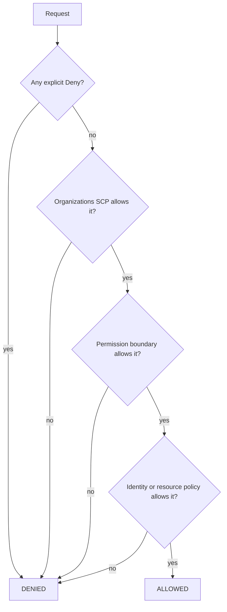
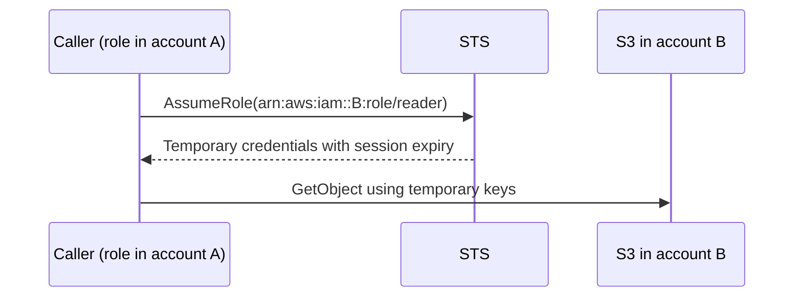

## How AWS decides: the evaluation logic

Requests begin without granted access. The diagram summarizes a common identity-policy path, not every resource-policy case. Applicable controls and principal type determine the full evaluation.



Three facts to remember:

1. An **explicit Deny always wins**.
2. SCPs and permission boundaries **limit** permissions; they never grant them.
3. Within the **same account**, a resource policy can grant access on its own. For **cross-account** access, both sides must allow it.

## Policy types

| Policy | Attached to | Purpose |
| --- | --- | --- |
| **Identity-based** | User, group, role | What this identity may do |
| **Resource-based** | S3 bucket, SQS queue, KMS key, Lambda | Who may use this resource |
| **Permission boundary** | User or role | Maximum permissions it can ever have |
| **SCP** | Organization, OU or account | Maximum permissions for the whole account |
| **Session policy** | A temporary session | Narrows one session further |

## Roles and STS

A **role** has no password or long-term keys. A principal **assumes** it through **STS** and receives temporary credentials.



A role has two policies:

- **Trust policy**: who may assume it.
- **Permissions policy**: what it may do after assumption.

```json
{
  "Version": "2012-10-17",
  "Statement": [{
    "Effect": "Allow",
    "Principal": { "AWS": "arn:aws:iam::111111111111:role/deployer" },
    "Action": "sts:AssumeRole",
    "Condition": { "StringEquals": { "sts:ExternalId": "partner-2024" } }
  }]
}
```

Use an **external ID** when a third party assumes a role in your account, to prevent the confused-deputy problem.

```bash
aws sts assume-role --role-arn arn:aws:iam::222222222222:role/reader --role-session-name audit
aws sts get-caller-identity     # Still uses the current profile, not the returned credentials
```

## Conditions make policies precise

```json
{
  "Effect": "Allow",
  "Action": "s3:*",
  "Resource": ["arn:aws:s3:::shop-uploads", "arn:aws:s3:::shop-uploads/*"],
  "Condition": {
    "Bool": { "aws:SecureTransport": "true" },
    "IpAddress": { "aws:SourceIp": "203.0.113.0/24" }
  }
}
```

Useful condition keys: `aws:SourceIp`, `aws:SourceVpce`, `aws:MultiFactorAuthPresent`, `aws:PrincipalOrgID`, `aws:RequestedRegion`, `aws:PrincipalTag/*`.

Use `aws:PrincipalOrgID` in resource policies to allow "anyone in my organization" without listing every account.

## Attribute-based access control (ABAC)

Instead of one policy per team, match **tags** on the person and the resource:

```json
{
  "Effect": "Allow",
  "Action": ["ec2:StartInstances", "ec2:StopInstances"],
  "Resource": "*",
  "Condition": {
    "StringEquals": { "aws:ResourceTag/team": "${aws:PrincipalTag/team}" }
  }
}
```

A user tagged `team=payments` can only touch instances tagged `team=payments`. New teams need no new policy.

## Permission boundaries for safe delegation

Let developers create roles, but cap what those roles can do:

```json
{
  "Effect": "Allow",
  "Action": "iam:CreateRole",
  "Resource": "arn:aws:iam::*:role/app-*",
  "Condition": {
    "StringEquals": {
      "iam:PermissionsBoundary": "arn:aws:iam::123456789012:policy/dev-boundary"
    }
  }
}
```

This statement only permits creating matching roles with the required boundary; it does not permit attaching policies. Scope attachment separately with `iam:PolicyARN`, protect the boundary from removal or modification, and review role trust changes and `iam:PassRole`. Creating a role alone does not grant administrator access. See [IAM policy attachment controls](https://docs.aws.amazon.com/IAM/latest/UserGuide/access_controlling.html).

## Finding and fixing problems

- **IAM Policy Simulator** tests whether a principal can perform an action.
- **IAM Access Analyzer** finds resources shared outside your account and can generate least-privilege policies from CloudTrail activity.
- **Last accessed** data shows unused permissions to remove.
- Decode `AccessDenied` messages: `aws sts decode-authorization-message --encoded-message ...`.

## Worked cross-account read: account A into account B

The shop's audit role in account A needs to read receipt files owned by account B. Use a dedicated reader role in B and explicitly scope both the assumption path and the resulting permissions.

1. In A, allow the caller to perform `sts:AssumeRole` on B's reader-role ARN.
2. In B, make the reader role's trust policy admit that specific caller, with relevant conditions.
3. Give B's reader role object-read permission on the intended receipt prefix.
4. Check applicable organization controls and boundaries, plus resource policies and encryption permissions.
5. Configure a local role profile and verify the resulting caller identity before testing access.

AWS evaluates cross-account access on both sides. See [cross-account evaluation](https://docs.aws.amazon.com/IAM/latest/UserGuide/reference_policies_evaluation-logic-cross-account.html).

### Use a role profile instead of copying credentials

Assuming your approved source profile already works, a local configuration can select a role:

```ini
[profile receipt-reader]
role_arn = arn:aws:iam::222222222222:role/receipt-reader
source_profile = academy
role_session_name = academy-audit
region = ap-southeast-1
```

Replace account IDs, role, and Region with your lab values. Then use `aws sts get-caller-identity --profile receipt-reader`. The output should identify B and the assumed reader role. Calling `assume-role` in one command does not automatically change the credentials of your next command.

### Why permission boundaries need nuance

The introductory diagram is a simplified mental model. Same-account resource grants can behave differently depending on whether the principal is a user ARN, role ARN, or role-session ARN. In particular, some direct resource grants are not limited by an implicit deny in identity or boundary policies. Explicit denies still matter. Consult [the detailed evaluation rules](https://docs.aws.amazon.com/IAM/latest/UserGuide/reference_policies_evaluation-logic_policy-eval-denyallow.html) before relying on boundaries alone.

### Guided diagnostic exercise

Create a permission matrix with three cases: assumption denied, assumption allowed but object read denied, and intended read allowed. For each failure, identify whether it concerns the trust relationship, role permissions, resource restrictions, or encryption. Test with sample receipt data and a dedicated role; do not broaden to administrator access just to make the final case pass.

## Remember this

- Explicit deny wins; SCPs and boundaries only restrict.
- Cross-account needs a trust policy plus a permission in the assumed role (or both sides of a resource policy).
- Prefer roles and short-lived credentials over access keys.
- Use conditions and tags to be precise; watch for IAM privilege escalation paths.
