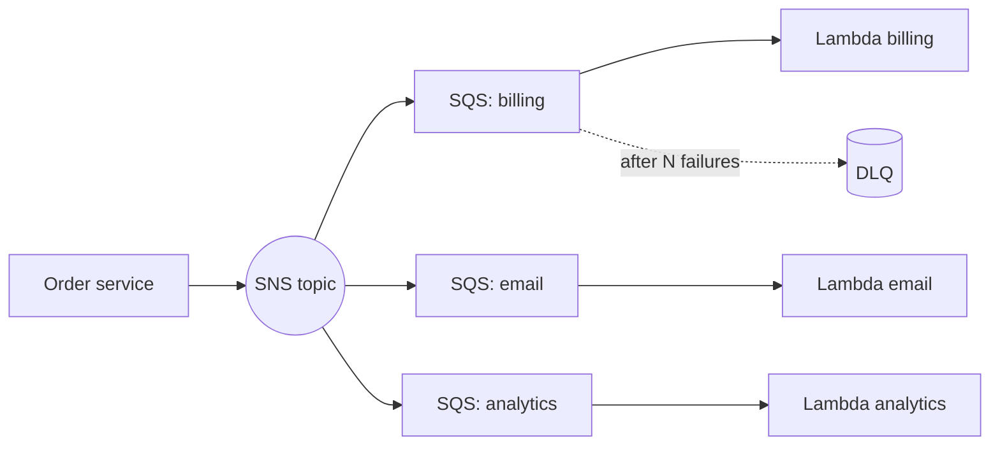

## Messages are delivered at least once

SQS standard queues, SNS, EventBridge and Lambda retries can all deliver a message **more than once**. Design for it: make handlers **idempotent**, so running twice gives the same result as running once.

```text
handler(event):
  validate(event)
  perform_operation_with_stable_idempotency_key(event.operationId)
  persist_confirmed_result_or_recoverable_pending_state()
```

This is a design sketch, not a complete implementation. A conditional claim prevents concurrent workers from starting the same operation, but external side effects also need idempotency or reconciliation. **Powertools for AWS Lambda** provides an idempotency utility; understand its persistence and failure semantics for your chosen operation.

## Choose the right glue

| Service | Pattern | Use when |
| --- | --- | --- |
| **SQS** | Queue, one consumer group | Buffering work, smoothing spikes |
| **SNS** | Pub/sub fan-out | One event, many subscribers |
| **EventBridge** | Event bus with rules and filtering | Routing events between services, SaaS and schedules |
| **Kinesis / MSK** | Ordered streams | High-throughput, replayable streams |
| **Step Functions** | Orchestrated workflow | Multi-step flows with branching, retries and waits |

**SNS to SQS fan-out** is a classic: publish once, and each team has its own queue and DLQ.



## Making SQS plus Lambda reliable

1. AWS recommends a **visibility timeout of at least six times the function timeout plus the configured batch window**, giving room for processing and throttling retries.
2. Configure a **dead-letter queue**; AWS recommends `maxReceiveCount` of at least 5 for Lambda consumers. Tune it for the workload and alarm on DLQ depth.
3. Enable **partial batch response** so one bad message does not retry the whole batch:

```json
{ "batchItemFailures": [ { "itemIdentifier": "msg-id-7" } ] }
```

4. Use **FIFO queues** with a `MessageGroupId` when order matters; remember the throughput limits per group.
5. Set **reserved concurrency** or event source `maximumConcurrency` so a burst cannot overwhelm your database.

AWS reference: [SQS event-source configuration](https://docs.aws.amazon.com/lambda/latest/dg/services-sqs-configure.html).

## Lambda concurrency and cold starts

| Setting | Effect |
| --- | --- |
| **Reserved concurrency** | Guarantees and caps a function's concurrency |
| **Provisioned concurrency** | Keeps environments warm to avoid cold starts |
| **SnapStart** (Java and some runtimes) | Restores from a snapshot for faster start |

Reduce cold starts by keeping packages small, initializing SDK clients **outside** the handler, and choosing arm64 (Graviton) for lower cost.

## Step Functions: orchestration instead of spaghetti

Putting a multi-step flow inside one Lambda, or chaining Lambdas through queues, makes failures hard to follow. **Step Functions** draws the flow as a state machine with built-in retries, timeouts, waits and parallel branches.

```json
{
  "StartAt": "ReserveStock",
  "States": {
    "ReserveStock": {
      "Type": "Task",
      "Resource": "arn:aws:states:::lambda:invoke",
      "Parameters": {
        "FunctionName": "reserve-stock",
        "Payload.$": "$"
      },
      "ResultPath": "$.reservation",
      "TimeoutSeconds": 30,
      "Retry": [
        {
          "ErrorEquals": [
            "Lambda.ServiceException",
            "Lambda.TooManyRequestsException"
          ],
          "IntervalSeconds": 2,
          "MaxAttempts": 3,
          "BackoffRate": 2.0
        }
      ],
      "Catch": [
        {
          "ErrorEquals": [
            "States.ALL"
          ],
          "ResultPath": "$.failure",
          "Next": "NeedsReview"
        }
      ],
      "Next": "RecordOutcome"
    },
    "RecordOutcome": {
      "Type": "Pass",
      "End": true
    },
    "NeedsReview": {
      "Type": "Fail",
      "Error": "ReservationRequiresReview"
    }
  }
}
```

| Workflow type | Best for |
| --- | --- |
| **Standard** | Long-running (up to 1 year), exactly-once execution, auditable history |
| **Express** | Short (up to 5 minutes); asynchronous is at-least-once, synchronous is at-most-once |

Features worth knowing: `Map` for parallel iteration over a list, `Wait` for timers, **callback tokens** to pause for a human approval, and direct **SDK integrations** that call 200+ AWS services without a Lambda.

### The saga pattern

A saga coordinates steps with **compensating actions** where needed, such as releasing a confirmed reservation after a later failure. The example above is only a reservation workflow: it preserves input, captures a task result, and routes failures to review. `RecordOutcome` is a placeholder Pass state, not durable storage. Implement persistence and an idempotent `reserve-stock` handler before deployment. A full payment saga must track confirmed charges, uncertain outcomes, and compensation failures rather than blindly refunding every exception.

## EventBridge tips

- Create **custom buses** per domain and filter with event patterns:

```json
{ "source": ["shop.orders"], "detail-type": ["OrderPlaced"], "detail": { "total": [{ "numeric": [">", 100] }] } }
```

- **Archive and replay** events to recover from bugs.
- **Pipes** connect a source (SQS, DynamoDB stream) to a target with optional filtering and enrichment.
- Use **EventBridge Scheduler** for one-off and recurring tasks at scale.
- Register schemas in the **schema registry** to keep producers and consumers aligned.

## Idempotency must cover the uncertain-outcome window

A handler checks a processed flag, charges a card, and writes the flag. If it crashes after charging but before writing, the next delivery charges again. Reversing the order can instead suppress work that never completed. A single boolean does not make an external side effect atomic.

Use a stable operation key, a conditional claim with an explicit in-progress state, and a recoverable completed result. For payment providers, pass an idempotency key they enforce and reconcile uncertain outcomes through their API. Expiring a lock does not prove the earlier payment failed.

```text
Claim operation → perform idempotent external request → store confirmed result
Timeout → reconcile using the same operation key → resume or escalate
```

### Classify errors before retrying

| Error | Response |
| --- | --- |
| Temporary provider unavailability | Bounded retry with backoff |
| Invalid order input | Reject without repeated attempts |
| Payment outcome unknown | Reconcile; do not assume failure |
| Stock unavailable after confirmed payment | Start a tracked compensation workflow |

Compensation is another operation that can fail and require retry or review. Only refund a confirmed charge, and make refunds idempotent too. See [Step Functions error handling](https://docs.aws.amazon.com/step-functions/latest/dg/concepts-error-handling.html).

### Failure-injection exercise

For a simulated payment provider, record operations by their idempotency key. Interrupt your worker after the provider stores success but before the worker stores its result. Retry the event and verify one charge plus the same result. Next, simulate a refund failure and show an actionable pending-compensation state.

Workflow execution guarantees do not mean your external side effects can never repeat: configured task retries can run a task again, and uncertain network responses still need application handling. Standard and synchronous/asynchronous Express have distinct semantics; see [workflow types](https://docs.aws.amazon.com/step-functions/latest/dg/choosing-workflow-type.html).

## Remember this

- Assume duplicates: idempotent handlers, DLQs, and partial batch responses.
- Budget visibility timeout for function execution, retry allowance, and the batch window.
- Fan out with SNS plus SQS; route with EventBridge; orchestrate with Step Functions.
- Use sagas with compensation instead of hoping for distributed transactions.
