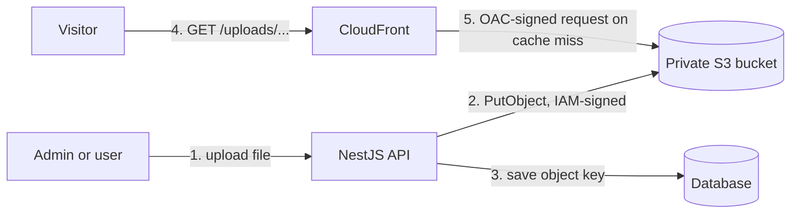
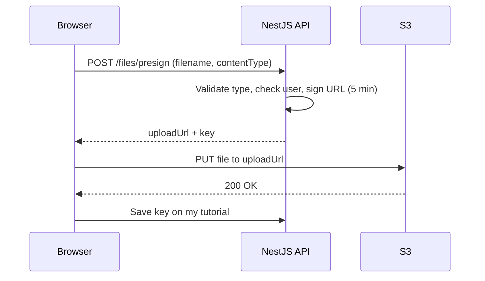

## What you will build

A tutorial website needs to store images, PDFs and videos. The rules are simple to say and easy to get wrong:

- **Uploads** go from your backend (or a trusted browser session) into **S3**.
- **Downloads** go through **CloudFront**, so they are fast and cached worldwide.
- **The bucket stays private.** Nobody can read it directly, and nobody can write to it except your backend.



By the end you will have all of this working on your own account, plus the tools to debug it when it does not.

> **Placeholders:** commands use `ACCOUNT_ID`, `BUCKET`, `DIST_ID` and similar values. Replace them with your own. Never publish real access keys, secret keys or account IDs in Git, screenshots, tickets or chat.

```bash
# Set these once per terminal session and reuse them in every command below.
export REGION=us-east-1
export ACCOUNT_ID=111122223333
export BUCKET=myapp-assets-$ACCOUNT_ID     # bucket names are global: this makes yours unique
```

## 1. The mental model: who is allowed to do what

Almost every S3 + CloudFront problem is really a question of **identity**. Four different identities touch your files:

| Identity | What it does | How it proves who it is | What it may do |
| --- | --- | --- | --- |
| **You (admin)** | Creates the infrastructure once | SSO or admin credentials | Everything, during setup |
| **NestJS backend** | Uploads, deletes, lists | IAM credentials (user keys locally, a **role** in AWS) | Write and read **only this bucket** |
| **CloudFront** | Reads files for visitors | **Origin Access Control (OAC)** signature | `GetObject` **only from this distribution** |
| **Visitor** | Downloads files | Nothing, it is public to CloudFront | Reads through the CDN URL only |

Notice what is missing: **no one is "the public" on S3.** The bucket never has a public policy. CloudFront is the only door for readers, and your API is the only door for writers.

## 2. Prerequisites

| Tool | Check | Used for |
| --- | --- | --- |
| AWS CLI v2 | `aws --version` | Creating and inspecting resources |
| Credentials with admin-like access in a **dev** account | `aws sts get-caller-identity` | Setup only, not for the app |
| Node.js 20+ and the Nest CLI | `node -v` and `nest --version` | The backend |
| `curl` | `curl --version` | Testing |

Confirm you are working in the account you expect before you create anything:

```bash
aws sts get-caller-identity
```

## 3. Create the private bucket

```bash
# us-east-1 must NOT include a LocationConstraint; every other region must.
aws s3api create-bucket --bucket $BUCKET --region $REGION

# For any other region, use:
# aws s3api create-bucket --bucket $BUCKET --region eu-west-1 \
#   --create-bucket-configuration LocationConstraint=eu-west-1
```

Block every form of public access. This is the safety net: even if someone later pastes a public policy by mistake, S3 refuses it.

```bash
aws s3api put-public-access-block --bucket $BUCKET \
  --public-access-block-configuration \
  BlockPublicAcls=true,IgnorePublicAcls=true,BlockPublicPolicy=true,RestrictPublicBuckets=true
```

Turn on default encryption (new buckets already encrypt with SSE-S3, this makes the setting explicit) and versioning, so an accidental overwrite or delete can be undone:

```bash
aws s3api put-bucket-encryption --bucket $BUCKET \
  --server-side-encryption-configuration \
  '{"Rules":[{"ApplyServerSideEncryptionByDefault":{"SSEAlgorithm":"AES256"}}]}'

aws s3api put-bucket-versioning --bucket $BUCKET \
  --versioning-configuration Status=Enabled
```

Versioning keeps old copies forever and you pay for them, so add a lifecycle rule that cleans up old versions and half-finished multipart uploads:

```bash
cat > lifecycle.json <<'EOF'
{
  "Rules": [
    {
      "ID": "cleanup",
      "Status": "Enabled",
      "Filter": {},
      "NoncurrentVersionExpiration": { "NoncurrentDays": 30 },
      "AbortIncompleteMultipartUpload": { "DaysAfterInitiation": 7 }
    }
  ]
}
EOF
aws s3api put-bucket-lifecycle-configuration --bucket $BUCKET \
  --lifecycle-configuration file://lifecycle.json
```

**Verify:**

```bash
aws s3api get-public-access-block --bucket $BUCKET
echo "hello" > hello.txt
aws s3 cp hello.txt s3://$BUCKET/uploads/hello.txt
aws s3 ls s3://$BUCKET/uploads/
```

Now try the public URL. It must fail:

```bash
curl -I https://$BUCKET.s3.$REGION.amazonaws.com/uploads/hello.txt
# HTTP/1.1 403 Forbidden   <- this is the correct, desired result
```

## 4. Put CloudFront in front with Origin Access Control

CloudFront needs permission to read the private bucket. **Origin Access Control (OAC)** is the modern way: CloudFront signs each request to S3, and the bucket policy says "allow only this specific distribution." The older Origin Access Identity (OAI) is legacy, so do not use it for new work.

### Step 1: create the OAC

```bash
cat > oac.json <<EOF
{
  "Name": "$BUCKET-oac",
  "Description": "OAC for $BUCKET",
  "SigningProtocol": "sigv4",
  "SigningBehavior": "always",
  "OriginAccessControlOriginType": "s3"
}
EOF

OAC_ID=$(aws cloudfront create-origin-access-control \
  --origin-access-control-config file://oac.json \
  --query 'OriginAccessControl.Id' --output text)
echo $OAC_ID
```

### Step 2: create the distribution

The cache policy ID below is AWS's managed **CachingOptimized** policy. Use the **regional** bucket domain (`BUCKET.s3.REGION.amazonaws.com`), not the global one, to avoid redirect problems on new buckets.

```bash
cat > distribution.json <<EOF
{
  "CallerReference": "$BUCKET-$(date +%s)",
  "Comment": "Assets for $BUCKET",
  "Enabled": true,
  "Origins": {
    "Quantity": 1,
    "Items": [
      {
        "Id": "s3-assets",
        "DomainName": "$BUCKET.s3.$REGION.amazonaws.com",
        "OriginAccessControlId": "$OAC_ID",
        "S3OriginConfig": { "OriginAccessIdentity": "" }
      }
    ]
  },
  "DefaultCacheBehavior": {
    "TargetOriginId": "s3-assets",
    "ViewerProtocolPolicy": "redirect-to-https",
    "AllowedMethods": { "Quantity": 2, "Items": ["GET", "HEAD"] },
    "CachePolicyId": "658327ea-f89d-4fab-a63d-7e88639e58f6",
    "Compress": true
  }
}
EOF

aws cloudfront create-distribution --distribution-config file://distribution.json \
  --query 'Distribution.[Id,DomainName]' --output text
```

Save the two values it prints:

```bash
export DIST_ID=E1ABCDEF234567                 # from the output above
export CF_DOMAIN=d1234abcd5678.cloudfront.net # from the output above
```

> **Prefer clicking?** In the console: **CloudFront → Create distribution → Origin domain: pick your bucket → Origin access: Origin access control settings → Create new OAC → Viewer protocol policy: Redirect HTTP to HTTPS → Cache policy: CachingOptimized**. When creation finishes the console offers a ready-made bucket policy to copy. The result is identical.

### Step 3: allow only this distribution to read the bucket

This is the policy that makes the whole design safe. Read it slowly:

```bash
cat > bucket-policy.json <<EOF
{
  "Version": "2012-10-17",
  "Statement": [
    {
      "Sid": "AllowCloudFrontReadOnly",
      "Effect": "Allow",
      "Principal": { "Service": "cloudfront.amazonaws.com" },
      "Action": "s3:GetObject",
      "Resource": "arn:aws:s3:::$BUCKET/*",
      "Condition": {
        "StringEquals": {
          "AWS:SourceArn": "arn:aws:cloudfront::$ACCOUNT_ID:distribution/$DIST_ID"
        }
      }
    }
  ]
}
EOF

aws s3api put-bucket-policy --bucket $BUCKET --policy file://bucket-policy.json
```

- **Principal** is the CloudFront service, not "everyone."
- **Action** is read-only: CloudFront can never write or delete.
- **Condition** pins it to **your** distribution. Without it, any other account's CloudFront distribution could be pointed at your bucket (the "confused deputy" problem).

### Step 4: test the whole read path

Wait until the distribution status is `Deployed` (a few minutes):

```bash
aws cloudfront get-distribution --id $DIST_ID --query 'Distribution.Status'
```

```bash
# Direct S3 -> still blocked
curl -I https://$BUCKET.s3.$REGION.amazonaws.com/uploads/hello.txt     # 403

# Through CloudFront -> works
curl -I https://$CF_DOMAIN/uploads/hello.txt                           # 200
```

Run the CloudFront request twice and compare the `X-Cache` header:

| Request | `X-Cache` | Meaning |
| --- | --- | --- |
| First | `Miss from cloudfront` | CloudFront fetched it from S3 and stored a copy at the edge |
| Second | `Hit from cloudfront` | Served from the edge cache, S3 was not touched |

If you see this behaviour, **the read side is done.** Everything left is the write side.

## 5. Create a least-privilege identity for NestJS

Your backend needs to write to this one bucket and nothing else. Start with the policy:

```bash
cat > nestjs-s3-policy.json <<EOF
{
  "Version": "2012-10-17",
  "Statement": [
    {
      "Sid": "ListBucket",
      "Effect": "Allow",
      "Action": ["s3:ListBucket", "s3:ListBucketMultipartUploads"],
      "Resource": "arn:aws:s3:::$BUCKET"
    },
    {
      "Sid": "ObjectReadWrite",
      "Effect": "Allow",
      "Action": [
        "s3:PutObject",
        "s3:GetObject",
        "s3:DeleteObject",
        "s3:AbortMultipartUpload",
        "s3:ListMultipartUploadParts"
      ],
      "Resource": "arn:aws:s3:::$BUCKET/*"
    }
  ]
}
EOF

aws iam create-policy --policy-name $BUCKET-app-access \
  --policy-document file://nestjs-s3-policy.json
```

Two resource ARNs are needed on purpose. **Bucket-level** actions (`ListBucket`) apply to `arn:aws:s3:::BUCKET`. **Object-level** actions apply to `arn:aws:s3:::BUCKET/*`. Mixing them up is the number one cause of surprise `AccessDenied` errors.

### Option A: an IAM user with access keys (local development)

Fine for your laptop. Not what you should run in production.

```bash
aws iam create-user --user-name myapp-nestjs
aws iam attach-user-policy --user-name myapp-nestjs \
  --policy-arn arn:aws:iam::$ACCOUNT_ID:policy/$BUCKET-app-access
aws iam create-access-key --user-name myapp-nestjs
```

The last command prints an `AccessKeyId` and a `SecretAccessKey`. **The secret is shown exactly once.** Copy it straight into your backend `.env` file, then close the terminal. If you lose it, delete the key and create a new one.

### Option B: an IAM role (production, recommended)

When the API runs on AWS, give the **compute** an identity instead of a key file:

| Where the API runs | Identity to attach |
| --- | --- |
| ECS or Fargate | **Task role** |
| EC2 | **Instance profile** (role) |
| EKS | **Pod Identity** or IRSA role |
| Lambda | **Execution role** |

Attach the same policy to that role. The AWS SDK discovers the temporary credentials automatically, so **your code does not change**; you just leave `AWS_ACCESS_KEY_ID` and `AWS_SECRET_ACCESS_KEY` unset. Temporary credentials rotate themselves, and there is no long-lived secret to leak.

> **Rule of thumb:** access keys are for a laptop, roles are for anything running in AWS.

## 6. Build the NestJS upload API

### Install the packages

```bash
nest new storage-api && cd storage-api
npm i @aws-sdk/client-s3 @aws-sdk/s3-request-presigner @nestjs/config
npm i -D @types/multer
```

### Environment file

```env
# .env  (never commit this file; add it to .gitignore)
AWS_REGION=us-east-1
AWS_ACCESS_KEY_ID=your_access_key_id          # local dev only; omit on AWS compute
AWS_SECRET_ACCESS_KEY=your_secret_access_key  # local dev only; omit on AWS compute
S3_BUCKET=myapp-assets-111122223333
CLOUDFRONT_URL=https://d1234abcd5678.cloudfront.net
```

```bash
echo ".env" >> .gitignore
```

Load it once for the whole app:

```ts
// src/app.module.ts
import { Module } from '@nestjs/common';
import { ConfigModule } from '@nestjs/config';
import { StorageModule } from './storage/storage.module';

@Module({
  imports: [ConfigModule.forRoot({ isGlobal: true }), StorageModule],
})
export class AppModule {}
```

### The storage service

This service is the **only** place in your codebase that knows about S3. Controllers ask it to "store this file," never to "call S3."

```ts
// src/storage/storage.service.ts
import { Injectable } from '@nestjs/common';
import { ConfigService } from '@nestjs/config';
import {
  S3Client,
  PutObjectCommand,
  DeleteObjectCommand,
} from '@aws-sdk/client-s3';
import { getSignedUrl } from '@aws-sdk/s3-request-presigner';
import { randomUUID } from 'crypto';
import { extname } from 'path';

const ONE_YEAR = 60 * 60 * 24 * 365;

@Injectable()
export class StorageService {
  private readonly s3: S3Client;
  private readonly bucket: string;
  private readonly cdnUrl: string;

  constructor(config: ConfigService) {
    this.bucket = config.getOrThrow('S3_BUCKET');
    this.cdnUrl = config.getOrThrow('CLOUDFRONT_URL');
    // No credentials passed on purpose: the SDK reads env vars locally
    // and the task/instance/pod role when running on AWS.
    this.s3 = new S3Client({ region: config.getOrThrow('AWS_REGION') });
  }

  /** Build an unguessable key such as uploads/tutorials/3f2a...-c1.png */
  buildKey(folder: string, originalName: string): string {
    const ext = extname(originalName).toLowerCase();
    return `uploads/${folder}/${randomUUID()}${ext}`;
  }

  /** The public, cacheable URL for a stored key. */
  publicUrl(key: string): string {
    return `${this.cdnUrl}/${key}`;
  }

  async upload(file: Express.Multer.File, folder = 'tutorials') {
    const key = this.buildKey(folder, file.originalname);

    await this.s3.send(
      new PutObjectCommand({
        Bucket: this.bucket,
        Key: key,
        Body: file.buffer,
        ContentType: file.mimetype,
        // Keys are unique per upload, so the file never changes: cache for a year.
        CacheControl: `public, max-age=${ONE_YEAR}, immutable`,
      }),
    );

    return { key, url: this.publicUrl(key) };
  }

  async delete(key: string) {
    await this.s3.send(
      new DeleteObjectCommand({ Bucket: this.bucket, Key: key }),
    );
  }

  /** A short-lived URL that lets a browser PUT one specific file straight to S3. */
  async presignUpload(folder: string, filename: string, contentType: string) {
    const key = this.buildKey(folder, filename);
    const uploadUrl = await getSignedUrl(
      this.s3,
      new PutObjectCommand({
        Bucket: this.bucket,
        Key: key,
        ContentType: contentType,
        CacheControl: `public, max-age=${ONE_YEAR}, immutable`,
      }),
      { expiresIn: 300 }, // 5 minutes
    );
    return { key, uploadUrl, url: this.publicUrl(key) };
  }
}
```

### The controller, with validation

Never trust what the client says about a file. Limit **size** and **type** at the door:

```ts
// src/storage/storage.controller.ts
import {
  BadRequestException,
  Body,
  Controller,
  Delete,
  FileTypeValidator,
  MaxFileSizeValidator,
  Param,
  ParseFilePipe,
  Post,
  UploadedFile,
  UseInterceptors,
} from '@nestjs/common';
import { FileInterceptor } from '@nestjs/platform-express';
import { StorageService } from './storage.service';

const ALLOWED = ['image/png', 'image/jpeg', 'image/webp', 'application/pdf'];

@Controller('files')
export class StorageController {
  constructor(private readonly storage: StorageService) {}

  @Post('upload')
  @UseInterceptors(FileInterceptor('file'))
  upload(
    @UploadedFile(
      new ParseFilePipe({
        validators: [
          new MaxFileSizeValidator({ maxSize: 5 * 1024 * 1024 }), // 5 MB
          new FileTypeValidator({ fileType: /^(image\/(png|jpeg|webp)|application\/pdf)$/ }),
        ],
      }),
    )
    file: Express.Multer.File,
  ) {
    return this.storage.upload(file);
  }

  @Post('presign')
  presign(@Body() body: { filename: string; contentType: string }) {
    if (!ALLOWED.includes(body.contentType)) {
      throw new BadRequestException('File type not allowed');
    }
    return this.storage.presignUpload('tutorials', body.filename, body.contentType);
  }

  // Wildcard so keys with slashes work: DELETE /files/uploads/tutorials/abc.png
  @Delete('*key')
  async remove(@Param('key') key: string | string[]) {
    const fullKey = Array.isArray(key) ? key.join('/') : key;
    if (!fullKey.startsWith('uploads/')) {
      throw new BadRequestException('Invalid key');
    }
    await this.storage.delete(fullKey);
    return { deleted: fullKey };
  }
}
```

```ts
// src/storage/storage.module.ts
import { Module } from '@nestjs/common';
import { StorageController } from './storage.controller';
import { StorageService } from './storage.service';

@Module({
  controllers: [StorageController],
  providers: [StorageService],
  exports: [StorageService],
})
export class StorageModule {}
```

> **Security note:** this lab leaves the routes open so you can focus on S3. In a real app, protect `upload`, `presign` and `delete` with an authentication guard and an admin role. An open upload endpoint is a free file host for strangers, and you pay the bill.

## 7. Test the upload end to end

Start the API:

```bash
npm run start:dev
```

Upload an image:

```bash
curl -F "file=@./docker-basics.png" http://localhost:3000/files/upload
```

Expected response:

```json
{
  "key": "uploads/tutorials/3f2a8c1e-5b7d-4e19-a6c0-9d2f1b8e7a44.png",
  "url": "https://d1234abcd5678.cloudfront.net/uploads/tutorials/3f2a8c1e-5b7d-4e19-a6c0-9d2f1b8e7a44.png"
}
```

Then check the three layers:

```bash
# 1. The object exists in S3
aws s3 ls s3://$BUCKET/uploads/tutorials/

# 2. CloudFront serves it (run twice: Miss, then Hit)
curl -I "<url from the response>"

# 3. Direct S3 access is still denied
curl -I "https://$BUCKET.s3.$REGION.amazonaws.com/<key from the response>"   # 403
```

Test the guards too. Both of these should be rejected:

```bash
curl -F "file=@./big-video.mp4" http://localhost:3000/files/upload     # wrong type / too large -> 400
curl -X DELETE http://localhost:3000/files/somewhere/else.png          # not under uploads/ -> 400
```

### What to store in the database

Save the **key**, not the full URL:

```text
uploads/tutorials/3f2a8c1e-5b7d-4e19-a6c0-9d2f1b8e7a44.png     <- store this
https://d1234abcd5678.cloudfront.net/uploads/...               <- build this at read time
```

When you later move to `files.yourdomain.com`, change one environment variable instead of rewriting every database row.

## 8. Big files: let the browser upload straight to S3

Sending a 500 MB video through NestJS ties up your server's memory and bandwidth. A **presigned URL** is a temporary, single-purpose permission slip: your API signs it, the browser uses it, and the bytes never touch your server.



The browser side is a plain `fetch`:

```ts
async function uploadDirect(file: File) {
  // 1. Ask the API for a signed URL
  const res = await fetch('/api/files/presign', {
    method: 'POST',
    headers: { 'Content-Type': 'application/json' },
    body: JSON.stringify({ filename: file.name, contentType: file.type }),
  });
  const { uploadUrl, key, url } = await res.json();

  // 2. Send the file straight to S3. Content-Type MUST match what was signed.
  const put = await fetch(uploadUrl, {
    method: 'PUT',
    headers: { 'Content-Type': file.type },
    body: file,
  });
  if (!put.ok) throw new Error(`Upload failed: ${put.status}`);

  return { key, url };
}
```

Because the browser talks to S3 from your website's origin, the bucket needs a **CORS** rule. List only the origins you actually use:

```bash
cat > cors.json <<'EOF'
{
  "CORSRules": [
    {
      "AllowedOrigins": ["http://localhost:3001", "https://www.yourdomain.com"],
      "AllowedMethods": ["PUT"],
      "AllowedHeaders": ["*"],
      "ExposeHeaders": ["ETag"],
      "MaxAgeSeconds": 3000
    }
  ]
}
EOF
aws s3api put-bucket-cors --bucket $BUCKET --cors-configuration file://cors.json
```

> **Gotcha with newer SDK versions:** recent AWS SDK for JavaScript v3 releases add checksum parameters to requests by default. A presigned `PUT` can then end up with checksum headers or query parameters that a plain browser upload does not send, and S3 rejects it. If your presigned uploads fail with a `SignatureDoesNotMatch` or a checksum error, create the client with `new S3Client({ region, requestChecksumCalculation: 'WHEN_REQUIRED' })`.

## 9. Private files: signed downloads

Everything so far is **public through CloudFront**. That is right for thumbnails and free PDFs, and wrong for paid or student-only content. For those you have two options:

| Approach | How it works | Use when |
| --- | --- | --- |
| **S3 presigned GET URL** | Your API signs a read URL for one object, valid for minutes | Simple, no extra setup, files read directly from S3 |
| **CloudFront signed URL or cookie** | Your API signs with a CloudFront key pair, and CloudFront enforces it | You also want CDN speed for private content, such as video |

The S3 version is a few lines in the same service:

```ts
import { GetObjectCommand } from '@aws-sdk/client-s3';

async presignDownload(key: string, filename: string) {
  return getSignedUrl(
    this.s3,
    new GetObjectCommand({
      Bucket: this.bucket,
      Key: key,
      ResponseContentDisposition: `attachment; filename="${filename}"`,
    }),
    { expiresIn: 60 }, // one minute is plenty to start a download
  );
}
```

Your controller checks that the logged-in user is **allowed** to see this lesson, and only then returns the URL. The signature proves AWS agreed; **your code** decides who deserves it.

For private files, upload them under a different prefix such as `private/`, and keep it out of the CloudFront bucket policy by narrowing that policy's resource to `arn:aws:s3:::BUCKET/uploads/*`. Then the CDN physically cannot serve them.

## 10. Keeping the cache correct

CloudFront caches by the full path. That gives you a choice when a file changes:

| Strategy | How | Verdict |
| --- | --- | --- |
| **Immutable unique keys** | Every upload gets a new UUID key; to "replace" a file, upload a new key and update the database | Best. Nothing is ever stale, nothing needs invalidation |
| **Overwrite the same key** | Upload over `logo.png` | Visitors may see the old file until the cache expires |
| **Invalidate** | `aws cloudfront create-invalidation` | Works, but the first 1,000 paths a month are free and later ones cost money |

This lab uses the first strategy, which is why the code sets `Cache-Control: public, max-age=31536000, immutable`. If you do overwrite a file, force the edge to refetch:

```bash
aws cloudfront create-invalidation --distribution-id $DIST_ID --paths "/uploads/logo.png"
```

## 11. A clean domain (optional, later)

The `*.cloudfront.net` URL works forever, but a branded URL looks better. When you own a domain:

1. Request a certificate in **ACM in `us-east-1`** (CloudFront only reads certificates from that region).
2. Add `files.yourdomain.com` as an **alternate domain name** on the distribution and attach the certificate.
3. Create a DNS `CNAME` (Route 53 alias, or Cloudflare set to **DNS only**) pointing `files` at the CloudFront domain.
4. Change `CLOUDFRONT_URL` to `https://files.yourdomain.com`.

Because you stored keys and not URLs, no database changes are needed.

## 12. Troubleshooting

Match the symptom first, then check the cause:

| Symptom | Likely cause | Check / fix |
| --- | --- | --- |
| `AccessDenied` on upload | Policy ARN mismatch | Bucket actions need `arn:aws:s3:::BUCKET`, object actions need `.../BUCKET/*` |
| `The security token included in the request is invalid` | Wrong or deleted keys, or a stale `AWS_SESSION_TOKEN` | `aws sts get-caller-identity` using the same credentials |
| `CredentialsProviderError` on AWS compute | No role attached, or key env vars point at a deleted user | Attach the role, and remove the leftover env vars |
| CloudFront returns `403 AccessDenied` XML | Bucket policy missing, wrong `DIST_ID`, or OAC not attached | Compare the policy `SourceArn` with `aws cloudfront get-distribution`; re-check the origin's OAC |
| CloudFront returns `404` for a file that exists | Wrong key or a leading-slash mismatch | `aws s3 ls` the exact key; URL path must equal key |
| CloudFront returns `307` redirecting to S3 | Global bucket endpoint used as the origin on a new bucket | Use the **regional** domain `BUCKET.s3.REGION.amazonaws.com` |
| Browser upload fails with a CORS error | Missing or wrong CORS rule | Allowed origin must match your site exactly (scheme, host, port) |
| `SignatureDoesNotMatch` on presigned `PUT` | `Content-Type` differs from what was signed, or SDK checksum headers | Send the same `Content-Type`; see the checksum gotcha in section 8 |
| Presigned URL says `Request has expired` | URL older than `expiresIn`, or the server clock is wrong | Request a fresh URL and check clock sync |
| Old image still showing after overwrite | CloudFront cached the previous object | Use unique keys, or invalidate the path |
| `413 Payload Too Large` from NestJS | Request over the body or Multer limit | Raise the limit deliberately, or use presigned uploads |

A reliable way to debug any read problem is to move one hop at a time:

```bash
aws s3 ls s3://$BUCKET/<key>                                  # 1. Does the object exist?
aws s3api get-bucket-policy --bucket $BUCKET                  # 2. Does the policy allow CloudFront?
aws cloudfront get-distribution --id $DIST_ID \
  --query 'Distribution.DistributionConfig.Origins.Items[0]'  # 3. Is the OAC attached?
curl -sI https://$CF_DOMAIN/<key> | grep -i -E 'HTTP|x-cache|via'   # 4. What does the edge say?
```

## 13. Production checklist

Done in this lab:

- [x] Bucket is private with Block Public Access on
- [x] CloudFront reads through OAC, restricted to one distribution
- [x] Backend identity is limited to one bucket
- [x] Encryption and versioning enabled; lifecycle cleans up old data
- [x] Uploads validated by size and type
- [x] Database stores keys, not URLs

Still to do before real users:

- [ ] Put an **authentication and authorization** guard on upload, presign and delete routes
- [ ] Run the API with an **IAM role**, delete the local access key
- [ ] Scan or re-check uploaded content type (the `Content-Type` header can be forged; inspect magic bytes for important uploads)
- [ ] Set a **CloudWatch billing alarm** and S3 request alerts
- [ ] Turn on **CloudFront standard logging** or real-time metrics
- [ ] Add AWS WAF rate limiting if the upload route is public
- [ ] Add a custom domain and HTTPS certificate
- [ ] Define the plan for bucket versions, backups and, if needed, cross-region replication
- [ ] Manage all of this with Terraform or CloudFormation so it can be recreated

## 14. Clean up (avoid surprise bills)

Delete in dependency order. A versioned bucket cannot be removed until every version is gone, so use the empty command that handles them for you.

```bash
# 1. Disable the distribution, wait for it, then delete it
aws cloudfront get-distribution-config --id $DIST_ID > dist.json
#    Edit dist.json: set "Enabled": false, keep only the DistributionConfig object, note the ETag
aws cloudfront update-distribution --id $DIST_ID \
  --distribution-config file://dist-config-only.json --if-match <ETag>
aws cloudfront delete-distribution --id $DIST_ID --if-match <new ETag>

# 2. Delete the origin access control
aws cloudfront delete-origin-access-control --id $OAC_ID --if-match <OAC ETag>

# 3. Empty and delete the bucket (removes all versions too in the console;
#    from the CLI, delete versions and delete markers first)
aws s3 rm s3://$BUCKET --recursive
aws s3 rb s3://$BUCKET

# 4. Remove the IAM identity
aws iam delete-access-key --user-name myapp-nestjs --access-key-id <KEY_ID>
aws iam detach-user-policy --user-name myapp-nestjs \
  --policy-arn arn:aws:iam::$ACCOUNT_ID:policy/$BUCKET-app-access
aws iam delete-user --user-name myapp-nestjs
aws iam delete-policy --policy-arn arn:aws:iam::$ACCOUNT_ID:policy/$BUCKET-app-access
```

The simplest route for a one-off lab is the **console**: CloudFront → Disable → Delete, then S3 → **Empty** → **Delete**. Check the Billing console the next day.

## 15. Practice plan

For each exercise write down: **purpose, what state it changes, expected output, and how to roll it back.**

1. Create the private bucket and prove the direct S3 URL returns `403`.
2. Create the CloudFront distribution and prove the same file returns `200` through the CDN.
3. Watch `X-Cache` change from `Miss` to `Hit`.
4. Remove the `Condition` from the bucket policy in a throwaway test and explain why that is dangerous, then restore it.
5. Upload a file through NestJS and find it with `aws s3 ls`.
6. Upload a 10 MB file and an `.exe` file and confirm both are rejected.
7. Implement the presigned upload and push a file from a browser, fixing the CORS error you will almost certainly hit first.
8. Overwrite a file at the same key, observe the stale copy, then fix it with an invalidation.
9. Add a presigned download for a private prefix and confirm the link stops working after it expires.
10. Run the API with an IAM role instead of access keys and confirm uploads still work with the key variables removed.

## Remember this

- **S3 stores, CloudFront delivers.** Keep the bucket private and let the CDN be the only reader.
- **OAC plus a pinned `SourceArn`** is what makes "private bucket, public website" safe.
- **Separate identities:** admin builds it, the backend writes it, CloudFront reads it, visitors only see the CDN URL.
- **Roles beat keys.** Use access keys only on a laptop.
- **Store keys, not URLs.** Use unique keys so caching never serves stale files.
- **Big files go direct** with presigned URLs; **private files** use short-lived signed downloads.
