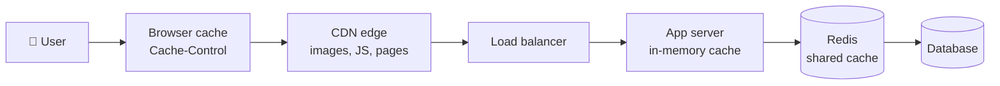
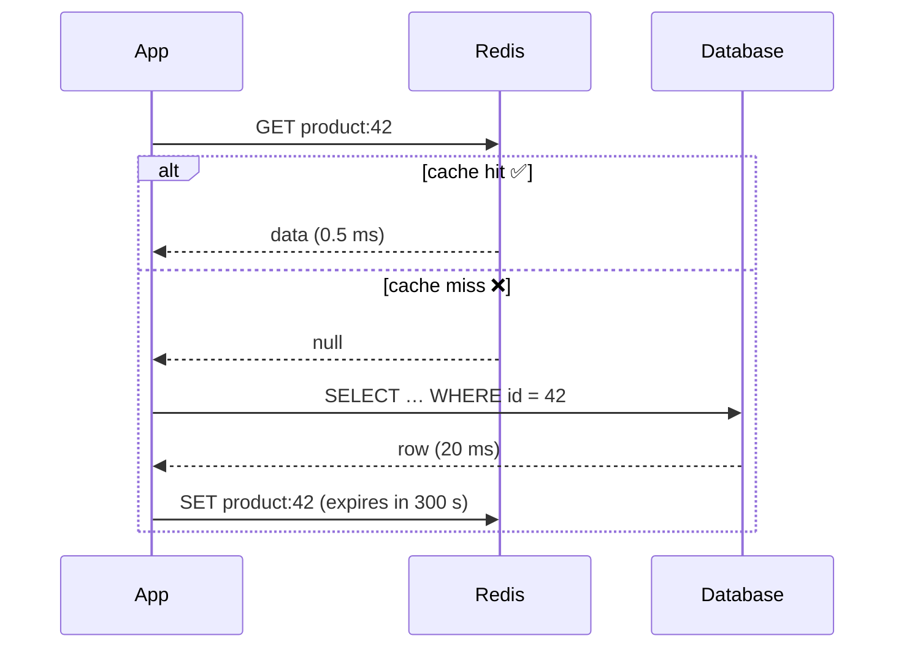
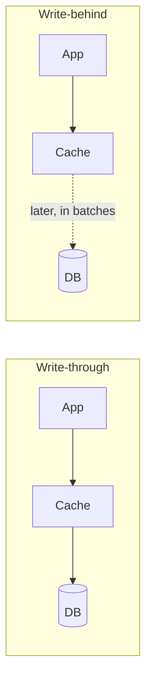
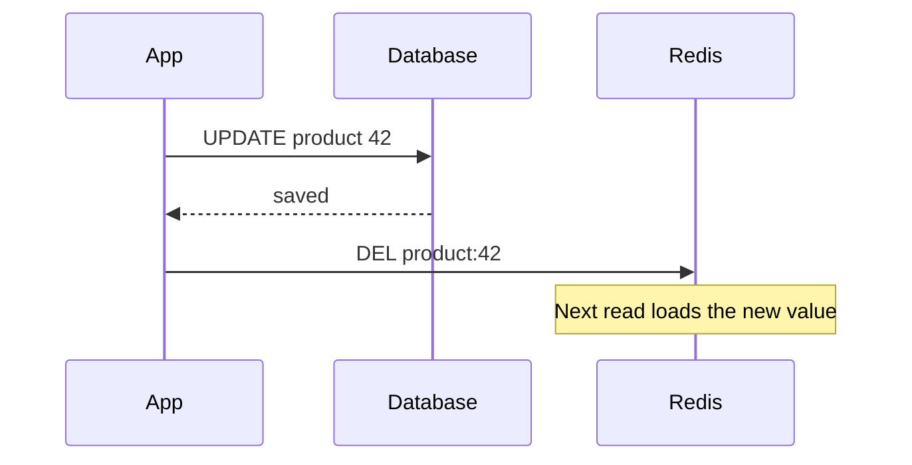
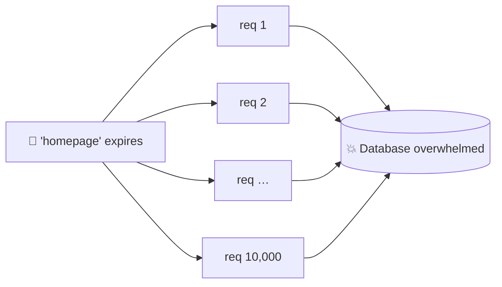
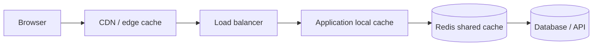

## The big idea

You keep the things you use every day (keys, phone, wallet) **on your desk**, not in the basement storage room. Going to the basement takes 5 minutes; reaching to your desk takes 1 second.

A **cache** is your desk: a small, fast store of copies of data that is expensive to fetch or compute.


| Where data lives | Typical latency | Analogy |
| --- | --- | --- |
| CPU cache | ~1 ns | In your hand |
| RAM / in-process cache | ~100 ns | On your desk |
| **Redis** over the network | ~0.5 ms | In the next room |
| Database with an index | ~5 ms | Downstairs |
| Slow DB query / external API | 100 ms – 2 s | Across town |

## Where caches live



Every layer can answer the request and save all the layers behind it.

## Strategy 1: Cache-aside (lazy loading) ⭐ most common

The app checks the cache first; on a miss it reads the database and stores the result.



```js
async function getProduct(id) {
  const key = `product:${id}`;
  const cached = await redis.get(key);
  if (cached) return JSON.parse(cached);

  const product = await db.products.findById(id);
  if (product) await redis.set(key, JSON.stringify(product), { EX: 300 }); // TTL 5 min
  return product;
}
```

## Other strategies

| Strategy | How it works | Pros | Cons |
| --- | --- | --- | --- |
| **Cache-aside** | App reads cache → DB on miss → fills cache | Simple, only caches what's used | First request is slow; can serve stale data |
| **Read-through** | The cache itself loads from the DB on a miss | Cleaner app code | Needs a cache library/provider that supports it |
| **Write-through** | Write to cache and DB together | Cache is always fresh | Slower writes, caches data nobody reads |
| **Write-behind** | Write to cache, flush to DB later | Very fast writes | Risk of losing data if the cache crashes |



## The hardest part: invalidation

> 📘 *"There are only two hard things in computer science: cache invalidation and naming things."* (Phil Karlton)

When data changes, the cached copy is **stale**. Options:

1. **TTL (time to live):** entries expire automatically. Simple; data can be stale for up to the TTL.
2. **Delete on write:** when the product changes, delete its cache key so the next read reloads it.
3. **Events:** publish `product.updated`; every service with a cached copy removes it.

```js
async function updateProduct(id, changes) {
  await db.products.update(id, changes);
  await redis.del(`product:${id}`); // delete, don't update: avoids race conditions
}
```

> 💡 Prefer **deleting** the key over writing the new value into it. Two concurrent updates can otherwise leave the older value in the cache.

## Eviction: when the cache is full

Memory is limited, so something must go:

| Policy | Evicts | Good for |
| --- | --- | --- |
| **LRU** (Least Recently Used) | The item not used for the longest time | Most workloads ✅ |
| **LFU** (Least Frequently Used) | The item used the fewest times | Stable "popular items" |
| **FIFO** | The oldest item | Simple streams |
| **TTL** | Expired items | Time-sensitive data |

In Redis: `maxmemory 2gb` and `maxmemory-policy allkeys-lru`.

## Five caching mistakes that cause stale or slow systems

Caching is fast only when its failure behaviour is designed too. These are the five mistakes to recognize before they reach production.

### 1. No TTL: the cache never forgets

Without a **TTL** (time to live), `product:42` can stay in Redis forever—even after the product changes or after the application changes the shape of the cached JSON.

```js
// Risky: this value has no expiry.
await redis.set("product:42", JSON.stringify(product));

// Safer: choose a freshness window that matches the data.
await redis.set("product:42", JSON.stringify(product), { EX: 300 });
```

**Fix:** give cache entries a deliberate TTL. A five-minute TTL may suit a product catalogue; a user's permission or payment state may need deletion on every write, a much shorter TTL, or no cache at all. A TTL limits how long a missed invalidation can lie to a reader; it does not replace invalidation.

### 2. No invalidation strategy: the database changes, the cache does not

This is the most common stale-data bug: the write path updates PostgreSQL, then returns success while Redis still holds the old value.



**Fix:** decide what every write does to every affected key. With cache-aside, the safe default is **write to the durable database first, then delete the cache key**. If one update affects a product, its category list, and a search result, invalidate all three key families. In a multi-service system, publish a durable `product.updated` event so other caches can invalidate too.

### 3. Cache stampede: one expiry becomes thousands of database queries

A popular key expires; 10,000 requests miss at the same moment and **all** hit the database.



**Fix:** use a short lock or request coalescing so one request rebuilds the value. The others wait briefly or receive the last known good value. Also add random **jitter** to TTLs so many keys do not expire together, and refresh genuinely hot keys before they expire. A lock is an optimization, not a reason to make the database unavailable.

### 4. Caching errors and empty results carelessly

An outage response, a timeout, or an accidental empty list is not the same as "there are no results." If you cache a transient `500` response, users keep seeing an outage after the dependency has recovered. If you cache every empty result for a long time, newly created data can appear missing.

```js
const product = await db.products.findById(id);

if (product) {
  await redis.set(`product:${id}`, JSON.stringify(product), { EX: 300 });
} else {
  // Negative caching protects the DB from repeated misses, but briefly.
  await redis.set(`product:${id}`, "NOT_FOUND", { EX: 30 });
}
// Do not cache thrown database errors or 5xx responses as normal data.
```

**Fix:** cache successful values normally. Negative-cache a confirmed "not found" result only for a short TTL; never treat a timeout, permission error, or `500` as a real empty result. For huge ID spaces or abusive traffic, a Bloom filter can reject IDs that definitely do not exist before the database query.

### 5. Treating the cache as the source of truth

Redis can restart, evict keys when memory is full, or fail over. If losing it loses orders, balances, or customer records, it was not a cache—it was an under-protected primary database.

**Fix:** write authoritative business data to a durable store such as PostgreSQL first. Redis accelerates reads, rate limits, sessions, and derived values; the application must be able to rebuild cached values from durable data. Test this directly: flush a non-production cache and confirm the application becomes slower temporarily, not incorrect or unavailable.

### Two related symptoms

**Cache penetration:** requests for IDs that **do not exist** always miss and always hit the DB (sometimes an attack). Short negative caching, as above, or a Bloom filter helps.

**Hot key:** one key (a celebrity's profile) gets so much traffic it overloads a single Redis node. Use a small in-process cache in front of Redis, replicate the value where appropriate, and measure the key before changing the design.

## Redis: more than a cache

Redis is an in-memory data-structure server. Its data types solve many real problems:

| Type | Commands | Use case |
| --- | --- | --- |
| **String** | `SET`, `GET`, `INCR`, `EXPIRE` | Cache, counters, rate limits |
| **Hash** | `HSET`, `HGETALL` | User sessions, objects |
| **List** | `LPUSH`, `RPOP`, `BLPOP` | Simple queues, recent activity |
| **Set** | `SADD`, `SISMEMBER` | Unique visitors, tags |
| **Sorted set** | `ZADD`, `ZRANGE`, `ZREVRANK` | **Leaderboards**, priority queues, time windows |
| **Stream** | `XADD`, `XREADGROUP` | Event log with consumer groups |
| **Pub/Sub** | `PUBLISH`, `SUBSCRIBE` | Real-time notifications, chat |

```js
// Leaderboard in 3 commands
await redis.zAdd("leaderboard", { score: 4200, value: "ana" });
await redis.zIncrBy("leaderboard", 50, "bo");
const top10 = await redis.zRangeWithScores("leaderboard", 0, 9, { REV: true });

// Rate limit: max 100 requests per minute per user
const key = `rate:${userId}:${Math.floor(Date.now() / 60000)}`;
const count = await redis.incr(key);
if (count === 1) await redis.expire(key, 60);
if (count > 100) throw new TooManyRequestsError();
```

### Persistence and availability

- **RDB snapshots:** save the whole dataset every N minutes (fast restarts, may lose the last minutes).
- **AOF (append-only file):** log every write (safer, bigger files). You can use both.
- **Replication + Sentinel:** automatic failover to a replica.
- **Redis Cluster:** shards data across nodes using 16,384 hash slots.

> ⚠️ Redis keeps data in RAM. Treat it as a cache or as fast secondary storage, **not** as your only copy of critical data (unless you configure persistence carefully).

## What to cache (and what not to)

✅ **Cache:** data read far more often than written (product pages, configs), expensive computations, sessions, rate-limit counters, 3rd-party API responses.

❌ **Don't cache:** data that must be perfectly fresh (account balance at the moment of payment), data that is rarely re-read, highly personalised data with no reuse.

## Where should you cache?

Choose the closest layer that can safely answer the request. Caching closer to the user is faster, but it is harder to invalidate and more likely to serve stale data.



| Layer | Good for | Freshness and scope |
| --- | --- | --- |
| **Browser** | Images, JavaScript, public assets, safe GET responses | Fastest; one user's device; controlled with `Cache-Control` |
| **CDN / edge** | Public pages, product/catalog data, media, API responses safe to share | Shared globally; purge or version when content changes |
| **In-process memory** | Tiny, very hot configuration or lookup data | Fastest server-side; each instance has a different copy |
| **Redis / shared cache** | Sessions, permissions snapshots, API results, rate limits, locks | Shared by instances; network hop and eviction risk |
| **Database materialized view** | Expensive joins, reports and aggregations | Durable and queryable; refresh on a schedule or after events |

Use a public cache only when the response is safe to share between users. Private or personalised responses need a user/tenant-scoped key and usually `Cache-Control: private`, or should stay in Redis/application storage rather than a shared CDN cache.

## When should the cache refresh?

There is no universal TTL. Choose refresh behavior from the business tolerance for stale data:

| Data | Example policy | Why |
| --- | --- | --- |
| Immutable assets | Cache for a year with a content-hashed URL | The URL changes when the file changes |
| Public content | 1–60 minutes, optionally stale-while-revalidate | A little staleness is acceptable |
| Product/catalog data | Delete on write plus a 5–30 minute TTL | Fast updates without permanent stale values |
| User profile/settings | Delete or version immediately after a successful write | Users expect read-your-own-write behavior |
| Permissions/features | Short TTL plus event invalidation | A stale permission can be dangerous |
| Exchange rates/availability | Short TTL based on business rules | Freshness has a direct business meaning |
| Payment/account balance | Do not use a stale cache for the final decision | Correctness is more important than latency |

Use one of these refresh patterns:

### 1. Lazy refresh (cache-aside)

Refresh only after a miss. This is the default for most database-backed reads:

```js
async function getProduct(id) {
  const key = `product:${id}`;
  const cached = await redis.get(key);
  if (cached) return JSON.parse(cached);

  const product = await db.products.findById(id);
  if (product) {
    await redis.set(key, JSON.stringify(product), { EX: 600 });
  }
  return product;
}
```

Best for data that is read often but does not need pre-warming. The first request after expiry pays the database cost, so protect hot keys with a lock or request coalescing.

### 2. Refresh ahead

Refresh a popular key before its TTL expires. A worker checks keys that are close to expiry and rebuilds them in the background. This avoids a slow first request during predictable traffic, but it costs extra database work and requires knowing which keys are hot.

### 3. Stale-while-revalidate

Return a value that is slightly stale while one background request refreshes it. This keeps latency stable during refreshes:

```js
const value = await redis.get(key);
const age = value ? Date.now() - value.createdAt : Infinity;

if (value && age < 300_000) return value.data;       // fresh for 5 min
if (value && age < 900_000) {                        // stale, but usable
  refreshOnce(key);                                  // do not start 1,000 refreshes
  return value.data;
}
return await loadAndStore(key);                      // too old: wait for refresh
```

Use this for feeds, recommendations, catalogs and dashboards—not for an authorization decision or a payment amount.

### 4. Refresh on write

After the database transaction commits, delete or update the affected cache key. Prefer deletion when several writers or derived keys exist:

```js
await db.products.update(id, changes);
await redis.del(`product:${id}`);
```

If the invalidation must not be lost, write an invalidation event to an outbox in the same database transaction and let a worker publish/process it. Never invalidate before the database commit: a failed write could leave a newly repopulated cache containing data that was never committed.

## How do you choose a TTL?

Start with the maximum acceptable staleness, not an arbitrary number. If a product price may be stale for at most 60 seconds, the TTL alone cannot be longer than 60 seconds unless writes also invalidate it immediately.

Then consider:

- **Read/write ratio:** cache longer when reads dominate and writes are rare.
- **Cost of stale data:** use shorter TTLs for permissions, stock and pricing.
- **Rebuild cost:** expensive queries benefit from longer TTLs plus background refresh.
- **Traffic shape:** add random jitter, for example `baseTtl + random(0, baseTtl * 0.2)`, so many keys do not expire together.
- **Failure behavior:** decide whether an old value is better than an error when the database is unavailable.

Always set an upper bound. A cache entry without an expiry can become permanently stale after an invalidation bug.

## A simple decision tree

```text
Is stale data unsafe?
  yes -> do not use a stale cache for the decision; read the source of truth
  no  -> Is the data public and shared?
           yes -> CDN/HTTP cache with Cache-Control and purge/versioning
           no  -> Is it needed by many application instances?
                    yes -> Redis with a scoped key and TTL
                    no  -> in-process memory cache with a short TTL

Does a write change it?
  yes -> delete/version the key after commit; optionally publish invalidation
  no  -> TTL, refresh-ahead or stale-while-revalidate
```

## Cache correctness checklist

- Include tenant/user/locale/version in keys when the response varies.
- Never cache secrets, access tokens or private data in a shared public cache.
- Set TTLs and monitor hit rate, miss rate, evictions, stale age and rebuild latency.
- Protect hot keys from stampedes with locks, single-flight refreshes or stale-while-revalidate.
- Delete or version keys after a committed write; do not update a cache before the database.
- Have a cold-cache plan: the database should survive cache loss, or the service should degrade gracefully.

## Key takeaways

- A cache stores copies of expensive data close to where it's needed.
- Cache-aside is the default pattern: check cache → DB on miss → store with a TTL.
- Invalidate by TTL, by deleting on write, or through events. Prefer delete over update.
- Guard against stampedes (locks, jitter), penetration (cache "not found") and hot keys.
- Redis offers strings, hashes, lists, sets, sorted sets and streams: leaderboards, rate limits, queues, sessions.
