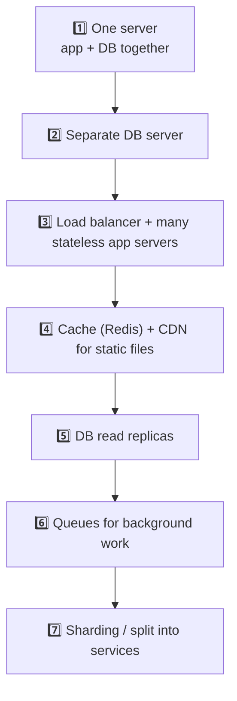
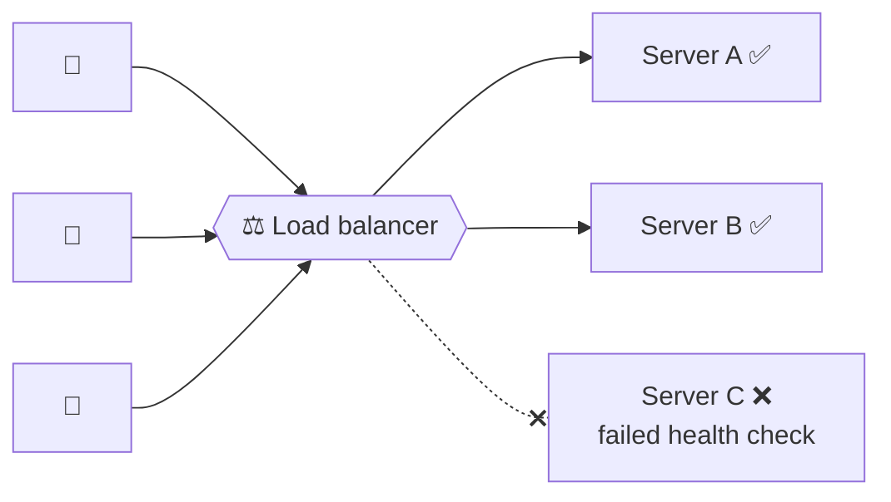
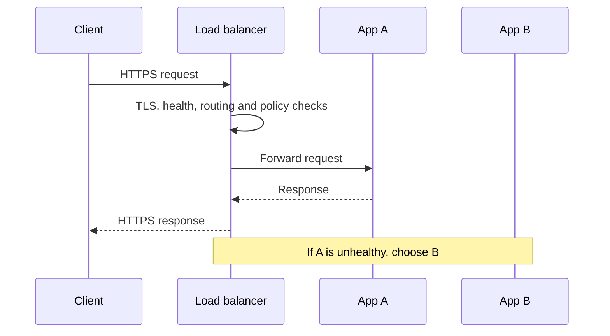
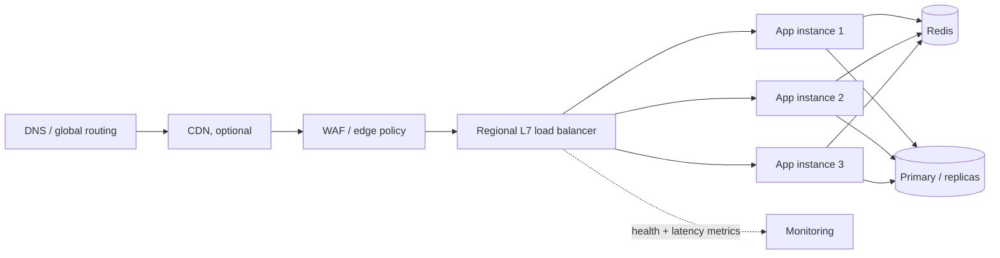
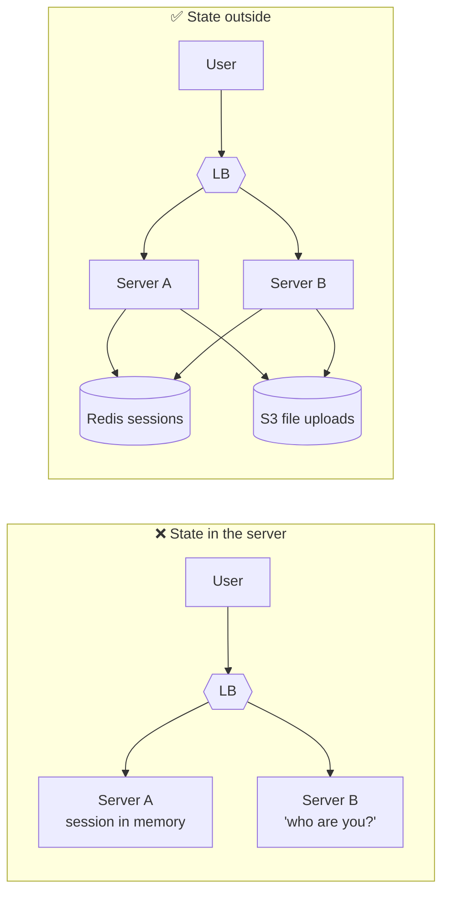
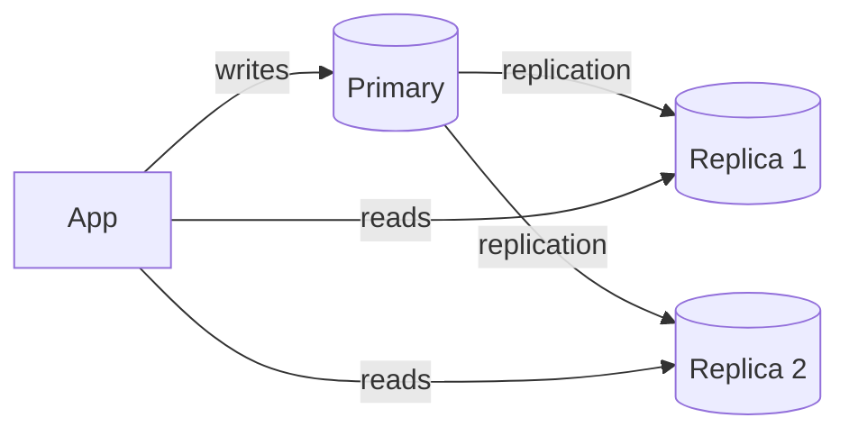
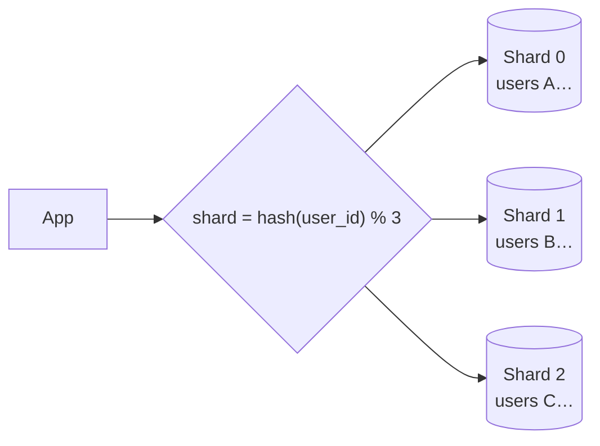
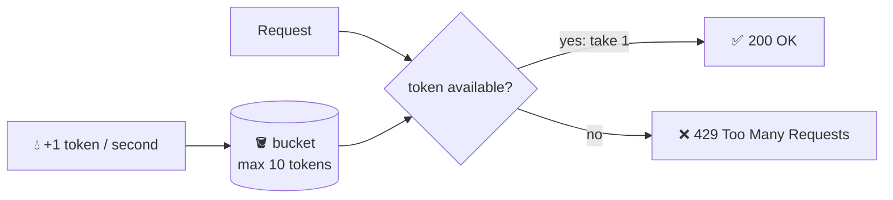

## The big idea

A small café with one barista is fine for 20 customers a day. At 2,000 customers you can either:

- Give the barista a **faster espresso machine** → **vertical scaling** (scale up).
- Hire **more baristas** and add a **host** who sends each customer to a free one → **horizontal scaling** (scale out) with a **load balancer**.


| | Vertical (up) | Horizontal (out) |
| --- | --- | --- |
| How | Bigger CPU / RAM | More servers |
| Simplicity | ✅ No code changes | Needs stateless design |
| Limit | Hardware ceiling, expensive at the top | Practically unlimited |
| Failure | One server = single point of failure | Survives losing a server |

## The scaling journey



Don't jump to step 7 on day one (remember **KISS** and **YAGNI**). Each step solves a real, measured bottleneck.

## Load balancers

A load balancer spreads requests across healthy servers and stops sending traffic to broken ones.



### Algorithms

| Algorithm | How it picks | Good when |
| --- | --- | --- |
| **Round robin** | A, B, C, A, B, C… | Servers are identical |
| **Weighted round robin** | Bigger servers get more | Mixed server sizes |
| **Least connections** | Server with the fewest active requests | Requests vary in duration |
| **IP hash / consistent hashing** | Same client → same server | Need stickiness or cache locality |

### Layer 4 vs Layer 7

- **L4 (transport):** routes by IP and port. Very fast, doesn't read HTTP.
- **L7 (application):** reads HTTP, so it can route `/api/*` to API servers and `/images/*` to storage, terminate TLS, add headers. Examples: NGINX, HAProxy, AWS ALB, Envoy.

## What does a load balancer actually do?

A load balancer is the traffic coordinator between clients and service instances. It gives clients one stable address while it decides which healthy backend should handle each connection or request.



It commonly performs several jobs:

1. **Traffic distribution:** spread connections or requests across instances.
2. **Health-based routing:** stop sending traffic to failed or unready instances.
3. **TLS termination:** decrypt HTTPS at the edge, then use HTTPS or a private network to the backend.
4. **Routing:** send traffic by hostname, path, headers, method or version.
5. **Connection management:** reuse connections, apply timeouts and limit slow clients.
6. **Protection:** enforce request-size limits, quotas, access rules or WAF policies.
7. **Deployment support:** drain old instances while allowing in-flight requests to finish.

The load balancer does not make a slow database fast, guarantee application correctness, or replace autoscaling. It gives a pool of application instances a reliable, observable entry point.

## How does it choose a server?

| Algorithm | How it works | Best fit |
| --- | --- | --- |
| **Round robin** | A, B, C, A, B, C | Similar instances and request durations |
| **Weighted round robin** | Larger instances receive more traffic | Mixed capacity during migration |
| **Least connections** | Choose the instance with fewest active connections | Long-lived or uneven requests |
| **Least latency** | Prefer the fastest healthy target | Multi-zone or multi-region traffic |
| **Random / power of two** | Sample targets and choose the better one | Large dynamic pools |
| **Consistent hash** | Same key tends to reach the same target | Cache locality or controlled stickiness |

Round robin is a reasonable default for stateless HTTP services. Least-connections is not automatically better: a connection may be idle, and a request with a small number of connections may still be expensive. Measure latency and queueing before changing algorithms.

## L4 versus L7

### Layer 4: connection-level balancing

An L4 balancer sees TCP/UDP information such as source address, destination port and connection state. It does not need to understand HTTP.

Use it when you need very high throughput, TCP or UDP support, end-to-end encryption, or protocol transparency. It is fast and simple, but cannot route `/orders` differently from `/users` or inspect HTTP status codes.

### Layer 7: request-level balancing

An L7 balancer understands HTTP/gRPC. It can route by host and path, retry selected failures, add `X-Request-ID`, terminate TLS and expose request metrics.

Example routing:

```text
api.example.com/orders/*  -> order-service
api.example.com/users/*   -> user-service
admin.example.com/*       -> admin-service
/v2/*                     -> v2 deployment
```

L7 routing is more capable but consumes more CPU and must understand protocol behavior. Do not blindly retry non-idempotent requests such as `POST /payments` at the load balancer.

## Health checks: alive is not ready

Use separate endpoints and meanings:

- **Liveness:** the process is running and should not be restarted.
- **Readiness:** this instance can accept traffic now; it has loaded configuration and can reach required dependencies.
- **Startup:** slow initialization has completed.

A health check might be `GET /ready` every 10 seconds. The balancer removes an instance after several failures and adds it back only after several successes. Use a failure threshold and recovery threshold to avoid flapping.

Do not make liveness call every dependency. If a third-party API is temporarily down, restarting every application instance makes the outage worse. Readiness can include critical dependencies, but keep it fast and define whether a degraded dependency should remove the instance or merely trigger an alert.

## Timeouts, retries and connection draining

Set explicit limits at every hop:

```text
client timeout > load-balancer timeout > application timeout > database timeout
```

The exact values depend on the endpoint, but an outer layer should not give up before an inner layer has had a chance to finish. Avoid retry storms: retry only idempotent requests or requests with an idempotency key, cap attempts, and use backoff with jitter.

During a deployment, mark the old instance **not ready**, stop new requests from reaching it, and allow a drain period for existing connections. A worker-backed service must also stop pulling new jobs and finish or release its current lease. If the drain deadline expires, terminate safely and rely on idempotent recovery.

## Sticky sessions: useful but usually a smell

Sticky sessions route the same client to the same backend, often with a cookie or source-IP hash. They can help legacy applications that keep session state in memory, but they reduce balancing quality and make failover painful.

Prefer stateless instances with sessions in Redis or signed tokens. Then any healthy instance can serve the next request, scaling is easier, and losing one instance does not lose user sessions.

## TLS termination and forwarded headers

It is common to terminate TLS at the load balancer and forward traffic over a private encrypted network. Preserve the original request context safely:

```http
X-Request-ID: req_7f2c
X-Forwarded-For: 203.0.113.10
X-Forwarded-Proto: https
```

Configure the application framework to trust forwarded headers only from the known proxy/network. Otherwise a client can spoof its IP or protocol and bypass IP-based limits, audit logs or redirect logic. Generate a request ID at the edge if one is not supplied and propagate it into logs and traces.

## What happens when the load balancer fails?

Production deployments usually make the balancer highly available across zones. Use health checks, multiple balancer nodes or a managed service, and a DNS/global traffic layer for regional failover. Keep the application instances private where possible and make the configuration reproducible.

Plan for partial failures too:

| Failure | Expected behavior |
| --- | --- |
| One app instance fails | Health check removes it; traffic goes to healthy instances |
| One zone fails | Balancer routes to another zone with spare capacity |
| Deployment starts | New instances become ready before old ones drain |
| Backend is overloaded | Queue, rate limit or return bounded `429`/`503`; do not queue forever |
| Balancer cannot reach a dependency | Keep the instance out only if that dependency is required to serve safely |

## A production request path



The load balancer is one layer in the system: DNS chooses a region, the edge filters traffic, the balancer chooses a healthy instance, the application enforces business rules, and the database remains the source of truth.

## Load balancer checklist

- Use at least two zones and keep spare capacity for losing one zone.
- Define liveness, readiness and startup behavior separately.
- Set connection, request, idle and backend timeouts explicitly.
- Drain connections during deployments and scale-in.
- Keep application instances stateless where possible.
- Propagate request IDs, trace context and safe client-IP information.
- Retry only safe/idempotent requests, with a strict budget.
- Monitor healthy target count, 4xx/5xx rates, p50/p95/p99 latency, active connections and rejected requests.
- Test a failed instance, failed zone and overloaded backend before production.

## Stateless servers: the key to scaling out

If a server keeps user sessions **in its own memory**, the next request might land on a different server that doesn't know the user.



**Rule:** any server should be able to handle any request. Keep sessions in Redis or in tokens, files in object storage (S3), and state in the database.

## Scaling the database

The database is usually the hardest part to scale.

### Read replicas

Most apps read far more than they write. Copy the data to replicas and send reads there.



⚠️ **Replication lag:** a replica may be a few milliseconds behind. After a user updates their profile, read *their* profile from the primary ("read your own writes").

### Sharding (partitioning)

When one primary can't handle the writes or the data size, split the data across several databases by a **shard key**.



| Challenge | Why |
| --- | --- |
| Choosing the shard key | A bad key creates "hot" shards (all celebrities on one) |
| Cross-shard queries and JOINs | Must query every shard and combine the results |
| Re-sharding | Adding shards moves data. **Consistent hashing** minimises that |
| Transactions across shards | Hard; avoid them by design |

## Rate limiting

Protect your API from abuse, bugs and traffic spikes by limiting requests per user, IP or API key. Over the limit → **429 Too Many Requests** with a `Retry-After` header.

### Token bucket (most popular)

> 🪣 A bucket holds up to 10 tokens and refills at 1 token per second. Each request takes a token. Empty bucket → request rejected. Allows short bursts but enforces an average rate.



| Algorithm | Idea | Trade-off |
| --- | --- | --- |
| **Fixed window** | Count per minute (resets at :00) | Simple; allows 2× bursts at window edges |
| **Sliding window** | Count over the last 60 s | Smoother, slightly more work |
| **Token bucket** | Tokens refill steadily | Allows bursts, smooth average ✅ |
| **Leaky bucket** | Queue drains at a fixed rate | Very smooth output, adds latency |

In a multi-server setup, keep counters in **Redis** so all servers share the same limits (see *Caching & Redis* for code).

## Resilience basics

At scale, something is *always* failing. Design for it:

| Pattern | Purpose |
| --- | --- |
| **Timeouts** | Never wait forever on a dependency |
| **Retries with exponential backoff + jitter** | Survive brief glitches without hammering the service |
| **Circuit breaker** | Stop calling a service that keeps failing; fail fast and give it time to recover |
| **Bulkhead** | Separate resource pools, so one slow dependency can't consume every thread |
| **Graceful degradation** | Show cached or partial results instead of an error page |
| **Health checks** | Let load balancers route around sick servers |

These are covered in depth in *Microservices → Resilience Patterns*.

## Back-of-the-envelope numbers

| Metric | Rough figure |
| --- | --- |
| 1 million requests/day | ≈ 12 requests/second average (peak maybe 5–10×) |
| One Node.js / Go server | Hundreds to thousands of simple requests/second |
| One Postgres primary | Thousands of simple writes/second, many more reads |
| One Redis node | ~100,000 operations/second |

## Key takeaways

- Scale vertically first (simple), horizontally when needed (resilient, unlimited).
- Load balancers spread traffic and route around failures; L7 can route by path.
- Stateless app servers are the foundation of horizontal scaling.
- Databases scale with caching, read replicas, then sharding.
- Rate limit with a token bucket in Redis; return 429 with `Retry-After`.
- Assume failure: timeouts, retries with backoff, circuit breakers.
