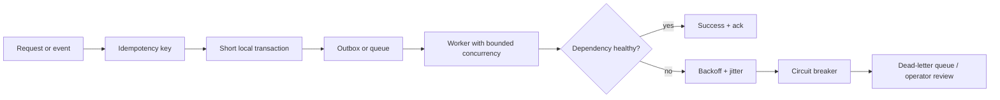

## The production problem

Most backend bugs appear when two things happen at once or when a dependency behaves badly: a webhook is delivered twice, a payment provider times out after charging the card, a queue grows faster than workers can drain it, or a deploy kills in-flight work.

The reliable approach is to make boundaries explicit:



## Race conditions and deadlocks

A **race condition** occurs when the result depends on timing. Prefer an atomic database statement or a transaction that owns the invariant:

```sql
UPDATE inventory
SET available = available - 1
WHERE sku = 'book-42' AND available > 0
RETURNING available;
```

If the returned row count is zero, the reservation failed. For more involved work, use `SELECT ... FOR UPDATE` (pessimistic locking) or a version column (optimistic locking). Keep transactions short, never call an external service inside one, and lock tables/rows in a consistent order. A **deadlock** is a cycle of lock waits; the database normally aborts one transaction, which the application should retry with a limit and idempotency.

For the full ACID, isolation-level, index and `EXPLAIN ANALYZE` treatment, continue with [Database Indexing & Transactions](/learn/backend/indexing-and-transactions).

## Idempotency: safe retries and duplicate delivery

At-least-once delivery is the practical default for queues and webhooks. Store an idempotency key with the result of the operation, protected by a unique constraint:

```sql
CREATE UNIQUE INDEX one_payment_attempt
ON payment_attempts (merchant_id, idempotency_key);
```

On a repeated request, return the stored result instead of charging or creating a second resource. Make the key scope, retention period and response semantics explicit. Idempotency is required for retryable HTTP requests, queue consumers, scheduled jobs and webhook handlers.

## Retries, exponential backoff and jitter

Retry only transient failures: timeouts, connection resets and selected `429`/`5xx` responses. Do not retry validation errors or a request that may be non-idempotent unless it has an idempotency key.

```js
const delay = Math.min(30_000, 250 * 2 ** attempt);
const jittered = delay * (0.5 + Math.random());
await sleep(jittered);
```

Use a maximum attempt count, a total time budget and a dead-letter path. **Jitter** prevents thousands of clients that failed together from retrying together. A **circuit breaker** opens after a failure threshold, fails fast while the dependency recovers, then allows a small half-open probe. Timeouts and bounded concurrency are just as important as retries.

## Workers, scheduling and backpressure

Use background workers for email, image processing, exports, billing reconciliation and other work that does not belong on the request path. A production job should have:

- a durable queue and a unique job ID;
- a visibility timeout or lease, so crashed work becomes available again;
- bounded concurrency and a maximum runtime;
- retry delays, a dead-letter queue and an operator replay path;
- metrics for queue depth, age of oldest job, success rate and processing time.

**Job scheduling** can enqueue recurring work (for example, nightly cleanup), but the job itself must still be idempotent because schedulers can fire twice or overlap. Use a database/Redis lock or a unique execution key when only one run is allowed.

**Backpressure** means slowing producers or shedding optional work when consumers cannot keep up. Cap queue length, reject early with `429`/`503`, reduce worker concurrency, or degrade to a cached response. An unbounded queue only moves an outage into memory and latency.

## Webhook verification and retries

Treat every webhook as untrusted input. Verify the provider's HMAC signature over the raw request body, check the timestamp to prevent replay, parse and validate the event schema, then enqueue it and return a fast `2xx` response.

```js
const expected = createHmac("sha256", WEBHOOK_SECRET)
  .update(`${timestamp}.${rawBody}`).digest("hex");
if (!timingSafeEqual(Buffer.from(expected), Buffer.from(signature))) {
  return res.status(401).end();
}
```

Do not perform slow business logic before acknowledging. Providers retry when they receive a timeout or non-`2xx`, so deduplicate by event ID and process asynchronously. Preserve the original event for audit and put permanently invalid events in a dead-letter queue.

## Outbox, eventual consistency and distributed transactions

Never update a database and publish a message as two unrelated operations. The **transactional outbox** writes the business row and an outbox row in one local transaction; a relay publishes the outbox event and marks it delivered. Consumers remain idempotent because publishing can still be repeated.

Across services, avoid two-phase commit when possible. Use a **Saga**: each service commits a local transaction, emits an event and defines a compensating action. This creates **eventual consistency**, so expose states such as `pending` and design reads to tolerate replication lag. CQRS and event sourcing are useful specialized patterns, not defaults; learn them in [Data in Microservices: Sagas & the Outbox Pattern](/learn/microservices/data-sagas-and-outbox) and [CQRS & Event Sourcing](/learn/microservices/cqrs-and-event-sourcing).

## Graceful shutdown and health checks

On `SIGTERM`, stop accepting new traffic, fail readiness, let in-flight requests finish up to a deadline, stop pulling new jobs, finish or safely release the current lease, close pools, and exit. If the deadline expires, terminate and rely on idempotency for recovery.

Keep health endpoints small and separate:

- **Liveness:** is the process alive, or should it be restarted?
- **Readiness:** can this instance receive traffic right now?
- **Startup:** has slow initialization finished?

Do not make liveness depend on every downstream service. A temporary database outage should usually remove an instance from traffic or trigger an alert, not create a restart loop.

## Connection pools and distributed tracing

A connection pool reuses expensive database connections, but the pool is not infinite. Size it against database capacity, set acquisition and idle timeouts, release connections in `finally`, and remember that `app instances × pool size` is the real connection count. A pooler such as PgBouncer can help when many short-lived processes share a database.

Propagate a trace ID across HTTP, queue messages and scheduled jobs. Record spans for database calls, queue wait time, retries and external requests. Correlate logs with the trace ID and alert on user-facing latency, errors and queue age. See [Observability: Logs, Metrics & Traces](/learn/backend/observability) for instrumentation details.

## Production checklist

| Boundary | Minimum protection |
| --- | --- |
| Database write | Constraint or atomic update; short transaction |
| External request | Timeout, idempotency key, bounded retry with jitter |
| Queue consumer | At-least-once safe handler, ack after success, DLQ |
| Webhook | Signature + timestamp verification, event deduplication |
| Worker | Lease, max runtime, bounded concurrency, graceful stop |
| Service | Readiness/liveness, connection-pool limits, trace propagation |

The goal is not to eliminate failure. It is to make failure bounded, observable and safe to repeat.
