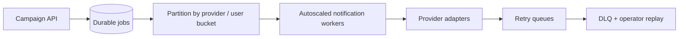
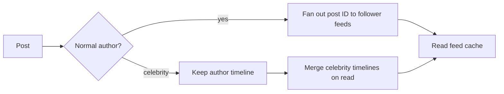

## How to answer these scenarios

Do not jump straight to a technology name. A strong answer follows this order:

1. Clarify the workload and the failure you are seeing.
2. Measure the bottleneck with logs, metrics and traces.
3. Choose the smallest change that fixes the current constraint.
4. Explain correctness, failure handling and the next scaling limit.

## Scenario questions

1. [Your cache hit rate is 95%, but the database still falls over every evening. What's happening and how do you find it?](#1-the-cache-hit-rate-is-95-but-the-database-still-falls-over-every-evening-what-is-happening-and-how-do-you-find-it)
2. [When do you invalidate the cache on write versus let it expire, and what breaks with each?](#2-when-do-you-invalidate-the-cache-on-write-versus-let-it-expire-and-what-breaks-with-each)
3. [Your users table reaches 500 million rows and queries slow down. Do you shard, partition or add read replicas first, and why?](#3-the-users-table-reaches-500-million-rows-and-queries-slow-down-do-you-shard-partition-or-add-read-replicas-first-and-why)
4. [A user updates their profile, refreshes the page and sees old data. Where did it come from and how do you fix it without killing performance?](#4-a-user-updates-their-profile-refreshes-the-page-and-sees-old-data-where-did-it-come-from-and-how-do-you-fix-it-without-killing-performance)
5. [You need to send 10 million push notifications in five minutes. How do you design it so it does not take down everything else?](#5-you-need-to-send-10-million-push-notifications-in-five-minutes-how-do-you-design-it-so-it-does-not-take-down-everything-else)
6. [Traffic spikes 10x in one region during a cricket final. How do you scale without overprovisioning the rest of the year?](#6-traffic-spikes-10x-in-one-region-during-a-cricket-final-how-do-you-scale-without-overprovisioning-the-rest-of-the-year)
7. [A payment succeeds at the gateway, but your service times out before saving it. The user retries. How do you prevent a double charge?](#7-a-payment-succeeds-at-the-gateway-but-your-service-times-out-before-saving-it-how-do-you-prevent-a-double-charge)
8. [One downstream service becomes slow and suddenly the whole application is slow. How do you stop one dependency from taking everything down?](#8-one-downstream-service-becomes-slow-and-suddenly-the-whole-application-is-slow-how-do-you-stop-one-dependency-from-taking-everything-down)
9. [Design a rate limiter for a public API. Where does it live, and what happens if the rate limiter itself goes down?](#9-design-a-rate-limiter-for-a-public-api-where-does-it-live-and-what-happens-if-the-rate-limiter-is-unavailable)
10. [Design a feed for 50 million users. Build it when users post or when they open the app? What changes for a celebrity with 10 million followers?](#10-design-a-feed-for-50-million-users-build-it-when-users-post-or-when-they-open-the-app-what-changes-for-a-celebrity-with-10-million-followers)

## Caching

### 1. The cache hit rate is 95%, but the database still falls over every evening. What is happening and how do you find it?

The hit rate is an average, not proof that the database is protected. A 5% miss rate can still be enormous at peak traffic. If the application receives 200,000 requests per second, 5% means 10,000 database requests per second. The misses may also be concentrated on the hottest keys, may trigger expensive joins, or may be multiplied by a cache stampede when many keys expire together.

Find the cause in this order:

- Graph database QPS, connection-pool wait time, CPU, locks, slow-query percentiles and cache misses together on the same timeline.
- Break cache metrics down by key family, endpoint, tenant and time of day; do not rely on one global hit-rate number.
- Inspect miss bursts, TTL distributions, evictions, hot keys, negative lookups and cache errors.
- Use database slow-query logs and `EXPLAIN ANALYZE` to identify the queries generated by misses.
- Check whether one request causes several database queries or an N+1 pattern.

Fix the actual bottleneck: add request coalescing or a single-flight lock for stampedes, jitter TTLs, cache negative results briefly, warm predictable hot keys, reduce expensive payloads, fix N+1 queries, or add a bounded local cache in front of Redis. A read replica may help read capacity, but it does not fix a miss storm or an inefficient query.

### 2. When do you invalidate the cache on write versus let it expire, and what breaks with each?

Use **invalidate on write** when stale data is harmful and the write path knows exactly which keys are affected: permissions, inventory, pricing, user settings and feature flags. Usually delete the key after the database commit; the next read repopulates it. Deleting is safer than writing a new value because concurrent writers can otherwise put an older value back into the cache.

Use **TTL expiry** when bounded staleness is acceptable or invalidation is difficult: product discovery, public content, analytics and third-party responses. Add jitter so many keys do not expire at once.

Each choice has a failure mode:

| Strategy | What can break | Protection |
| --- | --- | --- |
| Invalidate on write | The invalidation fails, is forgotten for a derived key, or races with an in-flight read | Outbox/event-based invalidation, versioned keys, metrics and repair jobs |
| TTL only | Users see stale data until expiry; synchronized expiry causes a stampede | Shorter TTL for sensitive data, jitter, stale-while-revalidate and request coalescing |
| Write-through | The cache/database write is slower or partially fails | Clear ownership, retries and reconciliation |

Never use a cache as the source of truth for a correctness-critical write. Commit the database first, then invalidate or publish an invalidation event.

## Data

### 3. The users table reaches 500 million rows and queries slow down. Do you shard, partition or add read replicas first, and why?

First measure the query plan, indexes, working set, connection pool and write/read mix. Five hundred million rows alone does not prove that sharding is required.

The usual order is:

1. Fix query shape and indexes; select only needed columns, remove N+1 queries and verify with `EXPLAIN ANALYZE`.
2. Partition by a natural access boundary such as tenant or time when queries can use partition pruning and maintenance benefits from smaller partitions.
3. Add read replicas when the primary is healthy but read traffic is the constraint. Route only replica-safe reads and handle replication lag.
4. Shard when the primary cannot handle the write rate, storage, I/O or connection count even after optimization and vertical scaling.

Partitioning is still one logical database and helps data organization and pruning. Read replicas copy data and increase read capacity but do not increase primary write capacity. Sharding splits ownership across databases and increases write/storage capacity, but introduces cross-shard queries, rebalancing, routing and distributed-transaction problems. Choose a shard key that matches the dominant access pattern and spreads traffic evenly.

### 4. A user updates their profile, refreshes the page and sees old data. Where did it come from and how do you fix it without killing performance?

The stale response may have come from an application cache, CDN/browser cache, a read replica with replication lag, a search index, or a stale client-side query cache. Trace the request and log the data source, cache key, version and database endpoint.

Fix it according to the source:

- **Application cache:** delete or version the profile key after the primary write commits.
- **Read replica:** use a short read-your-own-write window that routes this user to the primary, or wait until the replica has replayed the write.
- **CDN/browser:** use appropriate `Cache-Control`, purge only the affected resource, or use a versioned URL.
- **Client cache:** update or invalidate the local query cache after a successful mutation.
- **Search/index projection:** show the authoritative profile data from the primary for the confirmation view and treat indexing as eventual.

Avoid disabling caching globally. Use scoped invalidation, a monotonic version/timestamp, and a brief consistency window only for the user who just wrote.

## Scale

### 5. You need to send 10 million push notifications in five minutes. How do you design it so it does not take down everything else?

That is about 33,333 notifications per second before accounting for retries. Separate campaign submission from delivery:

Store the campaign and recipient snapshot once, then enqueue batches with a stable notification ID. Use provider-specific rate limits, bounded worker concurrency, connection reuse, backoff with jitter and a dead-letter queue. Respect provider quotas and feedback for invalid tokens.

Protect the rest of the system with a separate worker pool, queue capacity limits, bulkheads, priority queues and autoscaling based on queue age—not just CPU. Make delivery idempotent, track accepted/sent/failed counts, and allow pause/resume. If the five-minute requirement is strict, reserve provider capacity and load-test the complete path beforehand; autoscaling cannot create external provider capacity instantly.

### 6. Traffic spikes 10x in one region during a cricket final. How do you scale without overprovisioning the rest of the year?

Make the application tier stateless and scale it horizontally with autoscaling based on requests, latency and queue depth. Use a CDN for static assets and cacheable public data, and route traffic with a global load balancer or DNS policy that understands regional health and capacity.

For the hot region:

- pre-warm a minimum capacity shortly before the event;
- use scheduled scaling for the known spike and target tracking for the surprise surge;
- cache the read-heavy score/content endpoints at the edge;
- push non-critical work to queues;
- apply per-user/API-key rate limits and graceful degradation;
- shift overflow to nearby healthy regions if latency and data residency allow it.

Do not blindly send all traffic to another region: database writes, session state, replication lag and failover correctness must be designed first. After the event, scale in gradually with cooldowns to avoid oscillation.

## Reliability

### 7. A payment succeeds at the gateway, but your service times out before saving it. The user retries. How do you prevent a double charge?

Use one stable idempotency key for the logical payment attempt, generated before the first gateway request and reused on every retry. Persist it with a unique constraint in your database, and send the same key to the payment provider if the provider supports idempotency.

The flow is:

1. Create an internal payment attempt with status `pending` and the unique key.
2. Call the gateway using that key and an explicit amount/currency.
3. If the response times out, do not blindly create a new charge; query the provider by idempotency key or reconcile through a webhook.
4. Treat the webhook as at-least-once: verify its signature, deduplicate its event ID, and update the payment transactionally.
5. Let the retry return the existing `pending`, `succeeded` or `failed` result.

The database unique constraint is the final safety net. A timeout means “unknown,” not “failed.” Use an outbox for internal payment events and a reconciliation job for attempts that remain pending too long.

### 8. One downstream service becomes slow and suddenly the whole application is slow. How do you stop one dependency from taking everything down?

Put a strict timeout around every outbound call and give the dependency a bounded connection/thread/worker pool. Add a circuit breaker: after enough failures or slow calls, open the circuit and fail fast; after a cooldown, allow a small half-open probe.

Then isolate and degrade:

- use bulkheads so the slow dependency cannot consume all application resources;
- use bounded queues and propagate cancellation/deadlines;
- retry only safe transient failures, with a small capped budget and jitter;
- serve cached or partial data where acceptable;
- move non-critical work to an asynchronous queue;
- return a useful `202`, `503` or partial response instead of hanging;
- alert on dependency latency, timeout rate, circuit state and pool saturation.

Retries without timeouts and budgets amplify an outage. The dependency policy should be visible in traces so you can distinguish downstream time from application time.

## Design

### 9. Design a rate limiter for a public API. Where does it live, and what happens if it goes down?

Put enforcement at the edge or API gateway for coarse protection, then add a service-level limiter for business-specific limits. In a multi-instance deployment, store shared counters in Redis or use a gateway with distributed quota support; an in-memory limiter alone lets a caller multiply its quota by the number of instances.

A token bucket is a good default: it allows controlled bursts while enforcing an average rate. Key limits by API key/user, with IP as a fallback, and separate expensive endpoints from cheap ones. Return `429 Too Many Requests` and `Retry-After`.

The failure policy depends on the endpoint:

| Endpoint | If limiter is unavailable |
| --- | --- |
| Login, password reset, expensive public API | Fail closed or use a conservative local emergency limit |
| Low-risk read endpoint | Fail open briefly, with monitoring and a circuit breaker |
| Internal trusted traffic | Use a separate quota and emergency fallback |

Make the decision atomic (`INCR` plus expiry or a Lua script), set short timeouts, monitor Redis latency/errors, and never let a limiter outage block health checks or incident controls.

### 10. Design a feed for 50 million users. Build it when users post or when they open the app? What changes for a celebrity with 10 million followers?

Use a hybrid fan-out strategy. For ordinary users, **fan-out on write**: when someone posts, enqueue jobs that place the post ID into followers' feed stores. Reads are fast and predictable, but a post to millions of followers is expensive.

For celebrities, **fan-out on read**: keep the celebrity's posts in an author timeline and merge them into a user's feed when the user opens it. This avoids a write amplification event for 10 million followers, but reads require a merge and careful caching.

Use IDs rather than full post bodies in feed entries, cursor pagination rather than offsets, ranking separate from storage, and a queue to absorb write bursts. Cache the first page, expire or trim old entries, and use a stable snapshot/cursor so pagination does not jump while new posts arrive.

The right threshold is workload-dependent. Measure follower count, posting frequency, read/write ratio and ranking cost; some authors may use a mixed policy or delayed fan-out. Deletions, privacy changes, blocks and muted users need an invalidation path, so the feed must always re-check visibility before returning content.

## Final interview checklist

For each design, say:

- What is the bottleneck and how would you measure it?
- What is the correctness invariant?
- Where can duplicate work, stale data or lost work occur?
- What happens when a dependency, cache, queue or region fails?
- Which traffic is isolated, degraded or rejected first?
- What metric tells you the design is healthy?

The strongest backend designs are not the ones with the most components. They are the ones that make load, consistency and failure behavior explicit.
