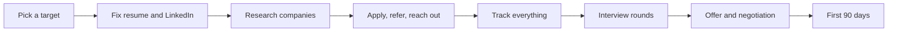

## Why most job searches stall

Many people open a job site, click "Apply" on 80 jobs, and hear back from two. The problem is rarely skill. It is **no target**. Recruiters can tell when a resume was sent everywhere.

A focused search is faster: fewer applications, each one tailored, each one followed up.

## The whole path at a glance

Each step has its own lesson in this topic. Follow them in order the first time.

## Step 1: Define your target

Write one sentence for each line. If you cannot, you are not ready to apply yet.

| Question | Example answer |
| --- | --- |
| Which **industry**? | Fintech or e-commerce |
| Which **company type**? | Product company, 50 to 500 people, remote friendly |
| Which **role and level**? | Backend Engineer (Node.js / Go), mid level |
| What **work** will you do every day? | Build and run APIs, databases and queues |
| Which **location / work mode**? | Dhaka on-site, or fully remote for a foreign company |
| What **salary range**? | Researched from levels.fyi, Glassdoor and peers |

> 💡 If two answers fight each other (for example "senior pay" and "first job"), talk to a mentor. A 30-minute conversation with someone already in that role can save months.

## Step 2: Gap check

Open 10 job posts that match your target. Copy the requirements into a table and count how often each skill appears.

| Skill | Seen in posts | My level (0–3) | Action |
| --- | --- | --- | --- |
| SQL & indexing | 9 / 10 | 2 | Review [Database Design](/learn/databases) |
| Docker | 8 / 10 | 1 | Build and deploy one project |
| System design | 6 / 10 | 1 | Work through [System Design L6](/learn/system-design-l6) |
| AWS | 5 / 10 | 0 | [AWS for Developers](/learn/aws) + one certificate |

The skills seen most often with the lowest score are your study plan.

## Step 3: A weekly rhythm

| Day | Focus |
| --- | --- |
| Mon–Fri (1–2 h) | Study gaps: DSA, system design, your stack |
| 3 days a week | 5 tailored applications + 5 outreach messages |
| 2 days a week | One LinkedIn post or project update |
| Sunday | Review your tracker, plan next week |

## Checklist before you apply

- [ ] One-sentence target written down
- [ ] Resume tailored to that target ([next lesson](/learn/career/resume-that-gets-shortlisted))
- [ ] LinkedIn profile complete
- [ ] 2–3 projects you can explain in depth
- [ ] A spreadsheet to track applications
