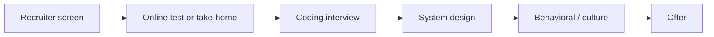

## A typical process

Small companies may merge rounds; big companies may add more. Always ask the recruiter: *"What rounds should I expect, and what does each one test?"*

## Recruiter screen (15–30 min)

Prepare:

- A **60-second introduction**: current role, stack, best result, why this company.
- Salary expectation as a researched range ([negotiation lesson](/learn/career/offer-and-salary-negotiation)).
- Notice period and availability.

## Coding interview

1. Learn the patterns, not 500 random problems: two pointers, sliding window, hash map, BFS/DFS, binary search, heap, intervals, dynamic programming. See [Data Structures & Algorithms](/learn/dsa).
2. Practice 2–3 problems a day on LeetCode or HackerRank, timed.
3. **Talk out loud** during the interview:

| Step | What to say |
| --- | --- |
| Clarify | Inputs, outputs, edge cases, size of data |
| Plan | Brute force first, then improve, state Big-O |
| Code | Clean names, small functions |
| Test | Walk through an example and an edge case |

## System design (mid level and above)

Use a repeatable structure: requirements → scale estimate → API → data model → high-level design → bottlenecks and failures → trade-offs. Practice with [System Design L6](/learn/system-design-l6), [Microservices](/learn/microservices) and [Database Design](/learn/databases).

## Take-home assignment

- Ask how many hours they expect; stay close to it.
- Include a README: how to run, decisions, what you would do with more time.
- Add tests and keep commits clean. Reviewers read the history.

## Stack-specific questions

Review the interview lessons in each topic:

- [AWS interview questions](/learn/aws)
- [Database interview prep](/learn/databases)
- [Linux & DevOps troubleshooting and interview questions](/learn/linux-devops)
- [OOP](/learn/oop), [Design Patterns](/learn/design-patterns), [Clean Code & SOLID](/learn/clean-code)

## Know your own projects deeply

Expect: *"Walk me through the architecture. What would you change? What broke in production? How did you debug it?"* Prepare one diagram and three stories per project.

## Interview day checklist

- [ ] Camera, mic and internet tested; quiet room
- [ ] Code editor and a whiteboard tool ready
- [ ] Company research and the role's job post open
- [ ] Your 6-month plan and questions to ask ready
- [ ] Water, and join 3 minutes early
