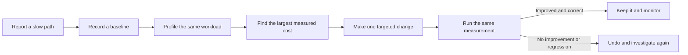
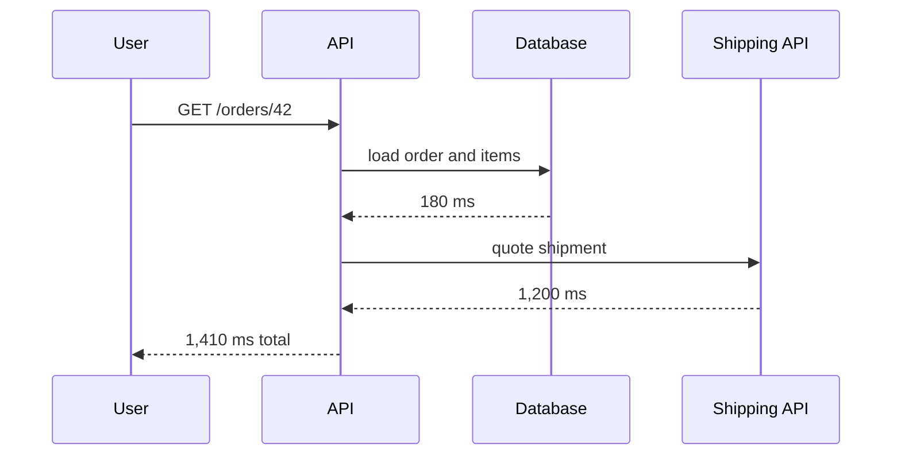

## The big idea

**Profiling** measures where a program spends time, allocates memory, or waits on work. It replaces “this looks slow” with evidence.

An optimisation is only useful when it improves a user-facing outcome: a faster request, smoother interaction, lower cost, or fewer crashes. Start with a realistic workload and a clear baseline; otherwise you may make code harder to read without moving the metric that matters.



> 💡 **Profile first, optimise second.** A function called once can look expensive in isolation but have no meaningful effect. A small function called a million times may be the real problem.

## What to measure

| Symptom | Start by measuring | Common cause |
| --- | --- | --- |
| A request is slow | End-to-end latency, then CPU time, database time and outbound calls | N+1 queries, serial I/O, expensive loops |
| UI feels stuck | Interaction delay and browser main-thread work | Long JavaScript task, unnecessary renders, large list |
| Memory grows over time | Heap after GC, allocation rate and retained objects | Cache without a bound, listeners, request data kept alive |
| CPU is high | CPU profile / flame graph under representative load | Repeated parsing, sorting, serialization, hot loop |
| Throughput drops | Queue depth, concurrency, wait time and saturation | Slow dependency, lock contention, exhausted pool |

Keep separate **wall-clock time** (how long the user waited) from **CPU time** (how much processor work your code did). A request may be slow because it is waiting for the database or another service, even when its CPU profile looks quiet.

## A practical Node.js example

Suppose an order summary endpoint has become slow. Start by timing the request and logging the number of records—not by adding a cache immediately.

```ts
import { performance } from "node:perf_hooks";

async function getOrderSummary(customerId: string) {
  const startedAt = performance.now();
  const orders = await orderRepository.findByCustomer(customerId);
  const summary = orders.map(toSummaryRow);

  logger.info({
    customerId,
    orderCount: orders.length,
    durationMs: Math.round(performance.now() - startedAt),
  }, "order summary completed");

  return summary;
}
```

This is a **baseline**, not a full profiler. It tells you whether slow requests correlate with record count. Add timings around the database query and any external calls next; do not log private order data just to debug performance.

### Capture a CPU profile

For a local or safely isolated workload, Node can write a CPU profile that Chrome DevTools can open:

```bash
node --cpu-prof dist/server.js
# Exercise the one slow route with representative test data, then stop the process.
# Open the generated .cpuprofile file in Chrome DevTools > Performance.
```

Look for functions with large **self time** (the function itself is busy) and large **total time** (it and its children are busy). A flame graph is read from top to bottom: a wide bar means that stack frame consumed a large share of sampled CPU time. Width matters; height is call depth, not cost.

```text
Wide stack:  request -> buildReport -> sortRows -> localeCompare
Narrow stack: request -> authenticate -> verifyToken

Investigate the wide path first, then repeat the profile after one change.
```

## Find a real cause, not a prettier microbenchmark

Here is a common accidental quadratic loop:

```ts
// Slow for a large order list: every order scans all customers again.
const rows = orders.map((order) => ({
  id: order.id,
  customerName: customers.find((customer) => customer.id === order.customerId)?.name,
}));
```

Profile it with data close to the production shape. If the lookup is genuinely hot, make the relationship explicit:

```ts
const customerNameById = new Map(customers.map((customer) => [customer.id, customer.name]));

const rows = orders.map((order) => ({
  id: order.id,
  customerName: customerNameById.get(order.customerId),
}));
```

The first version can perform roughly `orders × customers` comparisons; the second builds one lookup table and performs one lookup per order. Still validate the change with the original workload: a faster benchmark with tiny sample data is not proof of a better endpoint.

## Profile I/O separately

CPU profiles do not explain time spent waiting for a database, filesystem, or HTTP dependency. Trace the request across its boundaries:



The external call is the first lead here, not the small amount of JavaScript around it. Set timeouts, record dependency latency and error rate, and consider parallel work only when the operations are independent and downstream capacity can handle the added concurrency.

## Investigate memory growth

A process using more memory is not automatically leaking. Load, caching, and garbage-collection timing can all change the heap. Compare heap snapshots after a full GC at a healthy baseline and after repeatable growth.

```ts
// Risky: grows for every distinct key and never expires.
const reportCache = new Map<string, Report>();

export function rememberReport(id: string, report: Report) {
  reportCache.set(id, report);
}
```

Check the retained path: why is the object still reachable? Typical owners are unbounded maps, event listeners that were never removed, timers, queues, and request or response objects captured in long-lived closures. Fix the owner—for example, use a bounded cache with expiry—not merely a larger memory limit.

<details>
<summary>Useful guardrails for production profiling</summary>

- Reproduce first in development, staging, or a controlled canary whenever possible.
- Use representative, non-sensitive data and remove request bodies, tokens, and personal data from diagnostic logs.
- Prefer sampled, short-lived profiling and set a clear stop time; continuous detailed profiling has overhead.
- Keep the baseline, workload description, profile and before/after result with the change so another engineer can verify it.
</details>

## A trustworthy optimisation checklist

1. Define the user-visible symptom and success metric, such as p95 latency falling from 900 ms to 400 ms.
2. Reproduce it with a documented workload and record a baseline.
3. Use the right signal: trace for I/O, CPU profile for compute, heap snapshot for retained memory.
4. Change the narrowest confirmed bottleneck and preserve correctness with tests.
5. Repeat the same measurement, compare percentiles as well as averages, and monitor after release.

## Key takeaways

- Profiling tells you where resources are really going; it is evidence, not guesswork.
- Measure a complete user path before drilling into CPU, memory, database, or dependency details.
- CPU, waiting on I/O, and retained memory are different problems and need different tools.
- Make one small change at the measured bottleneck, then rerun the same workload to prove the result.
