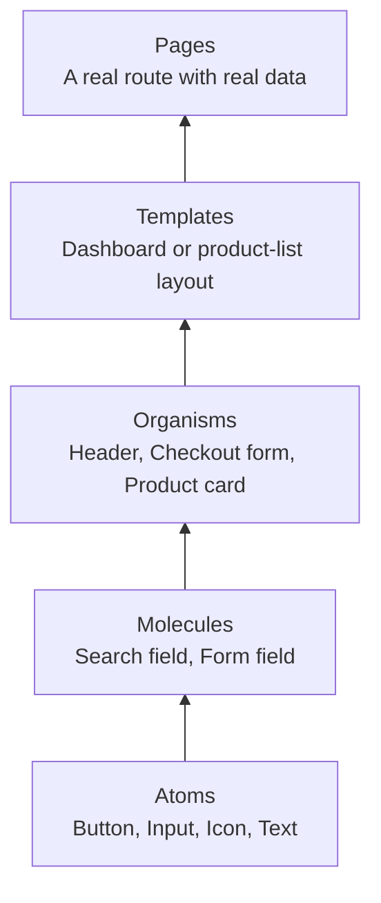

## The big idea

**Atomic Design** is a way to describe UI composition. Start with small, reusable building blocks and combine them into increasingly complete screens:



It is a shared vocabulary, not a folder structure that every application must copy exactly. Its value is consistency: the same button behavior, spacing, accessibility, and visual language appear wherever users meet a button.

> 💡 A design system is larger than its component library. It includes the decisions behind the components: design tokens, interaction rules, accessibility requirements, documentation, and ownership.

## The five levels

| Level | Responsibility | Example | Should it know about a customer order? |
| --- | --- | --- | --- |
| **Atom** | One small visual or interaction primitive | `Button`, `Input`, `Icon`, `Text` | No |
| **Molecule** | A small, reusable combination | `SearchField`, `FormField` | Usually no |
| **Organism** | A meaningful UI section | `SiteHeader`, `AddressForm` | Sometimes, if it is a domain component |
| **Template** | Page structure and layout regions | `AccountSettingsLayout` | No real data; it defines slots |
| **Page** | Route-level composition with real data and permissions | `/orders/123` | Yes |

For example, an ecommerce product page might be composed like this:

```text
ProductPage (real product data, route permissions)
└── ProductDetailTemplate (two-column layout)
    ├── ProductGallery (organism)
    │   └── Image, IconButton (atoms)
    └── PurchasePanel (organism)
        ├── Price (atom)
        ├── QuantityPicker (molecule)
        └── Button (atom)
```

## Start with tokens, not duplicate CSS

**Design tokens** are named values for decisions that should stay consistent: color, spacing, typography, border radius, shadow, and animation duration. Components consume the names instead of inventing values in every file.

```css
:root {
  --color-action: #2563eb;
  --color-action-hover: #1d4ed8;
  --color-danger: #b91c1c;
  --space-2: 0.5rem;
  --space-4: 1rem;
  --radius-control: 0.5rem;
}
```

```tsx
type ButtonProps = {
  children: React.ReactNode;
  tone?: "primary" | "danger";
} & React.ComponentPropsWithoutRef<"button">;

export function Button({ children, tone = "primary", ...props }: ButtonProps) {
  return (
    <button className={`button button--${tone}`} {...props}>
      {children}
    </button>
  );
}
```

```css
.button {
  border: 0;
  border-radius: var(--radius-control);
  padding: var(--space-2) var(--space-4);
  background: var(--color-action);
  color: white;
}

.button:hover { background: var(--color-action-hover); }
.button--danger { background: var(--color-danger); }
```

The token name records intent. When branding changes, update `--color-action` once instead of hunting down many near-identical blue values.

## Build accessible primitives once

The most reusable component is not always the smallest-looking one. A button needs native semantics, keyboard behavior, focus visibility, and a disabled state. Prefer the browser's native element before recreating it with `div` plus click handlers.

```tsx
type IconButtonProps = {
  label: string;
  children: React.ReactNode;
} & React.ComponentPropsWithoutRef<"button">;

export function IconButton({ label, children, ...props }: IconButtonProps) {
  return (
    <button type="button" aria-label={label} {...props}>
      {children}
    </button>
  );
}
```

```tsx
// Good: the accessible name is present even though the icon has no text.
<IconButton label="Close dialog"><CloseIcon /></IconButton>
```

When a custom interaction is necessary—dialog, menu, combobox, tabs—use a well-tested headless primitive or fully implement keyboard navigation, focus management, ARIA semantics, escape behavior, and screen-reader announcements. Styling can be shared; accessibility cannot be postponed.

## Keep domain logic out of generic components

Atomic Design becomes harmful when it turns domain concepts into vague “organisms,” or when every component tries to handle every possible product rule.

```tsx
// Good generic primitive: reusable outside the order domain.
<Button tone="primary">Save</Button>

// Good domain component: owns order-specific language and behavior.
<CancelOrderButton order={order} onCancelled={refreshOrder} />
```

`CancelOrderButton` may call an order API, enforce the product's cancellation policy, and show domain-specific copy. That knowledge does **not** belong inside the generic `Button`.

Use a practical split:

```text
components/ui/          # tokens and domain-neutral atoms/molecules
components/layouts/     # reusable page structure
features/orders/        # order-specific UI, queries and business rules
app/orders/[id]/page.tsx # route-level page composition
```

The exact directories can vary. The boundary matters more: shared UI stays independent of product domains; feature code stays close to its use case.

## Templates make loading and empty states consistent

A template defines structure and slots without deciding which API to call. This makes loading, empty, error, and populated states easier to review consistently.

```tsx
type SettingsTemplateProps = {
  navigation: React.ReactNode;
  children: React.ReactNode;
};

export function SettingsTemplate({ navigation, children }: SettingsTemplateProps) {
  return (
    <div className="settings-layout">
      <aside>{navigation}</aside>
      <main>{children}</main>
    </div>
  );
}
```

```tsx
// The page owns data fetching and permissions; the template owns the layout.
export default async function ProfileSettingsPage() {
  const profile = await getProfile();
  return <SettingsTemplate navigation={<SettingsNav />}><ProfileForm profile={profile} /></SettingsTemplate>;
}
```

## Document and test the library

Treat each shared component like a small product with a contract. A component explorer such as Storybook is useful for documenting examples and visually checking variations, but it is not a replacement for application tests.

| Check | Example |
| --- | --- |
| States | default, hover, focus-visible, disabled, loading, error |
| Variants | primary/danger, compact/regular, light/dark theme |
| Accessibility | keyboard-only use, accessible name, contrast, screen-reader flow |
| Responsive layout | narrow viewport, long labels, translated text |
| Regression safety | unit tests for behavior; visual checks for appearance |

Do not promote a one-off component to the shared library just because it exists. Promote it when its behavior, accessibility, and styling rules are stable and at least two real use cases need the same contract.

<details>
<summary>When Atomic Design is not the best primary structure</summary>

Small applications may only need feature folders and a handful of primitives. In large applications, feature-based organization is usually clearer for business code. Atomic Design works best for the domain-neutral UI layer; it should complement—not replace—feature ownership, route boundaries, and clear API/state management.
</details>

## Key takeaways

- Atomic Design explains how small UI parts compose into complete pages.
- A design system includes tokens, accessibility and documentation—not only components.
- Keep generic primitives domain-neutral; keep product rules inside feature components.
- Use native HTML first, and treat keyboard behavior and focus management as part of component quality.
- Promote code to the shared library only after repeated, stable use cases prove the contract.
