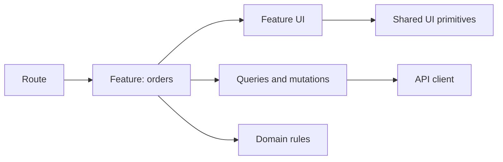

## The big idea

Frontend architecture is the set of boundaries that lets a team change one product area without accidentally breaking another. A scalable application is not the one with the most folders; it is the one where a developer can answer: **who owns this behavior, data and UI?**



## Prefer feature ownership

Put code that changes together near the feature that owns it. Shared code must be genuinely reusable and domain-neutral.

```text
app/orders/[id]/page.tsx          # route composition and access boundary
features/orders/
  api.ts                           # order requests and response mapping
  OrderDetails.tsx                 # order-specific UI
  CancelOrderButton.tsx            # order policy and mutation
  queries.ts                       # cache keys and data lifecycle
components/ui/                     # Button, Dialog, Input: no order rules
lib/http.ts                        # authenticated transport, retries, errors
```

Avoid a global `components/` directory becoming the default home for product code. Move a component there only after stable behavior is needed by more than one feature.

## Separate kinds of state

| State | Owner | Example |
| --- | --- | --- |
| Local UI | component | dialog open, input text |
| URL | router | selected tab, page, filters |
| Server | query cache | orders returned by an API |
| Global client | app shell | theme, short-lived notification |
| Form | form boundary | dirty fields and validation |

Do not copy server data into a global store just to make it available. Fetch it through a cached query close to its feature; invalidate or update that cache after a successful mutation.

## Define a narrow API boundary

Pages and components should not each invent `fetch` calls, base URLs and error handling. Put transport and response conversion behind a feature API boundary.

```ts
export async function getOrder(id: string): Promise<Order> {
  const response = await http.get(`/orders/${id}`);
  return orderSchema.parse(response); // validate untrusted data at the boundary
}
```

This makes authentication, tracing, error handling and schema changes consistent. Keep browser secrets out of this layer; use server-side routes or a backend-for-frontend when credentials must remain server-only.

## Architecture decision checklist

1. Keep state as close as possible to the code that changes it.
2. Make routes compose features; do not turn route files into 500-line implementations.
3. Create a shared abstraction only after repeated, stable use.
4. Enforce permissions on the server; a hidden client button is only a UX choice.
5. Document decisions that impose lasting constraints, such as microfrontends or a global state library.

### When to use microfrontends

Microfrontends can give independently deployed teams a boundary, but introduce shared-runtime, routing, visual-consistency and observability costs. They are not a cure for a poorly separated monolith. Start with feature ownership in one application; introduce independent frontends only when team autonomy and release independence outweigh that operational cost.

## Key takeaways

- Organize product code by feature and keep domain-neutral UI separately.
- Keep local, URL, server and global state distinct.
- Centralize transport and validation at an API boundary.
- Optimize for clear ownership before adding architectural machinery.
