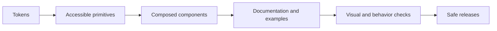

## A component library needs a contract

The Atomic Design lesson explains composition. Operating a design system means keeping that composition reliable as more teams use it: clear APIs, accessible behavior, tokens, examples, versioning and a path for migration.



## Headless behavior, branded presentation

A headless component supplies behavior and accessibility but leaves appearance to the product. This is useful for complex controls such as menus and dialogs, where keyboard navigation and focus management are easy to get wrong.

```tsx
// The app owns the presentation; the primitive owns focus and dialog behavior.
<Dialog.Root>
  <Dialog.Trigger className="dangerButton">Delete order</Dialog.Trigger>
  <Dialog.Content aria-describedby="delete-order-description">
    <Dialog.Title>Delete this order?</Dialog.Title>
    <p id="delete-order-description">This action cannot be undone.</p>
  </Dialog.Content>
</Dialog.Root>
```

Choose a maintained accessible primitive when appropriate. Do not replace native controls unnecessarily, and test keyboard navigation in the final styling—not only in the primitive's demo.

## Theme with semantic tokens

Use purpose-based names so themes can change without every component knowing a brand color.

```css
:root { --surface: #ffffff; --text: #172033; --action: #2563eb; }
[data-theme="dark"] { --surface: #101827; --text: #f8fafc; --action: #93c5fd; }

.card { background: var(--surface); color: var(--text); }
```

Avoid tokens named after a literal such as `blue500` in consuming UI. A semantic `--action` can map to a different palette for dark mode, a tenant theme, or accessibility needs.

## Document the states people will ship

Storybook or an equivalent component explorer is useful for showing each stable component in isolation. Document:

- variants, sizes and long or translated labels;
- loading, empty, disabled and error states;
- keyboard and screen-reader expectations;
- responsive behavior and light/dark themes.

Pair visual regression checks with behavior tests. A screenshot can catch spacing and color drift; it cannot prove that Escape closes a dialog or that a form submits correctly.

## Release safely

1. Add a stable component API and examples.
2. Test behavior, accessibility and representative visual states.
3. Release additively first; mark old APIs deprecated with a migration note.
4. Migrate consumers incrementally and measure adoption.
5. Remove deprecated APIs only after their consumers are gone.

## Key takeaways

- A design system is an owned product, not a folder of copied components.
- Headless primitives can protect complex accessibility behavior while products retain visual control.
- Semantic tokens make themes and accessibility changes safer.
- Documentation, visual checks and migration plans are part of the component contract.
