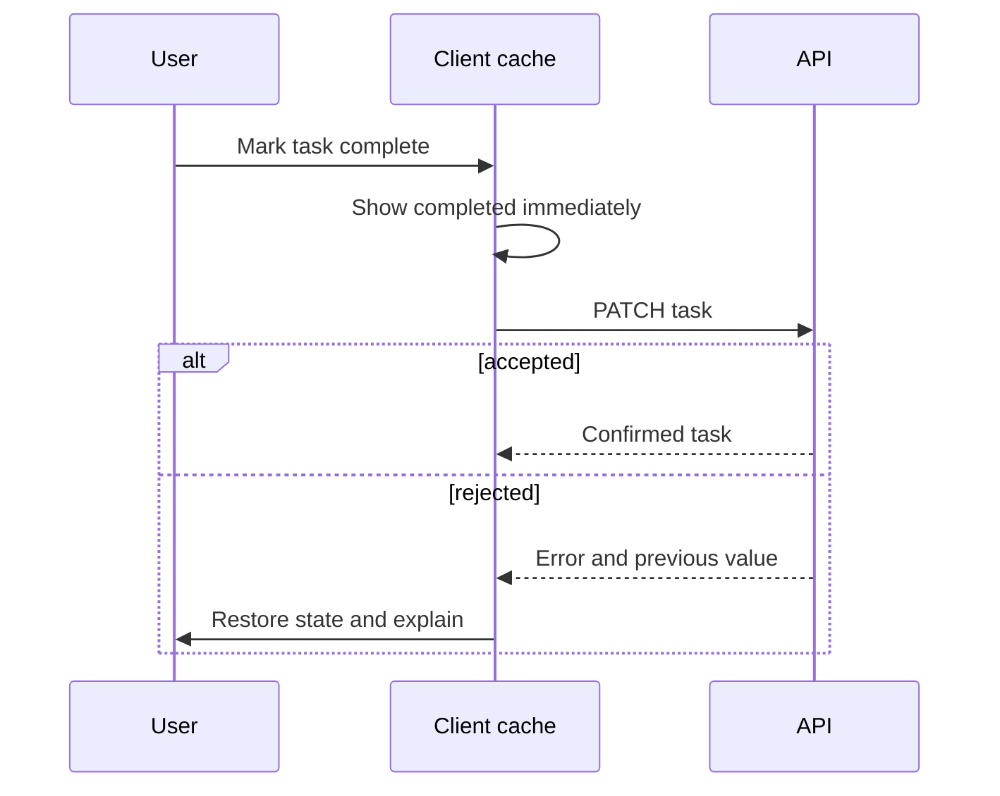

## Optimistic updates: fast, reversible feedback

An optimistic update changes the local view before the server confirms it. It should have a known rollback path.



Use it for small, reversible actions such as toggles. For money movement, inventory reservation or destructive operations, prefer confirmation and a server-authoritative result.

## Offline-first is a product decision

Offline support needs more than caching assets. Decide which reads can be stale, which writes can queue, how conflicts resolve, and how users see sync status. A queued action needs an idempotency key so replay does not create duplicates.

```text
client action -> durable local queue -> retry when online -> idempotent server endpoint
                         |                         |
                    show “pending sync”       reconcile success or conflict
```

Never silently claim a write succeeded when it is only queued.

## Feature flags need lifecycle ownership

Flags decouple deployment from release, but old flags become branching debt.

| Rule | Why |
| --- | --- |
| Name the owner and removal date | every flag must end |
| Evaluate sensitive rules server-side | the browser is visible to users |
| Keep a safe default | outages should not expose unfinished work |
| Measure flag variants | gradual rollouts need evidence |

## Tenants and roles

The UI may choose branding, navigation and helpful empty states from tenant and role context. It must not be the final authorization check.

```tsx
// UX gate only; the API must enforce the same permission.
{permissions.includes("orders:cancel") && <CancelOrderButton order={order} />}
```

Scope cached data by tenant and account identity. On tenant switching, clear or partition the cache so one customer's data cannot appear in another customer's session.

## Key takeaways

- Optimistic UI needs rollback; offline writes need durable queues and idempotency.
- Feature flags require ownership, a safe default and removal.
- Tenant and role context shape the UI, while the server remains the authority.
- Cache keys and session transitions must include tenant boundaries.
