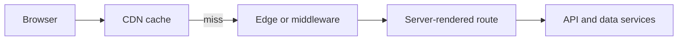

## One request can be handled in several places



Use the closest layer that can safely answer the request. Static public assets belong at the CDN. Personal or frequently changing data usually needs a server boundary. Do not put database credentials or heavy, long-running work in an edge runtime just because it is close to the user.

## Middleware is a narrow request gate

Middleware is well suited to lightweight tasks such as locale negotiation, an authentication redirect, headers, or an experiment assignment. It should not become an application server.

```ts
export function middleware(request: NextRequest) {
  const session = request.cookies.get("session");
  if (!session && request.nextUrl.pathname.startsWith("/account")) {
    return NextResponse.redirect(new URL("/login", request.url));
  }
  return NextResponse.next();
}
```

The destination route and backend must still enforce authorization. Redirecting in middleware improves UX; it does not protect data by itself.

## Cache by data classification

| Content | Typical cache rule | Reason |
| --- | --- | --- |
| Hashed JS, CSS, images | long-lived immutable | filename changes on deploy |
| Public catalog page | CDN cache with controlled revalidation | many users can share it |
| Signed-in account page | private or no shared cache | response is user-specific |
| Mutation response | usually no shared cache | must reflect confirmed state |

Cache keys must include every dimension that changes the response: locale, tenant, device variant where necessary, and authorization scope. Incorrect caching can become a data leak.

## Make deployment reversible

1. Build once from a pinned dependency lockfile.
2. Publish immutable static assets before or with the application release.
3. Use health checks and a small canary where the platform supports it.
4. Monitor error rate, Web Vitals and server latency after release.
5. Roll back to the previous known-good artifact when a release regresses.

Do not equate a successful build with a successful deployment. Verify the deployed route, its referenced assets and the real request path after release.

## Key takeaways

- CDN, edge, server and API layers have different jobs and trust boundaries.
- Middleware should stay small and cannot replace server authorization.
- Cache only data that is safe to share, with complete cache keys.
- A frontend release is complete only after deployed behavior and assets are verified.
