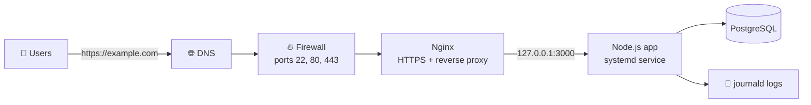

## The big idea

Writing code is like **cooking a meal in your kitchen**. Deployment is **running a restaurant**: the food must reach real customers, hot and safe, every day, even when the chef is asleep.

**DevOps** is the set of habits and tools that gets software from a developer's laptop to real users **quickly, safely and repeatably**, and keeps it running afterwards.

> 💡 DevOps is not a job title or a single tool. It's a way of working: **automate** the boring steps, **measure** what happens in production, and make releasing so routine that it stops being scary.

## From `git push` to a live website

| Stage | What happens | Tools you'll meet |
| --- | --- | --- |
| **1. Code** | You write and commit code | Git, GitHub |
| **2. Build** | Install dependencies, compile, bundle | `npm ci`, `npm run build`, Docker |
| **3. Test** | Automated checks catch mistakes before users do | Jest, Playwright, linters |
| **4. Release** | Copy the build to a server and switch traffic to it | GitHub Actions, SSH, `rsync`, Docker registry |
| **5. Run** | The app runs as a service and restarts if it crashes | Linux, systemd, Nginx, Docker |
| **6. Monitor** | Watch errors, speed, disk and memory | Logs, uptime checks, Prometheus, Grafana |

Then the loop starts again with the next change. Teams that do this well deploy **many times a day**, and each deploy is small, so problems are easy to find and undo.

## Why Linux?

About **96% of the top million web servers run Linux**, and almost every cloud server, Docker container and Kubernetes node is Linux underneath. Even if you develop on Windows or macOS, your code almost certainly **runs** on Linux.

| You want to… | You need to know… |
| --- | --- |
| Log in to a server | SSH and keys |
| Find out why the site is down | Logs, processes, ports |
| Keep the app running after a crash or reboot | systemd services |
| Serve a domain with HTTPS | Nginx and Let's Encrypt |
| Stop attackers | Users, permissions, firewalls |
| Automate a deploy | Bash scripts, cron, CI/CD |

## Where your app can run

| Option | What you manage | Good for | Example |
| --- | --- | --- | --- |
| **VPS** (virtual private server) | The whole Linux server | Small/medium apps, learning, low cost | Hetzner, Contabo, DigitalOcean, EC2 |
| **PaaS** (platform as a service) | Only your code | Fast start, no server work | Vercel, Render, Railway, Heroku |
| **Containers** | Images + an orchestrator | Many services, consistent environments | Docker Compose, ECS, Kubernetes |
| **Serverless** | Functions only | Spiky or event-driven workloads | AWS Lambda, Cloudflare Workers |

This section focuses on the **VPS path** because it teaches you what every other platform is doing for you behind the scenes. Once you understand a Linux server, PaaS, Docker and Kubernetes all make much more sense.

## A typical small production setup

Every box in this picture has a lesson in this section.

## The roadmap

| # | Lesson | You'll be able to… |
| --- | --- | --- |
| 2 | Command-line essentials | Move around a server, read files, search logs |
| 3 | Users, permissions & sudo | Run apps safely without `root` |
| 4 | Processes & systemd | Keep an app running and read its logs |
| 5 | SSH, networking & firewalls | Log in securely and open only the ports you need |
| 6 | Bash scripting & cron | Automate deploys and scheduled jobs |
| 7 | Nginx & HTTPS | Put a domain with a free certificate in front of your app |
| 8 | Deploy a Node.js app to a VPS | Do the whole thing end to end |
| 9 | CI/CD with GitHub Actions | Deploy automatically on every push |
| 10 | Docker in production | Ship the same image everywhere |
| 11 | Zero-downtime deploys & rollbacks | Release without errors and undo in seconds |
| 12 | Monitoring, logs & backups | Know about problems before users tell you |
| 13 | Troubleshooting & interview questions | Fix "the site is down" calmly |
| 14 | CI/CD fundamentals & pipeline design | Design a pipeline that works in any tool |
| 15 | Jenkins: install to first pipeline | Run Jenkins and write a Jenkinsfile |
| 16 | Jenkins in production | Build, approve and deploy Docker images from Jenkins |
| 17 | Running Kafka in production | Operate a Kafka cluster: tuning, security, monitoring, upgrades |

## DevOps principles worth remembering

- **Automate anything you do twice.** A script never forgets a step at 2 a.m.
- **Small, frequent releases.** A 20-line change is easy to debug; a 2,000-line release is not.
- **Everything in Git.** Code, config, server setup, CI pipelines. If it's not in Git, it can't be reviewed or restored.
- **Same build everywhere.** Build once, then deploy that exact artifact to staging and production.
- **You build it, you run it.** Developers see production logs and metrics, not just their own laptop.
- **Measure, don't guess.** Deployment frequency, failure rate, time to recover (the **DORA metrics**).

## Key takeaways

- DevOps = getting code to users **fast, safely and repeatably**, then keeping it healthy.
- The pipeline is **code → build → test → release → run → monitor**, in a loop.
- Production almost always means **Linux**, so the command line is a core skill.
- A VPS teaches you the fundamentals that PaaS, Docker and Kubernetes automate.

## Try it yourself

Write down every manual step you take today to put your app online. Circle the ones you've forgotten at least once. Those are the first things to automate in the lessons ahead.
