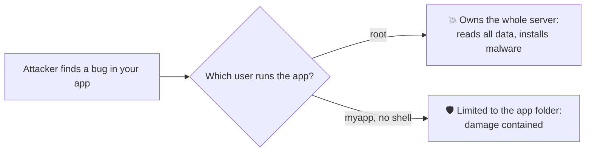

## The big idea

An office building has **keycards**. The cleaner can enter every floor but not the safe. An accountant can open the finance room. Only the manager has the master key.

Linux works the same way. Every file has an **owner**, a **group**, and a set of **permissions** that say who can **read**, **write** or **execute** it. The all-powerful user is **root**, the master key, and like a master key you should use it as rarely as possible.

## Reading permissions

```bash
$ ls -l /var/www/myapp
-rw-r--r-- 1 deploy www-data  1534 Nov 15 10:02 package.json
drwxr-x--- 5 deploy www-data  4096 Nov 15 10:02 .next
-rwx------ 1 deploy deploy     812 Nov 15 09:40 deploy.sh
-rw------- 1 deploy deploy     220 Nov 15 09:40 .env
```


| Letter | On a file | On a folder |
| --- | --- | --- |
| **r** (read) | View the contents | List the files inside |
| **w** (write) | Change the contents | Create, rename, delete files inside |
| **x** (execute) | Run it as a program | Enter it with `cd` |
| **-** | Permission not given | Permission not given |

So `-rw-r--r-- deploy www-data package.json` means:

- the **owner** `deploy` can read and write,
- the **group** `www-data` can only read,
- **everyone else** can only read.

## Numbers: the octal shortcut

Each permission has a value: **r = 4, w = 2, x = 1**. Add them for each of the three groups.

| Number | Letters | Meaning |
| --- | --- | --- |
| 7 | `rwx` | Read, write, execute |
| 6 | `rw-` | Read, write |
| 5 | `r-x` | Read, execute |
| 4 | `r--` | Read only |
| 0 | `---` | Nothing |

| Common value | Use it for |
| --- | --- |
| `644` (`rw-r--r--`) | Normal files: code, HTML, config without secrets |
| `755` (`rwxr-xr-x`) | Folders and scripts others may run |
| `600` (`rw-------`) | **Secrets**: `.env`, SSH private keys |
| `700` (`rwx------`) | Private folders like `~/.ssh` |
| `777` (`rwxrwxrwx`) | ❌ **Never.** Anyone on the server can change it |

## Changing permissions: `chmod`

```bash
chmod 600 .env                # only the owner can read/write the secrets
chmod 755 deploy.sh           # owner can edit, everyone can run
chmod +x deploy.sh            # just add "execute" for everyone
chmod u+x,g-w file            # u=user(owner), g=group, o=others, a=all
chmod -R 755 public/          # recursive (careful: also makes files executable)
```

A safer recursive fix for a website folder: folders `755`, files `644`.

```bash
find /var/www/myapp -type d -exec chmod 755 {} +
find /var/www/myapp -type f -exec chmod 644 {} +
```

## Changing the owner: `chown`

```bash
sudo chown deploy file.txt               # new owner
sudo chown deploy:www-data file.txt      # new owner and group
sudo chown -R deploy:deploy /var/www/myapp   # whole folder
```

## Users and groups

```bash
whoami                         # who am I?
id                             # my user ID and groups
sudo adduser deploy            # create a user (Ubuntu/Debian, interactive)
sudo usermod -aG sudo deploy   # add to the sudo group (-a = append, don't remove others!)
sudo usermod -aG docker deploy # allow running docker without sudo
groups deploy                  # list a user's groups
sudo deluser olduser
```

> ⚠️ `usermod -G` **without** `-a` *replaces* all of the user's groups. Always use `-aG`. Group changes apply at the next login.

**System users** have no password and no shell. They exist only to run one program, so a hacked app can't do much:

```bash
sudo useradd --system --no-create-home --shell /usr/sbin/nologin myapp
```

## root and sudo

**root** (user ID 0) can do anything: read every file, delete the whole system, change any password.

**`sudo`** lets a normal user run **one command** as root, and records it in the logs.

```bash
sudo systemctl restart nginx   # one privileged command
sudo -i                        # a root shell (use rarely, exit when done)
sudo visudo                    # safely edit who may use sudo
```

| ❌ Don't | ✅ Do |
| --- | --- |
| Log in over SSH as `root` | Log in as a normal user, use `sudo` when needed |
| Run your Node app as root | Run it as a dedicated `deploy` or `myapp` user |
| `chmod 777` to "fix" permission errors | Give the right **owner/group** the minimum permission |
| Share one login between people | One account per person, so logs show who did what |

### Allowing one exact command without a password

Your deploy script may need to restart the app. Instead of giving the deploy user full root, allow **only that command**:

```bash
# sudo visudo -f /etc/sudoers.d/deploy
deploy ALL=(root) NOPASSWD: /usr/bin/systemctl restart myapp.service, /usr/bin/systemctl status myapp.service
```

## Principle of least privilege

Give every user and every program **the minimum access it needs, nothing more**.



## Fixing "Permission denied"

1. **Who am I?** `whoami`
2. **Who owns it and what's allowed?** `ls -l file` (and `ls -ld folder` for the folder itself)
3. **Can I reach it?** Every parent folder needs `x` for you. Check with `namei -l /var/www/myapp/.env`
4. **Fix the owner or group first**, then the mode, with the smallest change that works.

```bash
$ cat /var/www/myapp/.env
cat: /var/www/myapp/.env: Permission denied
$ ls -l /var/www/myapp/.env
-rw------- 1 deploy deploy 220 Nov 15 .env    # only deploy can read it
$ whoami
ana                                           # ← that's why
```

## Key takeaways

- Every file has an **owner, group and rwx permissions** for owner / group / others.
- Octal: **r=4, w=2, x=1**. Remember `644` files, `755` folders/scripts, `600` secrets.
- `chmod` changes permissions, `chown` changes ownership, `usermod -aG` adds groups.
- Use `sudo` for single commands; **never** log in as root or run apps as root.
- `chmod 777` is never the right fix.

## Try it yourself

Create a user called `myapp`, a folder `/srv/myapp` owned by it, and a `.env` file inside that only `myapp` can read. Then confirm your own user gets `Permission denied` when trying to `cat` it.
