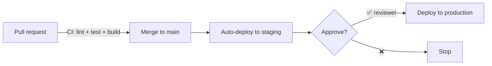

## The big idea

Today you SSH into the server and type the deploy commands yourself. That works until you're on holiday, or you forget `npm ci`, or two people deploy at once.

**CI/CD** hands those steps to a robot that does them **the same way every time**:

- **CI (continuous integration):** every push and pull request is automatically installed, linted, tested and built. Broken code is caught **before** it's merged.
- **CD (continuous delivery/deployment):** every merge to `main` is automatically released to the server.


## GitHub Actions vocabulary

| Term | Meaning |
| --- | --- |
| **Workflow** | A YAML file in `.github/workflows/` that describes an automation |
| **Trigger (`on:`)** | What starts it: `push`, `pull_request`, a schedule, a manual button |
| **Job** | A group of steps that runs on one fresh machine (a **runner**) |
| **Step** | One command (`run:`) or a reusable action (`uses:`) |
| **Runner** | The virtual machine: `ubuntu-latest`, or your own **self-hosted** runner |
| **Secret** | An encrypted value (SSH key, API token) available to workflows but never shown in logs |
| **Environment** | A deployment target (`staging`, `production`) with its own secrets and optional approval |

## Step 1: CI, test every push and pull request

`.github/workflows/ci.yml`:

```yaml
name: CI

on:
  pull_request:
  push:
    branches: [main]

jobs:
  test:
    runs-on: ubuntu-latest
    steps:
      - uses: actions/checkout@v4

      - uses: actions/setup-node@v4
        with:
          node-version: 22
          cache: npm                 # reuse downloaded packages between runs

      - run: npm ci
      - run: npm run lint
      - run: npm test
      - run: npm run build           # a build error fails the PR, not production
```

Then protect the branch: **Settings → Branches → Add rule for `main` → Require status checks to pass** (select `test`). Now nobody can merge a red pull request.

## Step 2: Store secrets

Go to **Settings → Secrets and variables → Actions** and add:

| Secret | Value |
| --- | --- |
| `SSH_HOST` | `203.0.113.10` |
| `SSH_USER` | `deploy` |
| `SSH_PRIVATE_KEY` | A **new** private key made just for CI (not your personal key) |
| `SSH_KNOWN_HOSTS` | Output of `ssh-keyscan 203.0.113.10` (protects against fake servers) |

```bash
# On your laptop: a dedicated key for GitHub Actions
ssh-keygen -t ed25519 -f gha_deploy -N "" -C "github-actions"
ssh-copy-id -i gha_deploy.pub deploy@203.0.113.10
cat gha_deploy          # paste into the SSH_PRIVATE_KEY secret, then delete the local file
```

> 🔒 Secrets are hidden in logs and are **not** given to workflows triggered by pull requests from forks. Still: give the CI user the **minimum** permissions (it only needs to deploy and restart one service).

## Step 3: CD, deploy over SSH after tests pass

Add a second job to the same workflow:

```yaml
  deploy:
    needs: test                                     # only if the test job passed
    if: github.ref == 'refs/heads/main' && github.event_name == 'push'
    runs-on: ubuntu-latest
    environment: production                         # shows up under "Deployments"
    concurrency:
      group: production
      cancel-in-progress: false                     # never run two deploys at once
    steps:
      - name: Set up SSH
        run: |
          mkdir -p ~/.ssh
          echo "${{ secrets.SSH_PRIVATE_KEY }}" > ~/.ssh/id_ed25519
          chmod 600 ~/.ssh/id_ed25519
          echo "${{ secrets.SSH_KNOWN_HOSTS }}" > ~/.ssh/known_hosts

      - name: Deploy
        run: |
          ssh ${{ secrets.SSH_USER }}@${{ secrets.SSH_HOST }} \
            "bash ~/bin/deploy.sh ${{ github.sha }}"
```

The server runs the same `deploy.sh` you'd run by hand (lessons 6 and 11), and the workflow fails (red ❌) if the script exits with a non-zero code, for example when the health check fails.

## Better: build in CI, copy the result

Building **on** the server has downsides: it uses the server's CPU and RAM (a big Next.js build can crash a 1 GB VPS), and the build happens while the site is serving users.

Building **in CI** and shipping the result is more robust:

```yaml
  deploy:
    needs: test
    if: github.ref == 'refs/heads/main'
    runs-on: ubuntu-latest
    environment: production
    concurrency: production
    steps:
      - uses: actions/checkout@v4
      - uses: actions/setup-node@v4
        with: { node-version: 22, cache: npm }
      - run: npm ci
      - run: npm run build

      - name: Package the release
        run: tar -czf release.tgz .next public package.json package-lock.json next.config.*

      - name: Set up SSH
        run: |
          mkdir -p ~/.ssh
          echo "${{ secrets.SSH_PRIVATE_KEY }}" > ~/.ssh/id_ed25519 && chmod 600 ~/.ssh/id_ed25519
          echo "${{ secrets.SSH_KNOWN_HOSTS }}" > ~/.ssh/known_hosts

      - name: Upload and activate
        env:
          TARGET: ${{ secrets.SSH_USER }}@${{ secrets.SSH_HOST }}
          RELEASE: ${{ github.sha }}
        run: |
          scp release.tgz "$TARGET:/tmp/release-$RELEASE.tgz"
          ssh "$TARGET" "bash ~/bin/activate-release.sh $RELEASE"
```

`activate-release.sh` unpacks into a new release folder, runs `npm ci --omit=dev`, switches a symlink and restarts the service. That pattern is lesson 11.

> 💡 Build once, deploy the **same artifact** everywhere. If staging and production each run their own build, you can't be sure production gets exactly what you tested.

## Environments and approvals

**Settings → Environments → New environment: `production`**:

- **Required reviewers:** a person must click "Approve" before the deploy job runs.
- **Deployment branches:** only `main` may deploy to production.
- **Environment secrets:** production SSH keys live only here, so a staging job can't read them.

A common flow:



## Rollbacks from CI

Make it possible to deploy **any** earlier commit with a manual button:

```yaml
on:
  workflow_dispatch:
    inputs:
      ref:
        description: "Commit SHA or tag to deploy"
        required: true
```

Or keep previous releases on the server and switch back in seconds (lesson 11). Rollback should be **faster** than a fix.

## Speed and reliability tips

| Tip | How |
| --- | --- |
| Cache dependencies | `actions/setup-node` with `cache: npm` |
| Run checks in parallel | Separate `lint`, `test` and `build` jobs |
| Fail fast | Lint (seconds) before end-to-end tests (minutes) |
| Avoid double deploys | `concurrency: production` |
| Pin action versions | `actions/checkout@v4` (or a full commit SHA for strict security) |
| Notify | A Slack/Discord step with `if: failure()` |
| Keep secrets out of logs | Never `echo` a secret; use `env:` instead of inline interpolation in long scripts |

## Other CI/CD tools

| Tool | Notes |
| --- | --- |
| **GitHub Actions** | Built into GitHub, huge marketplace of actions |
| **GitLab CI** | `.gitlab-ci.yml`, built into GitLab, strong self-hosting |
| **Jenkins** | Self-hosted, very flexible, more maintenance |
| **CircleCI, Buildkite** | Hosted CI services |
| **Argo CD, Flux** | GitOps for Kubernetes: the cluster pulls changes from Git |

The ideas are the same everywhere: trigger → jobs → steps → secrets → deploy only after checks pass.

## Key takeaways

- **CI** tests every push and PR; protect `main` so red builds can't merge.
- **CD** deploys automatically after tests pass, using `needs:`, `if:` and `environment:`.
- Store SSH keys and tokens as **secrets**, with a dedicated, low-privilege CI key.
- Prefer **building in CI** and shipping the artifact; deploy the same build everywhere.
- Use `concurrency` to prevent overlapping deploys, and keep rollback one click away.

## Try it yourself

Add the CI workflow above to one of your repositories, open a pull request that breaks a test, and confirm GitHub blocks the merge. Then fix it and watch the checks turn green.
