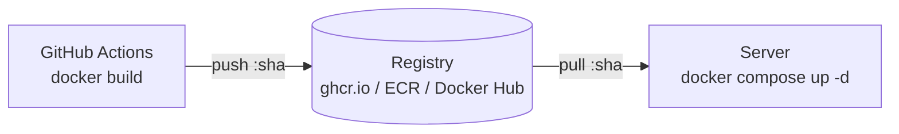

## The big idea

Shipping goods used to mean loading loose boxes, barrels and sacks by hand, differently for every ship. The **shipping container** changed that: pack once, and every ship, train and truck can move it the same way.

A **Docker image** is a shipping container for your app: the code, the exact Node version and every dependency, packed once. It runs the same on your laptop, in CI and on the server. "It works on my machine" stops being a problem.

> 📘 New to containers? The Backend section's [Docker & Containers](/learn/backend/docker-and-containers) lesson covers images, containers, layers and basic commands. This lesson is about running them **in production**.


## A production Dockerfile (multi-stage)

A good production image is **small** (fast to pull), contains **no build tools or source secrets**, and runs as a **non-root** user.

```dockerfile
# ---- 1. Install dependencies ----
FROM node:22-alpine AS deps
WORKDIR /app
COPY package.json package-lock.json ./
RUN npm ci

# ---- 2. Build ----
FROM node:22-alpine AS build
WORKDIR /app
COPY --from=deps /app/node_modules ./node_modules
COPY . .
RUN npm run build

# ---- 3. Run (only what production needs) ----
FROM node:22-alpine AS runtime
WORKDIR /app
ENV NODE_ENV=production
ENV HOSTNAME=0.0.0.0
# Next.js "standalone" output: set output: "standalone" in next.config
COPY --from=build --chown=node:node /app/.next/standalone ./
COPY --from=build --chown=node:node /app/.next/static ./.next/static
COPY --from=build --chown=node:node /app/public ./public
USER node
EXPOSE 3000
HEALTHCHECK --interval=30s --timeout=3s --retries=3 \
  CMD wget -qO- http://127.0.0.1:3000/ > /dev/null || exit 1
CMD ["node", "server.js"]
```

And a `.dockerignore`, so secrets and junk never enter the image:

```text
node_modules
.next
.git
.env*
*.log
Dockerfile
```

| Practice | Why |
| --- | --- |
| Multi-stage build | The final image has no compilers or dev dependencies: often 150 MB instead of 1 GB |
| Copy `package*.json` first, then `npm ci` | Docker caches that layer; code changes don't reinstall everything |
| `USER node` | A hacked app isn't root inside the container |
| `.dockerignore` with `.env*` | Secrets never end up in an image layer |
| Pin the base version (`node:22-alpine`) | Builds don't change under you |
| `HEALTHCHECK` | Docker knows when the app is actually ready, not just started |

## Docker Compose: the whole stack in one file

`compose.yaml` on the server:

```yaml
services:
  app:
    image: ghcr.io/your-org/myapp:${APP_TAG:-latest}
    restart: unless-stopped
    env_file: .env
    environment:
      DATABASE_URL: postgres://myapp:${DB_PASSWORD}@db:5432/myapp
    depends_on:
      db:
        condition: service_healthy
    expose:
      - "3000"                 # reachable by other containers only

  db:
    image: postgres:16-alpine
    restart: unless-stopped
    environment:
      POSTGRES_USER: myapp
      POSTGRES_PASSWORD: ${DB_PASSWORD}
      POSTGRES_DB: myapp
    volumes:
      - pgdata:/var/lib/postgresql/data      # data survives container restarts
    healthcheck:
      test: ["CMD-SHELL", "pg_isready -U myapp"]
      interval: 5s
      retries: 10

  nginx:
    image: nginx:1.27-alpine
    restart: unless-stopped
    ports:
      - "80:80"
      - "443:443"             # the ONLY ports open to the internet
    volumes:
      - ./nginx.conf:/etc/nginx/conf.d/default.conf:ro
      - /etc/letsencrypt:/etc/letsencrypt:ro
    depends_on: [app]

volumes:
  pgdata:
```

Inside Compose, containers find each other **by service name**: the app connects to `db:5432`, and Nginx proxies to `http://app:3000`.

```bash
docker compose up -d              # start everything in the background
docker compose ps                 # status and health
docker compose logs -f app        # follow one service's logs
docker compose exec db psql -U myapp   # open a shell in a container
docker compose down               # stop (volumes are kept)
```

> ⚠️ `docker compose down -v` **deletes volumes**, including your database. Never run it in production unless that's exactly what you want.

## Restart policies

| Policy | Behavior |
| --- | --- |
| `no` (default) | Never restart |
| `on-failure` | Restart only after a crash (non-zero exit) |
| `unless-stopped` ⭐ | Always restart, including after a reboot, unless you stopped it yourself |
| `always` | Always restart, even if you stopped it, after the Docker daemon restarts |

Make sure Docker itself starts on boot: `sudo systemctl enable docker`.

## The image-based deploy flow

Build the image **in CI**, push it to a **registry**, and have the server **pull** it:



**In CI:**

```yaml
      - uses: docker/login-action@v3
        with:
          registry: ghcr.io
          username: ${{ github.actor }}
          password: ${{ secrets.GITHUB_TOKEN }}
      - uses: docker/build-push-action@v6
        with:
          push: true
          tags: ghcr.io/your-org/myapp:${{ github.sha }}
```

**On the server (`deploy.sh`):**

```bash
#!/usr/bin/env bash
set -euo pipefail
cd /srv/myapp
export APP_TAG="$1"                           # the commit SHA from CI

docker compose pull app                       # download the new image
docker compose up -d --no-deps app            # replace only the app container
sleep 5
docker compose ps app | grep -q "healthy" || { echo "❌ unhealthy"; exit 1; }
echo "$APP_TAG" > .deployed-tag               # remember what's running
docker image prune -f                         # clean up old images
```

**Rollback** is the same command with the previous tag: `./deploy.sh <previous-sha>`.

> 💡 **Tag images with the commit SHA**, not only `latest`. `latest` changes every build, so you can never tell what's actually running or roll back to it.

## Database migrations

Run migrations as a **separate one-off step** before switching the app, not automatically every time a container starts (several containers starting at once would all try to migrate):

```bash
docker compose run --rm app npx prisma migrate deploy
docker compose up -d --no-deps app
```

## Secrets

| ✅ Do | ❌ Don't |
| --- | --- |
| `.env` file on the server (`chmod 600`), referenced with `env_file:` | `ENV DB_PASSWORD=…` in the Dockerfile (it stays in the image forever) |
| Compose/Swarm secrets, or a secrets manager | Commit `.env` to Git |
| Pass build-time tokens with `--secret` | `COPY .env .` into the image |

## Housekeeping

```bash
docker system df                  # how much disk Docker uses
docker image prune -a -f          # remove unused images (careful: forces re-pulls)
docker builder prune -f           # remove build cache
```

Container logs grow forever by default. Limit them globally in `/etc/docker/daemon.json`:

```json
{
  "log-driver": "json-file",
  "log-opts": { "max-size": "10m", "max-file": "3" }
}
```

Then run `sudo systemctl restart docker`.

## Docker or plain systemd?

| | systemd + Node on the host | Docker Compose |
| --- | --- | --- |
| Setup | Simplest for one Node app | A bit more to learn |
| Same environment everywhere | ❌ Server's Node version | ✅ Image is identical everywhere |
| Several apps with different Node versions | Awkward | ✅ Easy |
| Database, Redis, proxy alongside | Installed on the host | One file, one command |
| Rollback | Keep old release folders | Run the previous image tag |
| Moving to Kubernetes/ECS later | Rewrite | Images carry over |

Both are valid. Many teams start with systemd and move to Docker when they add services or servers.

## Key takeaways

- Use **multi-stage** Dockerfiles, a **non-root** user, `.dockerignore` and a `HEALTHCHECK`.
- **Compose** runs app, database and proxy together; only the proxy publishes ports.
- Keep database data in a **named volume**; never `down -v` in production.
- Build in CI, push to a registry tagged with the **commit SHA**, and pull + `up -d` on the server.
- Run migrations as a separate step, cap log sizes, and prune old images.

## Try it yourself

Containerize a small Express + PostgreSQL app with the Dockerfile and `compose.yaml` above. Then stop the database container, start it again, and confirm your data is still there thanks to the volume.
