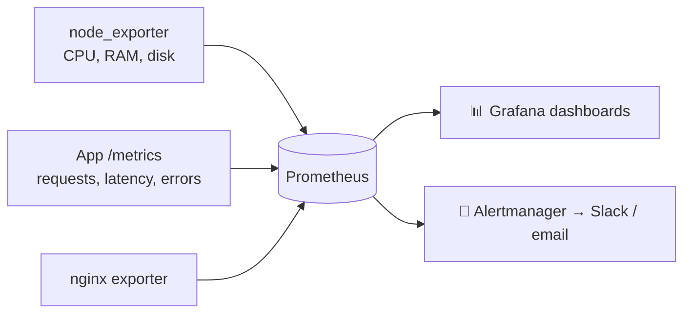

## The big idea

A car dashboard shows **speed, fuel and engine temperature**, and a warning light comes on **before** the engine fails. Without it, the first sign of trouble is smoke on the motorway.

A production server needs the same three things:

1. **Monitoring:** numbers that show health (CPU, memory, disk, response time, errors).
2. **Alerts:** a warning light that wakes someone up when a number crosses a line.
3. **Logs:** the detailed story you read when you're working out *why*.

And one more thing a car doesn't need: **backups**, because one day a disk, a bad deploy or a mistyped command **will** destroy data.


## What to watch on a server

| Resource | Check by hand | Warning sign | What happens if ignored |
| --- | --- | --- | --- |
| **Disk** ⭐ | `df -h` | Above 80% | At 100%: database crashes, logs stop, deploys fail |
| **Memory** | `free -h` | Swap growing, available < 10% | The kernel's **OOM killer** kills your app |
| **CPU / load** | `uptime`, `htop` | Load above the number of cores for a long time | Everything slows down |
| **Inodes** | `df -i` | Above 80% | "No space left" even though `df -h` shows free space (millions of tiny files) |
| **App health** | `curl -I https://example.com` | Non-200, slow | Users see errors |
| **Certificates** | `sudo certbot certificates` | < 14 days left | Browser security warnings |
| **Failed services** | `systemctl --failed` | Any | A background job silently stopped |

> 💡 **Watch the disk first.** Full disks are one of the most common causes of "everything suddenly broke", usually from unrotated logs, old Docker images or old release folders.

## Level 1: Uptime checks (start here, free)

An **external** service requests your site every minute and alerts you if it fails. It sees what users see, including DNS, TLS and firewall problems.

- **Tools:** UptimeRobot, Better Stack, Uptime Kuma (self-hosted), Pingdom, Healthchecks.io.
- **Check:** `https://example.com/health` returns 200 within 2 seconds.
- **Alert to:** email, Slack, Telegram or SMS.

Add a cheap **health endpoint** that checks the important dependencies:

```js
app.get("/health", async (_req, res) => {
  try {
    await db.query("SELECT 1");
    res.json({ status: "ok", version: process.env.GIT_SHA });
  } catch {
    res.status(503).json({ status: "db_unreachable" });
  }
});
```

For **scheduled jobs** (backups, cron), use a "dead man's switch": the job pings a URL when it **succeeds**, and you get alerted when the ping **doesn't** arrive.

```bash
/home/deploy/bin/backup-db.sh && curl -fsS https://hc-ping.com/your-uuid > /dev/null
```

## Level 2: Logs

### Application logs with journald

systemd stores your app's stdout/stderr in the journal (lesson 4):

```bash
journalctl -u myapp -f                        # live
journalctl -u myapp --since "10 min ago" -p err
sudo journalctl --vacuum-size=500M            # cap the journal's total size
```

Make the cap permanent in `/etc/systemd/journald.conf`: `SystemMaxUse=500M`.

### Write useful logs

Log in **JSON**, one event per line, with context:

```json
{"time":"2026-11-15T10:04:12Z","level":"error","msg":"payment failed","orderId":"o_123","requestId":"req_9f2","durationMs":2140}
```

Use a structured logger (`pino` for Node). Never log passwords, tokens or full card numbers.

### Rotating log files with logrotate

Apps that write their own files (and Nginx) need **rotation**, or the disk fills up. `/etc/logrotate.d/myapp`:

```text
/var/log/myapp/*.log {
    daily
    rotate 14          # keep 14 days
    compress
    delaycompress
    missingok
    notifempty
    copytruncate       # safe for apps that keep the file open
}
```

Test it: `sudo logrotate -d /etc/logrotate.d/myapp` (dry run).

### Centralized logs (when you have several servers)

Ship logs to one searchable place: **Grafana Loki**, **Elasticsearch/OpenSearch**, **Better Stack**, **Datadog**, or **CloudWatch Logs**. Then you can search *"all errors for requestId req_9f2"* across every server at once.

## Level 3: Metrics and dashboards

**Prometheus** collects numbers every few seconds; **Grafana** draws them and sends alerts.



```bash
# The standard host metrics exporter (port 9100: firewall it, or bind to localhost)
sudo apt install -y prometheus-node-exporter
curl -s http://127.0.0.1:9100/metrics | grep node_filesystem_avail_bytes
```

**Alerts worth having** (and no more, at first):

| Alert | Condition |
| --- | --- |
| Site down | Uptime check fails for 2 minutes |
| Disk filling | Root disk > 85% |
| Memory pressure | Available memory < 10% for 10 minutes |
| Error rate | 5xx responses > 2% for 5 minutes |
| Slow responses | p95 latency > 1 s for 10 minutes |
| Certificate expiry | < 14 days |
| Backup missing | No successful backup ping in 26 hours |

> ⚠️ **Alert fatigue is real.** Every alert should be *actionable*. If an alert fires and nobody needs to do anything, delete it or turn it into a dashboard panel.

Hosted all-in-one options: **Grafana Cloud** (free tier), **Netdata**, **Datadog**, **New Relic**. For the full theory of metrics, logs and traces, see the Backend section's [Observability](/learn/backend/observability) lesson.

## Backups: the 3-2-1 rule

Keep **3** copies of your data, on **2** different kinds of storage, with **1** copy **off-site** (not on the same server or provider account).

| What to back up | How |
| --- | --- |
| **Database** | `pg_dump` / `mysqldump` nightly, plus point-in-time recovery for important data |
| **Uploaded files** | `rsync` or `restic` to object storage (S3, Backblaze B2) |
| **Config** | `.env` (encrypted!), Nginx and systemd files, ideally in a private repo or secrets manager |
| **Code** | Already in Git, so no server backup needed |
| **Whole server** | Provider snapshots: convenient, but on the same provider, so not your only backup |

### A nightly PostgreSQL backup

```bash
#!/usr/bin/env bash
# /home/deploy/bin/backup-db.sh
set -euo pipefail

STAMP=$(date +%F-%H%M)
DIR=/home/deploy/backups
mkdir -p "$DIR"

pg_dump --format=custom --no-owner "$DATABASE_URL" > "$DIR/myapp-$STAMP.dump"

# Copy off-site (rclone works with S3, B2, Google Drive…)
rclone copy "$DIR/myapp-$STAMP.dump" remote:myapp-backups/

# Keep 7 days locally
find "$DIR" -name "*.dump" -mtime +7 -delete

# Tell the monitoring service it worked
curl -fsS https://hc-ping.com/your-uuid > /dev/null
```

Schedule it with a systemd timer or cron at 03:00, and make sure the off-site bucket has **versioning or object lock** so a hacked server can't delete the backups too.

### Test your restores ⭐

> 💬 *"Nobody wants backups. Everybody wants restores."*

A backup you've never restored is a **hope**, not a backup. Once a month (put it in the calendar):

```bash
createdb myapp_restore_test
pg_restore --no-owner -d myapp_restore_test /home/deploy/backups/myapp-2026-11-15-0300.dump
psql myapp_restore_test -c "SELECT count(*) FROM orders;"    # does the data look right?
dropdb myapp_restore_test
```

Write down how long it took. That's your real **recovery time**.

| Term | Question it answers | Example target |
| --- | --- | --- |
| **RPO** (recovery point objective) | How much data can we afford to lose? | 24 h with nightly dumps, minutes with WAL archiving |
| **RTO** (recovery time objective) | How long can we be down? | 1 hour to restore and switch |

## Monitoring checklist

- [ ] External uptime check on `/health`, alerting to your phone
- [ ] Disk, memory and CPU alerts
- [ ] journald size capped; logrotate for file logs; Docker log limits
- [ ] Structured JSON logs with a request ID, and no secrets
- [ ] Nightly database backup, copied **off-site**, with a success ping
- [ ] Restore tested within the last month
- [ ] Certificate expiry alert

## Key takeaways

- Watch **disk, memory, CPU, app health and certificates**; disk is the most common silent killer.
- Start with an **external uptime check** and a `/health` endpoint, then add metrics.
- Cap and rotate logs; log structured JSON with request IDs.
- Alerts must be actionable, or people learn to ignore them.
- Follow **3-2-1** for backups, and **test restores** regularly.

## Try it yourself

Set up a free uptime monitor for one of your sites, write the backup script above for a test database, schedule it, and do a full restore into a new database. Time how long it takes.
