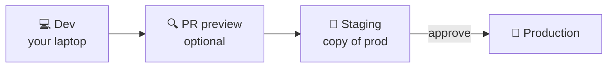

## The big idea

Lesson 9 showed CI/CD with one tool (GitHub Actions). This lesson steps back and explains the **ideas** that every CI/CD tool shares. Once you understand them, Jenkins, GitLab CI, GitHub Actions and Azure Pipelines are just different syntax for the same thing.

Think of a pipeline as a **factory assembly line** for code. A change goes in at one end. At each station a machine checks or builds something. If any station finds a defect, the line stops. What comes out at the end is a tested, packaged product that is safe to ship.

## CI, continuous delivery, continuous deployment

These three terms are often mixed up:

| Term | What is automated | Who presses "release"? |
| --- | --- | --- |
| **Continuous Integration (CI)** | Every push is built and tested; everyone merges to `main` often (at least daily) | Nobody: nothing is released yet |
| **Continuous Delivery** | Every passing change is packaged and deployed to staging, ready for production | A **person** approves the production deploy |
| **Continuous Deployment** | Every passing change goes all the way to production | **Nobody**: the pipeline does it |

> 💡 Most teams start with CI, add continuous delivery, and only move to continuous deployment once they have good tests, monitoring and fast rollbacks.

## The stages of a good pipeline

| Stage | Typical commands | Goal | Usual time |
| --- | --- | --- | --- |
| **1. Checkout** | `git clone` | Get the exact commit | Seconds |
| **2. Install** | `npm ci`, `pip install -r`, `mvn dependency:go-offline` | Reproducible dependencies from a lock file | Under 1 min with cache |
| **3. Static checks** | Lint, format check, type check | Catch cheap mistakes first | Seconds |
| **4. Unit tests** | `npm test`, `pytest`, `go test ./...` | Logic is correct | 1 to 3 min |
| **5. Build / package** | `npm run build`, `docker build`, `mvn package` | Produce **one** artifact | 1 to 5 min |
| **6. Security scans** | `npm audit`, Trivy, Semgrep, secret scanning | No known vulnerable deps or leaked keys | 1 to 2 min |
| **7. Integration / E2E tests** | Playwright, Testcontainers | Pieces work together | 3 to 15 min |
| **8. Publish artifact** | Push image to a registry, upload a `.tgz` | Store the tested build | Seconds |
| **9. Deploy to staging** | Helm, SSH + script, `kubectl apply` | Real environment check | 1 to 3 min |
| **10. Approval / smoke test** | Manual approve, health check | Last safety gate | Varies |
| **11. Deploy to production** | Same script, different target | Release | 1 to 3 min |
| **12. Verify** | Health checks, error rate, metrics | Roll back automatically if bad | Minutes |

**Order matters:** run the **fastest, cheapest checks first**. A lint error should fail the build in 20 seconds, not after a 10-minute E2E run.

### Keep the pipeline fast

A pipeline that takes 45 minutes gets skipped, batched, or ignored. Aim for **under 10 minutes** to a green CI result.

- **Cache** dependencies (`~/.npm`, `~/.m2`, Docker layers).
- Run independent jobs **in parallel** (lint, unit tests and build at the same time).
- **Split** slow test suites across several machines.
- Only run expensive jobs when needed (for example, E2E only on `main` or on PRs that touch the frontend).

## Build once, promote the same artifact

The most important rule in CD:

> **Build the artifact once. Deploy that exact artifact to every environment.**

| ❌ Rebuild per environment | ✅ Build once, promote |
| --- | --- |
| Staging and production each run `npm run build` | CI builds `myapp:3f9c2a1` once |
| Different dependency versions can sneak in | Staging gets `myapp:3f9c2a1` |
| "It worked in staging" means little | Production gets the **same** `myapp:3f9c2a1` |

Tag artifacts with the **commit SHA** (and optionally a semantic version like `v1.4.2`). Never deploy `latest` to production: you can't tell what's running or roll back to it.

Configuration that differs per environment (database URL, API keys) comes from **environment variables or secrets at deploy time**, not from the build.

## Branching strategies

| Strategy | How it works | Good for |
| --- | --- | --- |
| **Trunk-based** | Short-lived branches (hours to a day or two), merge to `main` often, hide unfinished work behind **feature flags** | Most teams doing CI/CD; fastest feedback |
| **GitHub Flow** | Branch → PR → review + CI → merge to `main` → deploy | Web apps and SaaS |
| **GitFlow** | `develop`, `release/*`, `hotfix/*`, `main` branches | Versioned products with planned releases (mobile apps, desktop software) |

Long-lived branches are the enemy of CI: the longer a branch lives, the bigger and riskier the merge. If your team does "merge week", you are not doing continuous integration.

## Deployment strategies

| Strategy | How | Rollback | Cost |
| --- | --- | --- | --- |
| **Recreate** | Stop old, start new | Redeploy old version | Downtime |
| **Rolling** | Replace servers or pods a few at a time | Roll forward or back gradually | Low |
| **Blue/green** | Run new version beside old, switch traffic at once | Switch back instantly | Double capacity briefly |
| **Canary** | Send 1% → 10% → 50% → 100% of traffic to new version while watching metrics | Stop and send traffic back | Needs good metrics |
| **Feature flags** | Code is deployed but switched off; turn it on per user or percentage | Flip the flag off | Flag management |

Lesson 11 shows blue/green and symlink releases on a single server in detail.

## Environments

- **Staging** should look like production: same OS, same versions, same deploy script, smaller size.
- Each environment has **its own secrets**. A staging job must never be able to read production credentials.
- Use **infrastructure as code** (the Terraform section) so environments don't drift apart.

## Pipeline security

A CI server can deploy to production, so it is a juicy target. Treat it like production.

| Risk | Defense |
| --- | --- |
| Secrets leaked in logs | Use the tool's secret store; never `echo` a secret; mask output |
| A malicious PR runs code on your CI | Don't give secrets to PRs from forks; require approval for first-time contributors |
| Compromised third-party plugin or action | Pin versions (or commit SHAs); install only what you need; update regularly |
| CI has admin access everywhere | Least privilege: a deploy key that can only deploy one app |
| Long-lived cloud keys | Use short-lived credentials (OIDC federation to AWS/GCP/Azure) |
| Vulnerable dependencies shipped | Dependency and image scanning as a pipeline stage |
| Tampered artifacts | Sign images (cosign) and verify before deploy |

## Measure it: the DORA metrics

The DORA research program found four numbers that separate high-performing teams from the rest:

| Metric | Question | Elite teams |
| --- | --- | --- |
| **Deployment frequency** | How often do we deploy to production? | On demand, many times a day |
| **Lead time for changes** | Commit → running in production | Less than a day |
| **Change failure rate** | What share of deploys cause an incident? | Low (around 5% or less) |
| **Time to restore service** | How fast do we recover from a failure? | Less than an hour |

Speed and stability are **not** a trade-off: small, frequent, automated deploys are both faster **and** safer.

## Choosing a CI/CD tool

| Tool | Hosting | Pipeline file | Strengths | Watch out for |
| --- | --- | --- | --- | --- |
| **Jenkins** | Self-hosted | `Jenkinsfile` (Groovy) | Free, runs anywhere (including air-gapped networks), 1,800+ plugins, very flexible | You maintain the server, upgrades, plugins and security |
| **GitHub Actions** | Hosted or self-hosted runners | `.github/workflows/*.yml` | Built into GitHub, huge marketplace, zero setup | Tied to GitHub; minutes cost money on private repos |
| **GitLab CI** | Hosted or self-hosted | `.gitlab-ci.yml` | All-in-one with GitLab (registry, environments, security) | Best when your code is on GitLab |
| **Azure Pipelines** | Hosted | `azure-pipelines.yml` | Good for Microsoft/.NET shops | Azure DevOps ecosystem |
| **CircleCI, Buildkite** | Hosted (Buildkite: your own agents) | YAML | Fast, good parallelism | Paid at scale |
| **Argo CD, Flux** | In your Kubernetes cluster | Git repo of manifests | GitOps: the cluster pulls desired state from Git | CD only; pair with a CI tool |

**Rule of thumb:**

- Code on GitHub, cloud servers, small team → **GitHub Actions**.
- Code on GitLab → **GitLab CI**.
- Many repos, on-premises servers, strict network rules, or a company that already runs it → **Jenkins** (lessons 15 and 16).
- Kubernetes deployments → CI tool builds the image, **Argo CD** deploys it.

## Key takeaways

- **CI** = build and test every change; **continuous delivery** = always ready to release with an approval; **continuous deployment** = release automatically.
- Order stages from fast and cheap to slow and expensive; keep CI under about 10 minutes.
- **Build once, promote the same artifact**, tagged with the commit SHA.
- Short-lived branches and feature flags make CI work.
- Secure the pipeline like production and track the four **DORA metrics**.

## Try it yourself

Draw your current release process as boxes on paper, from `git push` to "users see it". Mark every **manual** step with a ✋. Pick the one that breaks most often and automate it first.
