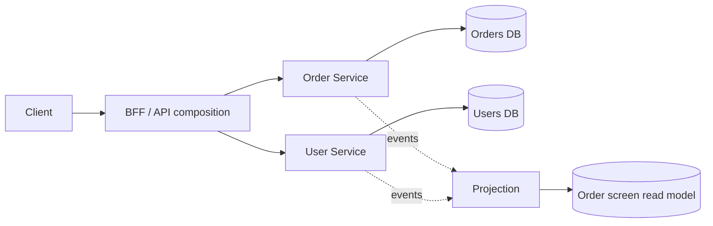
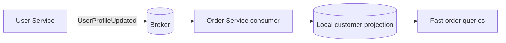

## The problem

In a monolith, an order screen might use one SQL query:

```sql
SELECT orders.id, orders.total, users.name
FROM orders
JOIN users ON users.id = orders.user_id
WHERE orders.id = 42;
```

In microservices, the **Order Service** owns `orders` and the **User Service** owns `users`. Their databases are private implementation details, so Order Service cannot safely run a normal SQL `JOIN` against User Service's tables.

That restriction is intentional. It protects independent deployment, schema ownership and service autonomy. The answer is not to create a shared database link; it is to choose where the cross-service view should be assembled.



## Option 1: API composition

The caller, API gateway or backend-for-frontend calls both services and joins the responses in memory.

```js
const [order, user] = await Promise.all([
  orders.get(`/orders/${orderId}`),
  users.get(`/users/${userId}`),
]);

return {
  id: order.id,
  total: order.total,
  customerName: user.displayName,
};
```

### Use it when

- the result contains one or a few records;
- the data must be close to current;
- the read is not on a very hot, large list;
- the services already expose stable APIs.

### Trade-offs

API composition is simple, but the response now depends on multiple network calls. Latency is roughly the slowest dependency plus network overhead, and partial failure must be handled. Use parallel calls, strict timeouts, tracing and a clear fallback when the user service is unavailable.

For a list of 100 orders, avoid making 100 user requests. Use a batch endpoint such as `GET /users?ids=...`, a GraphQL data loader, or a local projection. Otherwise the composition layer creates a cross-service N+1 query problem.

## Option 2: Replicate the small piece of data you need

The Order Service can keep a local copy of selected user fields, such as `display_name` and `avatar_url`. User Service publishes `UserProfileUpdated`; Order Service consumes it and updates its local `order_customers` table.



### Use it when

- the same data is read frequently;
- the data changes less often than it is read;
- a little staleness is acceptable;
- the consuming service needs fast filtering or sorting.

Do not copy the entire User aggregate. Replicate only the fields needed for the local use case, give them clear ownership semantics, and record the source version or update timestamp. If the projection is behind, the application should tolerate it or fall back to the source service for a critical view.

This is **eventual consistency**: a profile update commits in User Service first, and the Order Service projection catches up shortly afterward.

## Option 3: Build a dedicated read model

For dashboards, search and complex screens, create a read model designed specifically for the query. Events from Order Service and User Service feed a projector that writes a denormalised `order_overview` table.

```sql
CREATE TABLE order_overview (
  order_id       UUID PRIMARY KEY,
  user_id        UUID NOT NULL,
  customer_name  TEXT NOT NULL,
  order_total    NUMERIC NOT NULL,
  order_status   TEXT NOT NULL,
  updated_at     TIMESTAMP NOT NULL
);
```

The read model can be queried with one fast local query:

```sql
SELECT order_id, customer_name, order_total, order_status
FROM order_overview
WHERE user_id = $1
ORDER BY updated_at DESC
LIMIT 20;
```

This is the most scalable option for high-read or high-cardinality views, but it adds a projector, replay/rebuild logic, monitoring and eventual consistency. Use an outbox in each source service so important events are not lost between the database commit and broker publish.

## Option 4: A reporting or analytics store

If the requirement is reporting rather than a transactional user request, copy events or change data into a warehouse/search store. Join there, not inside the operational services.

This is a good fit for:

- revenue reports joining users, orders and payments;
- historical analytics;
- full-text search across several service-owned entities;
- data science and business intelligence.

It is not a good fit for deciding whether a live order can be cancelled. Operational decisions should call the owning service or use a purpose-built projection with a known freshness guarantee.

## What not to do

### Do not share the tables

If User Service changes a column and Order Service depends on it, the services are coupled even if their code lives in separate repositories. A shared schema becomes a distributed monolith.

### Do not let every service query every database

Database credentials, migrations, indexes and availability now belong to everyone. Ownership becomes unclear, and a harmless query in one service can overload another service's database.

### Do not use distributed JOINs for large lists

A gateway that fetches 10,000 orders and then calls User Service for each user has multiplied latency and load. Batch, cache, replicate or project the data instead.

### Do not pretend the data is strongly consistent

If a screen uses events or replicas, document its freshness. Show `pending`, `syncing` or a last-updated time when the business needs that clarity. For a user's own write, use read-your-own-write routing or return the updated object from the command response.

## Choosing the right approach

| Need | Best starting point | Main risk |
| --- | --- | --- |
| One order detail page | API composition | Dependency latency and partial failure |
| Many orders with a user name | Local replicated fields | Stale profile data |
| Fast dashboard or feed | Dedicated read model / CQRS | Projection lag and rebuild complexity |
| Historical reporting | Warehouse or analytics store | Data freshness and pipeline delay |
| Live business rule | Call the owning service | Runtime dependency and latency |

## A practical design: order history page

Suppose the page needs order ID, total, status and customer display name:

1. Order Service remains the source of truth for order status and totals.
2. User Service remains the source of truth for identity and profile changes.
3. User Service publishes signed, versioned profile events through its outbox.
4. Order Service maintains only `customer_name` in a local projection.
5. The page reads orders and local customer fields in one query.
6. If the projection is missing, show a safe fallback such as `Customer` or fetch the User Service in a bounded repair path.
7. A replay job rebuilds the projection from retained events or a snapshot.

This gives fast reads without a cross-database JOIN while preserving ownership.

## Final rule

When services own separate databases, combine data at the **API**, **event**, **projection** or **analytics** layer—not by reaching across database boundaries. Start with API composition for simple reads; move to replicated data or a dedicated read model when latency, traffic or query complexity demands it.
