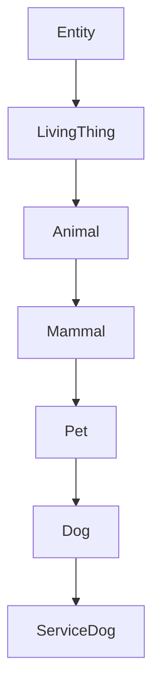

## The big idea

Children **inherit** traits from their parents, like eye color or height, and then add their own personality.

In code, a **child class** (subclass) inherits the properties and methods of a **parent class** (superclass or base class). It can then:

- **add** new properties and methods,
- **override** (replace) methods that should work differently.


## `extends` and `super`

```ts
class Animal {
  constructor(public name: string) {}

  eat() {
    return `${this.name} is eating.`;
  }

  speak() {
    return `${this.name} makes a sound.`;
  }
}

class Dog extends Animal {          // Dog inherits from Animal
  constructor(name: string, public breed: string) {
    super(name);                    // call the parent constructor FIRST
  }

  speak() {                         // override
    return `${this.name} barks.`;
  }

  fetch() {                         // new method only dogs have
    return `${this.name} fetches the ball!`;
  }
}

const rex = new Dog("Rex", "Labrador");
rex.eat();    // "Rex is eating."   ← inherited from Animal
rex.speak();  // "Rex barks."       ← overridden in Dog
rex.fetch();  // "Rex fetches the ball!" ← only in Dog
rex instanceof Animal; // true
```

| Keyword | What it does |
| --- | --- |
| `extends` | Makes one class inherit from another |
| `super(...)` | Calls the parent's constructor (required before using `this`) |
| `super.method()` | Calls the parent's version of a method |
| `override` (TS) | Marks a method as replacing a parent method, so typos are caught |

## Extending a parent method with `super`

You don't have to replace a method completely. You can run the parent's version and add to it.

```ts
class Employee {
  constructor(public name: string, protected salary: number) {}

  describe() {
    return `${this.name} earns $${this.salary}`;
  }
}

class Manager extends Employee {
  constructor(name: string, salary: number, private reports: string[]) {
    super(name, salary);
  }

  override describe() {
    return `${super.describe()} and manages ${this.reports.length} people`;
  }
}

new Manager("Sara", 120_000, ["Ali", "Bo"]).describe();
// "Sara earns $120000 and manages 2 people"
```

> 💡 Add `"noImplicitOverride": true` to `tsconfig.json`. TypeScript will then require the `override` keyword, and catch you if the parent method was renamed.

## The "is-a" test

Use inheritance only when the sentence **"Child *is a* Parent"** is true in every situation.

| Relationship | "is-a"? | Inheritance? |
| --- | --- | --- |
| `Dog` → `Animal` | A dog **is an** animal ✅ | Yes |
| `SavingsAccount` → `BankAccount` | A savings account **is a** bank account ✅ | Yes |
| `Car` → `Engine` | A car **is an** engine ❌ (a car **has an** engine) | No: use composition |
| `Stack` → `Array` | A stack is **not** an array (you shouldn't insert in the middle) ❌ | No |

## Real-world example: notifications

```ts
abstract class Notification {
  constructor(protected recipient: string, protected message: string) {}

  send() {
    if (!this.message.trim()) throw new Error("Empty message");
    this.deliver();
    console.log(`Sent to ${this.recipient}`);
  }

  protected abstract deliver(): void; // each channel fills this in
}

class EmailNotification extends Notification {
  protected deliver() { /* SMTP / email API */ }
}

class SmsNotification extends Notification {
  protected deliver() {
    if (this.message.length > 160) throw new Error("SMS too long");
    /* SMS API */
  }
}

new SmsNotification("+15550100", "Your code is 4821").send();
```

The validation and logging live once in `Notification`; each child only writes what's different.

## When inheritance hurts ⚠️

Inheritance is the **tightest coupling** in OOP. A child depends on every detail of its parent.

**1. Deep hierarchies are hard to follow.**



To understand `ServiceDog` you now have to read **six** parent classes.

**2. The fragile base class problem.** Changing the parent can silently break children you've never seen.

**3. Forced inheritance of things you don't want.**

```ts
class Bird {
  fly() { return "Flying!"; }
}

class Penguin extends Bird {
  override fly(): string {
    throw new Error("Penguins can't fly"); // ❌ breaks code expecting any Bird to fly
  }
}
```

This breaks the **Liskov Substitution Principle**: a child must be usable anywhere the parent is. (See the SOLID lessons.)

> ✅ **Rule of thumb:** keep hierarchies **shallow** (1–2 levels). If you're inheriting just to reuse a few methods, use **composition** instead. It gets its own lesson.

## Common mistakes

- **Inheriting for code reuse only**, when there's no real "is-a" relationship.
- **Forgetting `super()`** in the child constructor. JavaScript throws before you can use `this`.
- **Overriding a method and changing what it promises**, such as throwing where the parent never did.
- **Making parent fields `public`** so children can use them. Use `protected` instead.

## Key takeaways

- A child class **inherits** from a parent with `extends`, and calls the parent constructor with `super()`.
- Children can **add** new members and **override** existing ones.
- Use inheritance only for true **"is-a"** relationships.
- Keep hierarchies shallow; prefer composition for code reuse.

## Try it yourself

Create a `Shape` base class with a `name` and an `area()` method. Make `Circle` and `Rectangle` extend it and override `area()`. Then ask yourself: should `Square` extend `Rectangle`? (Hint: what happens if you call `setWidth()` on a square?)
