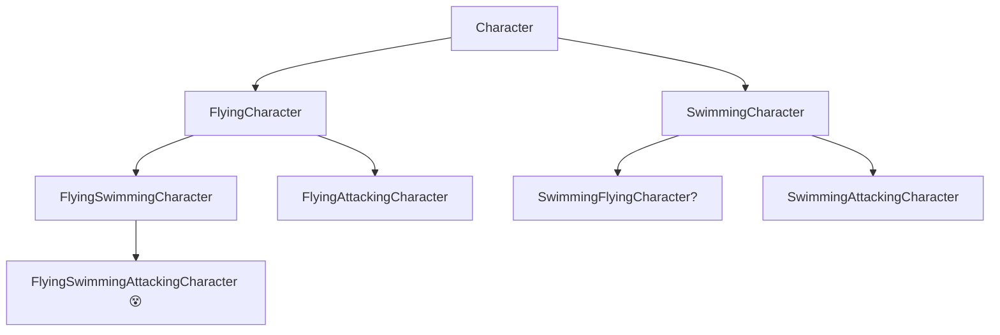

## The big idea

**LEGO** doesn't make a special brick for every possible model. It gives you small, simple bricks that you **combine** into a house, a car or a spaceship.

**Composition** builds objects the same way: an object **has** smaller objects inside it and asks them to do the work. Instead of *being* something through inheritance, it *has* the parts it needs.

> 📘 *"Favor object composition over class inheritance."* This line from the *Design Patterns* book (1994) is still one of the most quoted rules in OOP.


## "Is-a" vs "has-a"

| Test | Relationship | Tool |
| --- | --- | --- |
| A dog **is an** animal | is-a | Inheritance can fit |
| A car **has an** engine | has-a | Composition |
| A user **has a** shopping cart | has-a | Composition |
| A logger **is a** … file? database? console? | It **has a** destination | Composition |

## The problem: the class explosion

Imagine game characters. Some can **fly**, some can **swim**, some can **attack**.



Three abilities already need **seven classes**, and code gets copied between branches because a class can only have one parent. Add a fourth ability and it doubles again.

## The fix: compose abilities

Make each ability a small object. A character **has** a list of abilities.

```ts
interface Movement {
  move(name: string): string;
}

class Fly implements Movement {
  move(name: string) { return `${name} flies through the air`; }
}
class Swim implements Movement {
  move(name: string) { return `${name} swims through the water`; }
}
class Walk implements Movement {
  move(name: string) { return `${name} walks along the ground`; }
}

interface Attack {
  attack(name: string): string;
}
class FireBreath implements Attack {
  attack(name: string) { return `${name} breathes fire 🔥`; }
}
class NoAttack implements Attack {
  attack(name: string) { return `${name} doesn't fight`; }
}

class Character {
  constructor(
    public name: string,
    private movement: Movement,   // has-a
    private weapon: Attack,       // has-a
  ) {}

  move() { return this.movement.move(this.name); }
  attack() { return this.weapon.attack(this.name); }

  // Parts can even be swapped while the program runs
  setMovement(movement: Movement) { this.movement = movement; }
}

const dragon = new Character("Dragon", new Fly(), new FireBreath());
const duck = new Character("Duck", new Swim(), new NoAttack());

dragon.move();   // "Dragon flies through the air"
dragon.attack(); // "Dragon breathes fire 🔥"

duck.setMovement(new Fly()); // the duck takes off
duck.move();     // "Duck flies through the air"
```

A new ability is **one new small class**. No hierarchy to redesign, no duplicated code.

## Real-world example: a report service

```ts
// ❌ Inheritance: a class for every format + destination combination
class PdfEmailReport extends Report {}
class PdfS3Report extends Report {}
class CsvEmailReport extends Report {}
class CsvS3Report extends Report {}
// …and so on
```

```ts
// ✅ Composition: pick a formatter and a destination
interface Formatter { format(rows: object[]): Buffer; }
interface Destination { deliver(file: Buffer, name: string): Promise<void>; }

class ReportService {
  constructor(private formatter: Formatter, private destination: Destination) {}

  async run(rows: object[], name: string) {
    const file = this.formatter.format(rows);
    await this.destination.deliver(file, name);
  }
}

new ReportService(new PdfFormatter(), new EmailDestination("boss@example.com"));
new ReportService(new CsvFormatter(), new S3Destination("reports-bucket"));
```

2 formatters + 2 destinations = **4 small classes** that make every combination. Add a third formatter and you write **one** class, not two more.

## Inheritance vs composition

| | Inheritance | Composition |
| --- | --- | --- |
| Relationship | is-a | has-a |
| Coupling | Tight: the child depends on the parent's internals | Loose: depends only on a part's interface |
| Change at runtime | ❌ Fixed when the class is written | ✅ Swap parts any time |
| Combining features | Hard (one parent only) | Easy (use as many parts as you need) |
| Testing | Must set up the whole parent chain | Pass in fake parts |
| Best for | Small, stable, true "is-a" families | Most everyday code reuse |

## When inheritance is still fine

Composition is the default, not a ban on inheritance. Inheritance works well when:

- the relationship is a true, permanent **"is-a"** (`HttpError extends Error`),
- the hierarchy is **shallow** (one or two levels),
- a framework expects it (`class MyElement extends HTMLElement`, NestJS exception filters).

```ts
// ✅ A perfectly good use of inheritance
class NotFoundError extends Error {
  readonly status = 404;
  constructor(resource: string) {
    super(`${resource} not found`);
    this.name = "NotFoundError";
  }
}
```

## Common mistakes

- **Inheriting just to reuse one helper method.** Move the helper into its own object or a plain function.
- **Composition with no interfaces.** If `Character` creates `new Fly()` inside itself, you can't swap it. Pass the parts in (**dependency injection**).
- **Going too far.** Splitting a 20-line class into eight tiny parts makes it harder to read, not easier.

## Key takeaways

- **Composition** = an object *has* parts and hands work to them.
- Use the **"is-a" vs "has-a"** test to choose.
- Inheritance hierarchies explode when you combine features; composition scales by adding small parts.
- Pass parts in through the constructor so they can be swapped and faked in tests.
- Keep inheritance for small, true "is-a" families.

## Try it yourself

You have `Logger` with subclasses `FileLogger`, `ConsoleLogger`, `JsonFileLogger` and `JsonConsoleLogger`. Redesign it with composition: a `Logger` that **has** a `Formatter` (text or JSON) and a `Sink` (file or console).
